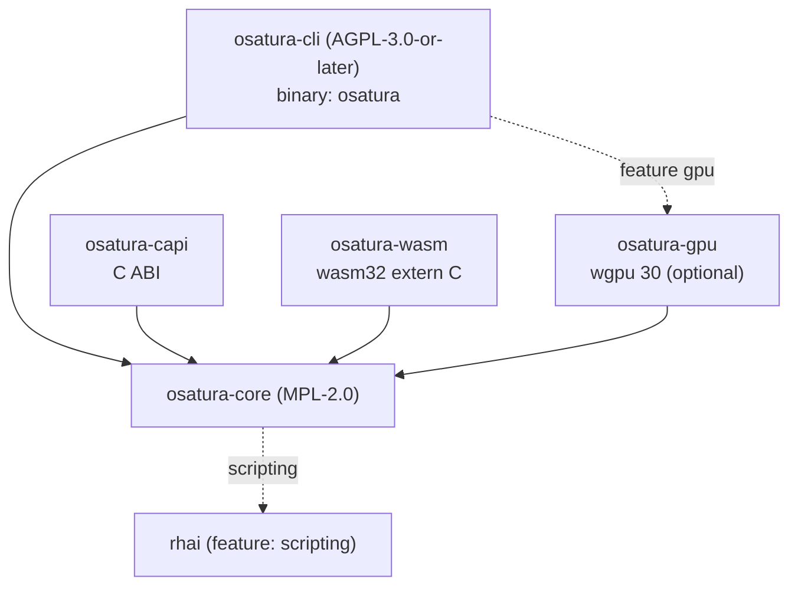

<!-- SPDX-License-Identifier: CC-BY-4.0 -->
<!-- Copyright (c) 2026 Alexandru-Ionuț Chiuță (Alexio) -->

# OSATURA architecture

This document explains how the workspace is organised, how data flows from a project file to
pixels, which guarantees the engine gives and which it does not, and how to extend it. Field-level
detail of the file format is in [PROJECT_FORMAT.md](PROJECT_FORMAT.md). Terms are defined in
[GLOSSARY.md](GLOSSARY.md). The threat model and hardening list are in
[SECURITY.md](SECURITY.md). The public library surface is described in [API.md](API.md).

Contents

1. [Crates and dependency graph](#1-crates-and-dependency-graph)
2. [Data flow](#2-data-flow)
3. [Module map of osatura-core](#3-module-map-of-osatura-core)
4. [The non-destructive bake pattern](#4-the-non-destructive-bake-pattern)
5. [Editor, ops and undo](#5-editor-ops-and-undo)
6. [Determinism: guarantees and limits](#6-determinism-guarantees-and-limits)
7. [Error-handling policy](#7-error-handling-policy)
8. [Security overview](#8-security-overview)
9. [Studio server architecture](#9-studio-server-architecture)
10. [Collaboration architecture](#10-collaboration-architecture)
11. [Performance notes](#11-performance-notes)
12. [Extension guide](#12-extension-guide)
13. [Feature flags](#13-feature-flags)
14. [Build targets](#14-build-targets)

## 1. Crates and dependency graph

| Crate | Licence | Kind | Role |
| --- | --- | --- | --- |
| `osatura-core` | MPL-2.0 | library | Everything that is not a front end: data model, engine, renderers, tools, collaboration core. Default feature `scripting`. |
| `osatura-cli` | AGPL-3.0-or-later | binary `osatura` | Command line, the Studio web server and the collaboration HTTP routes. Depends on core with `default-features = false` and re-exposes `scripting`; optional feature `gpu`. |
| `osatura-capi` | MPL-2.0 | `cdylib`, `staticlib`, `rlib` | C ABI (`osatura.h`, `ABI_VERSION` 1). Depends on core with `default-features = false`. |
| `osatura-wasm` | MPL-2.0 | `cdylib`, `rlib` | Plain `extern "C"` WebAssembly module, no wasm-bindgen. Depends on core with `default-features = false`. |
| `osatura-gpu` | MPL-2.0 | library | Optional wgpu renderer. Depends on core with `default-features = false`. |



```text
            osatura-cli  (AGPL, bin "osatura")
              |        \.........(feature "gpu").........  osatura-gpu
              v                                              |
  osatura-capi --->  osatura-core  <---  osatura-wasm  <--+  (gpu also depends on core)
                          :
                          :.....(feature "scripting")..... rhai
```

Why the licences differ: core is MPL-2.0 so that closed-source applications can embed it through the
library, the C ABI or the WASM module without adopting the AGPL; the command line and the Studio
server are AGPL. Every source file carries an SPDX line equal to its crate's licence; a test
(`osatura-cli/tests/spdx_audit.rs`) and `scripts/licence-audit.sh` check this. See `LICENSING.md`.

Stability: only `osatura_core::api` and `osatura_core::prelude` are the stable surface
(`API_VERSION` 1.4.0). A snapshot test compares the public items to `api_surface.txt`; changing the
surface forces a conscious edit of that file and a version decision.

## 2. Data flow

```text
 project.json
     |
     v   Project::from_json      parse, magnitude check (+-1e7), format gate
 Project (serde structs)
     |
     v   Engine::new / with_asset_dir
     |     validate everything (all problems returned), resolve names to indices,
     |     bake springs, resolve links and containers
 Engine
     |
     v   Engine::evaluate(frame)         pure function of the frame
 Frame  (bones, resolved geometry per node, camera, masks, effects, nonfinite flag)
     |
     +--> svg::      vector text (SVG)
     +--> raster::   tiny-skia, 8-bit RGBA
     +--> fraster::  own f32 scanline rasteriser (HDR / EXR path)
     +--> osatura-gpu  wgpu, stencil-then-cover
     +--> export / gltf / lottie_export / open_formats / ...
```

Entry points that wrap this chain:

- **CLI**: `load` / `load_sized` (reads a file with `--max-input-bytes`), `Engine::with_asset_dir`,
  then the command. Writers call `write_json`, which re-validates through `Engine::new` before
  writing and rewrites asset paths relative to the output.
- **`api::Animation`**: the stable facade used by the C ABI and the WASM module. `check_frame`
  clamps the frame index; `guard()` runs the call under `catch_unwind` and maps a panic to
  `ApiError::Internal`. `Player` adds run-time state machines and bindings on top of an
  `Animation`.
- **Studio**: holds an `Editor` (section 5) inside a handler thread; each request evaluates a frame
  and renders it.

The renderers only see a `Frame`. They never re-run rig logic, so IK, skinning and deformers are
implemented once, in `engine`.

## 3. Module map of osatura-core

`osatura-core/src` has about 100 modules. They are grouped by area. For each module the "basis" is
the public standard, paper or textbook technique recorded in `CLEANROOM.md`; "own design" means the
clean-room log records no outside source. Names ending `_tests` are test modules and are omitted.

### 3.1 Data model and language

**project** defines the serde structs of the file (`Project`, `Bone`, `Layer`, `Channel`, `Camera`
and the rest) and `Project::from_json`, which performs the format gate and the magnitude check.
Own design. **path** holds vector paths, anchors, morphs and bone weights; flattening of Bezier
curves is textbook de Casteljau. **style** has colours, paints, gradients and stroke styles; sRGB
transfer follows IEC 61966-2-1. **anim** has keys, tracks and easing curves; `Bounce` and `Back` are
own derivations from elementary mechanics (CLEANROOM `anim` row); `Smooth` is a non-uniform
Catmull-Rom spline. **math** is 2-D affine algebra. **rig** has bones, FK, the two-bone analytic
IK, FABRIK, soft and stretch IK (own parametrisation) and constraints. **expr** is a small
recursive-descent expression language with a 4096-byte, depth-64 limit. **noise** is hash-based
value noise; the integer finaliser is Chris Wellons' lowbias32 (public domain) with Knuth and
MurmurHash3 constants. **base64** is a plain RFC 4648 codec.

### 3.2 Engine and rendering

**engine** validates the project, evaluates a frame (the order is in PROJECT_FORMAT.md section 16)
and repairs non-finite geometry. **raster** renders a `Frame` with tiny-skia (blend modes, masks,
layer effects, gradients). **fraster** is an own scanline rasteriser in `f32` (16 sub-scanlines,
exact span area, non-zero and even-odd winding) with the W3C Compositing and Blending Level 1
formulas, used by the HDR path. **svg** writes SVG. **hdr** does colour-managed high-precision output: sRGB/linear conversion (IEC 61966-2-1), 16-bit
PNG and OpenEXR (public specification, uncompressed single-part scanlines, IEEE 754 binary16). **postfx** and **fx** hold the post-effect chain (blur, levels,
`relight` with Lambert shading from a normal map, morphological ops; Gaussian blur is separable);
`fx` also builds liquid, boolean and emitter geometry (marching squares, polygon clipping,
closed-form particles). **layerfx** implements layer effects with the semantics of the SVG filter
primitives (`feGaussianBlur`, `feOffset`, `feColorMatrix`, `feMerge`). **dof** is an own layered
circle-of-confusion approximation with Gaussian blur, composed through the engine compositor so
blend modes, masks and layer effects survive. **export** writes animated GIF, the self-contained HTML player and Lottie JSON (MP4 goes through
the user's `ffmpeg` in the CLI);
**animimport**, **seqimport** and **open_formats** read GIF89a, APNG, PNG sequences and
OpenRaster/OCA containers (zip limits enforced). **gltf** writes glTF 2.0 / GLB from the Khronos
specification (ear-clipping triangulation). **lottie_export** and **lottie_import** map to the
public Lottie JSON layout (subset, with warnings). **importers** reads SVG 1.1 path grammar, BVH and
plain-text cue sheets.

### 3.3 Audio and speech

**soundtrack** places sounds on the timeline and builds an ffmpeg filter graph (atrim, afade,
adelay, amix) for the user's own ffmpeg; trim and fade values are seconds. **audio** is audio-driven
lip-sync: an amplitude and zero-crossing heuristic (not phoneme recognition) that picks one of five
mouth shapes per frame. **audiomap** turns audio into envelopes and onsets (RMS with one-pole attack/release; onset energy
against a moving average). **speech** does voice-activity detection, forced alignment by dynamic
programming (Viterbi) against a duration prior, and letter-to-mouth rules that drive switch layers.

### 3.4 Deformation and geometry processing

**cage** is the mean-value-coordinate cage deformer (M. S. Floater, CAGD 20(1), 2003). **pinwarp**
is the pin warp using the Wendland 1995 compactly supported radial basis function solved by
Gauss-Jordan elimination. **cloth** and **physics** use position-based dynamics with Verlet
integration (textbook) for cloth surfaces, strips and colliders; results are baked. **warp** holds editing operations on deformer
control points: pivots, proportional (soft) scaling and whole-mesh resize. **weights** computes bone weights by Laplace/heat
diffusion with Gauss-Seidel iteration. **meshtrace** builds meshes from raster shapes: marching
squares, Douglas-Peucker, Bridson Poisson-disc sampling, Bowyer-Watson Delaunay triangulation and
Laplacian/Taubin smoothing. **trace** vectorises bitmaps (marching squares and
Ramer-Douglas-Peucker). **autotrace** adds k-means (Lloyd 1982, k-means++), median cut, Suzuki-Abe
border following, Zhang-Suen thinning, Otsu thresholding and Borgefors chamfer distance. **links**
resolves mesh locks and glues (barycentric coordinates, Kahn topological sort).

### 3.5 Rigging helpers and animation tools (bake producers)

**autorig** and **vocab** name-match anatomy words to build a basic rig with a two-bone IK at mix 0,
a looped breath and a seeded blink. **rigedit** edits the rest pose. **eyeclip** adds ordinary masks
to eye layers. **parentswitch** re-parents with affine algebra (`relative = parent^-1 * child`) and
bakes keys. **stretch** is textbook 2-D aim plus distance scaling. **footlock** and **magnet**
correct positions by contact detection and smoothstep falloff. **pathfollow** samples flattened
Bezier by arc length and bakes keys. **drivers** maps a controller to poses by piecewise-linear
interpolation. **procgen** and **looper** generate idle motion and fix loops (linear detrending).
**springfit** fits second-order spring parameters. **clipstack** is the layered clip stack with
replace, additive and multiply blending, smoothstep fades and glob masks. **skins** are named layer
groups. **camshots** keyframes camera shots. **comps** stores layer-state snapshots. **bonevis**
and **chanmeta** hold editor metadata. **depth** spreads the `parallax` factor of top-level layers from far to near for a multiplane camera.
**motionlib** copies key ranges with renaming and time scaling. **anim_tools**, **keyops**,
**timeline** and **timeline_graph** implement dope-sheet maths (translate, scale about a pivot,
ripple), Hermite to Bezier conversion and the Fritsch-Carlson monotone limiter.

### 3.6 Interactive runtime

**machine** is the runtime state machine (own design: finite-state machine, 1-D blend tree, easing
cross-fade). **binding** maps external data to properties (affine remap, one-pole smoothing).
**statemachine** is the earlier event-log state machine with baking. **containers**
implements flexbox-style one-dimensional distribution, pin and aspect rectangles and the elastic
scroll (damped spring, semi-implicit Euler). **layout** has align and distribute helpers and a
baked trim-path operation (bounding boxes of flattened curves, arc-length sampling). **liveinput** and **midi** parse MIDI 1.0 messages and
Standard MIDI Files and record live input. **perf** turns recorded samples into minimal keys, maps input signals (sliders, MIDI, audio level)
onto parameters and retargets motion by limb reach. **faceparam**
computes eye aspect ratio (Soukupova and Cech 2016) and the One-Euro filter (Casiez, Roussel and
Vogel, CHI 2012). **facedet** and **facegen** are a small face detector trained on synthetic faces
(HOG features after Dalal and Triggs 2005, logistic regression, supervised descent). **mocap** reads
BVH. **posesuggest**, **posematch** and **tinymlp** are classical local ML assist with a
(mu/mu_w, lambda) evolution strategy (Beyer and Schwefel 2002) and no bundled model weights.

### 3.7 Editor and collaboration

**edit** is the `Editor` with ops and undo. **pick** and **gizmo** do hit testing (winding number,
distance to segment) and transform handles (QR decomposition of a 2 by 2 matrix). **overlays** and
**scrub** produce onion skins, motion trails and a revision-keyed LRU frame cache with a proxy
worker. **collab**, **collabhub** and **collablog** are the CRDT replica, the sequencer and the
persistent log (section 10). **script** and **scriptops** expose a sandboxed Rhai API (feature
`scripting`). **agent** is a JSON-RPC 2.0 / MCP-shaped tool server for a single project.
**snapshots** keeps numbered project copies with duplicate suppression and pruning (a counter, no
clock, so it behaves the same everywhere) for crash recovery. **explain** gives an ordered account of everything that determines a bone's or layer's value at a
frame; **inspect** has statistics, semantic diff and golden-frame regression hashes (exact FNV-1a
per frame plus a 16 by 16 thumbnail).

### 3.8 Quality, size and version control

**lint** checks animation heuristics (codes L001 and up). **safety** checks flash and red-flash
thresholds after WCAG 2.3.1 using relative luminance. **ci** and **percep** implement animation CI:
CIE76 and CIEDE2000 (CIE TR 142-2001, formulae as printed in Sharma, Wu and Dalal 2005), block SSIM
(Wang et al. 2004), a DCT perceptual hash, PSNR. **fuzz** stresses poses (SplitMix64, Latin
hypercube, Halton sequences, 2 by 2 deformation gradient, ddmin). **sizefit** fits output to a byte
budget (median cut, Floyd-Steinberg, RDP with a repair loop). **lod** produces levels of detail with
a declared error bound (Douglas-Peucker 1973, Visvalingam-Whyatt 1993, Schneider's least-squares
Bezier fit, Garland-Heckbert quadric error metrics, discrete Frechet distance after Eiter and
Mannila). **semdiff** and **vcs** are semantic diff and a content-addressed version control (Merkle
DAG, SHA-256 per FIPS 180-4, diff3 after Khanna, Kunal and Pierce 2007). **unknownfields**
detects ignored JSON keys. **assets** and **fsutil** enforce path and size rules for files.
**api** is the stable facade; **demo** builds the demo project; **robustness** and **fuzz** hold
tests and generators that keep input handling panic-free.

## 4. The non-destructive bake pattern

Many tools compute something over time: physics, magnet, footlock, stretch, path following, procedural
generation, clip stack, camera shots, skins, drivers, state-machine and live-input baking, and
more. They all do the same thing:

1. Read the project and evaluate it as it is.
2. Compute new values per frame.
3. Append **ordinary channels** to `project.channels` (default merge mode `keep`).
4. Leave the original animation untouched.

Because the output is plain channels, it needs no special format, runs in every renderer, and can be
edited by hand. The rules every baker follows:

- Never delete hand-made keys. Appended `replace` channels override earlier angle keys at
  evaluation time; removing the baked channel restores the original.
- Be lock-aware: channels covered by `channel_meta` `lock`, and layers with `locked`, are skipped.
- Be idempotent where a baker can recognise its own output. The clip stack snapshots what it baked
  in `clip_baked` and replaces exactly that on a re-bake.
- Stay deterministic: seeded RNGs and fixed iteration counts.

Run-time features follow the same idea on export. A Player's machine states and bindings are
turned into constant `replace` channels appended to the project, so an exported file does not need
the runtime.

## 5. Editor, ops and undo

`edit.rs` defines `Editor`, which owns a `Project` and all edit history.

- An `Op` is one of `set`, `insert`, `remove` or `batch`, addressing the project's JSON by RFC 6901
  pointer. `raw_apply` applies an op and returns its **inverse**.
- Each `apply` runs the op, then rebuilds a full `Engine` from the new JSON. If validation fails the
  op is rolled back and the error list is returned, so the editor cannot hold an invalid project.
- Undo and redo stacks hold inverse ops. A revision counter increments on every change; caches
  (scrub frames, proxies) key on it.
- High-level operations (`set_key`, move, delete, add container, and so on) are built from ops. They
  call `assert_unlocked` first, so `locked` layers and locked channels resist editor operations;
  plain `Op`s bypass that check, because they are the low-level layer.
- `replace_doc` swaps in a whole document (used by collaboration) and clears history.

Because everything is expressed as JSON-pointer ops, the same representation serves undo, the
collaboration CRDT (section 10), the scripting API and the agent server.

## 6. Determinism: guarantees and limits

What is guaranteed:

- `Engine::evaluate(frame)` is a pure function of the project and the frame number. Springs are
  simulated at load; noise is hash-based; particles are closed-form functions of time; RNGs are
  seeded; cloth and physics are baked.
- Evaluating frames in any order, or twice, gives identical results.
- Rendering the same frame twice on one machine with one build gives byte-identical output. CI
  includes a determinism check for this.

What is not guaranteed:

- Equality across operating systems, CPUs or compiler versions has not been verified. Differences in
  `libm`, fused multiply-add and SIMD code paths may move anti-aliased edge pixels.
- The GPU renderer is outside the exact-hash harness; it matches the CPU renderer only within a
  tolerance (see ROADMAP, section 9).
- The animation CI uses a perceptual tolerance rather than exact hashes for that reason.

Threads: engine evaluation is single-threaded. Threads exist in the face detector (scoped), the
scrub/LOD proxy worker, `sizefit`, and the Studio HTTP server. None of them changes results of
evaluation.

## 7. Error-handling policy

- Input must never cause a panic. Robustness tests and the fuzz generators exercise this, and the
  facade, the C ABI and the WASM entry points wrap calls in `catch_unwind`.
  On `wasm32-unknown-unknown` the default is `panic=abort`, so `catch_unwind` has no effect there;
  that module relies on validation instead.
- Validation returns **all** problems as `Err(Vec<String>)` so a user can fix a file in one pass.
- Messages are for people; do not parse them. Tests that need stability match on distinctive
  fragments.
- Everything that grows with input has a cap: JSON bytes, bones, mesh vertices, effects per layer,
  image sides and pixels, frames times anchors, container members, HTTP header and body sizes. The
  numbers are in PROJECT_FORMAT.md section 12 and section 18.
- Non-finite values are contained rather than propagated: channels skip them, `repair_nonfinite`
  hides a bad node, and `Frame.nonfinite` tells callers. `evaluate_checked` and
  `check_all_frames_finite` turn that into an error for batch tools.
- The C ABI stores the last error in thread-local storage and returns codes; it never unwinds across
  the boundary.

## 8. Security overview

The short version: OSATURA reads untrusted JSON and asset files, and the Studio listens on a
network socket. Defences are layered: strict loading limits (magnitude, size, count caps), path
confinement for assets, a std-only HTTP server with
deadlines and host/origin checks, token authentication for collaboration, and a sandboxed scripting
engine with explicit limits. The threat model and the hardening measures are in [SECURITY.md](SECURITY.md).

## 9. Studio server architecture

`osatura studio` serves a single HTML page (`studio.html`) and a JSON API from one process.

```text
 browser  <--HTTP/1.1-->  http.rs  (accept loop; bounded connection threads, I/O only)
                             |  parsed request over a channel
                             v
                       handler thread  (single owner of the Editor and caches)
                             |   studio.rs  ~52 /api routes
                             |   uiconfig.rs  command registry, key map
                             |   collab_srv.rs  /api/collab/* routes
                             v
                      osatura-core: Editor, Engine, raster, svg, scrub, collab
```

- **http.rs** is a std-only HTTP/1.1 server (the earlier `tiny_http` dependency was removed after a
  security review). Connection threads are bounded in number and only read and write sockets; they
  hand requests to the single handler thread, which owns the `Editor`. So no lock protects project
  state and no two requests mutate it at once.
- Limits and responses: read and write deadlines (408), size limits (413), connection cap (503),
  `Connection: close` on every response. Responses carry a Content-Security-Policy,
  `X-Content-Type-Options: nosniff`, `X-Frame-Options` and `Referrer-Policy`.
- **Network exposure**: the default bind is `127.0.0.1`. Any other bind requires a token. A Host
  allow-list defends against DNS rebinding, and POST requests need a same-origin check.
- **studio.rs** implements about 52 `/api` routes (editing, undo and redo, frame rendering, proxies,
  picking and gizmos, overlays, imports and exports, LOD background builds). **uiconfig.rs** holds the command registry: ids, titles, default key map,
  preset panel arrangements.
- The page is served from memory. A `/source` route offers the corresponding source, in line with
  the AGPL.
- **Proxies**: while scrubbing the page asks for a reduced-detail picture (`LodProxy`, built by a
  background worker) and requests full quality on release.

## 10. Collaboration architecture

Multi-user editing is built in three layers, all deterministic and testable without a network.

**collab.rs, the replica.** A CRDT over the project's JSON. An object key is a last-writer-wins
register. An array is an RGA (replicated growable array, Roh et al. 2011) with tombstones, and removal
wins over concurrent edits. Ordering uses Lamport clocks (Lamport 1978) and vector clocks (Fidge,
Mattern). Changes travel as an `Envelope { replica, seq, lamport, deps, ops }`. Delivery is causal
(an envelope waits until its dependencies have been applied) and idempotent (re-delivery has no
effect). Each user has an undo stack that inverts only their own ops. `compaction` discards
tombstones that every replica has seen. The design follows Shapiro et al. 2011 (operation-based
CRDTs).

**collabhub.rs, the sequencer.** One authoritative `Hub` owns the main replica. Users are either
*Thin* (a proxy replica kept by the hub, for browsers) or *Replica* (their own replica). The hub
validates the merged JSON with a caller-supplied closure, so a merge that would produce an
invalid project is rejected. It also tracks presence (cursors, selections) and an event stream
(server-sent events). Limits: 32 users (`MAX_USERS`), and users idle for 10 minutes are dropped.

**collablog.rs, persistence.** A line-oriented JSON log. Each record is chained to the previous by a
hash (FNV-1a 64-bit in version 1, SHA-256 in version 2) so damage is detected; writes use
`fdatasync` when `--collab-log` is set.

**collab_srv.rs (CLI), the HTTP side.** Routes under `/api/collab/`: `join`, `leave`, `state`, `log`,
`ops`, `undo`, `redo`, `presence`, `compact`, `events`. Authentication: a token of at least 16
characters, sent in the `X-Collab-Token` header or the `arm_token` cookie (set by `/api/login`),
compared in constant time, with a rate limit that answers 429. Each participant also gets a secret
(`X-Collab-Secret`) so one user cannot act as another. The transport is plain HTTP without TLS:
put a TLS-terminating proxy in front for anything beyond a trusted network.

`osatura collab-sim` runs many simulated clients against a hub in-process, which is how convergence
is tested.

## 11. Performance notes

Numbers below are the measurements recorded in `ROADMAP.md` section 9. They are reproduced, not
re-measured here. Treat them as orders of magnitude for the stated machine and build.

| Measurement | Result |
| --- | --- |
| 640x480 demo, release build, one thread, mean of 48 frames: raster level 0 | 14.4 ms per frame |
| same, proxy level 1 / level 2 / level 4 | 3.5 ms / 0.7 ms / 0.09 ms |
| SVG writer; simplified SVG | 0.17 ms; 0.10 to 0.15 ms |
| 671-layer synthetic project, raster level 0 vs level 2 | 1832 ms vs 106 ms |
| browser decode of that project: full SVG, proxy 2, proxy 4 | 45 ms, 28 ms, 25 ms |
| cache hit in the scrub cache | about 0.002 ms |
| GPU renderer on Mesa llvmpipe (software, not a real GPU), scale 1 | 253 to 295 ms per frame (GL 253, Vulkan 295) against 13.8 ms for tiny-skia |
| same, scale 2 | 1260 ms against 56 ms |
| Studio proxy test (debug build): bitmap, vector | 51.6 to 34.2 ms; 2.12 to 0.30 ms |
| LOD background build, debug build | 19.5 s |
| end-to-end suite | about 19 s debug, about 40 s release |
| face detector training, 2 cores | 91 s; 99.3 percent of boxes found |
| LOD demo, declared vs measured error (px) | 0.104/0.386/0.928/1.537/1.657 vs 0.099/0.334/0.819/1.337/1.337 |

Reading these: the vector path is cheap, so a proxy gives little benefit in the browser for small
projects but a large one for bitmap rendering and for projects with hundreds of layers. The GPU
figures say nothing about hardware performance; no hardware adapter was available. LOD levels never
exceed their declared error, and the measured error sits under the declared bound.

Practical notes: evaluation cost grows with channels, bones and deformer sizes; rendering cost grows
with resolution, effects (each one uses an offscreen layer) and masks. Use `--proxy N` or LOD levels
while scrubbing, and the full renderer for final output.

## 12. Extension guide

General rules for any change:

- Every new source file starts with the SPDX line of its crate and the copyright line. A test fails
  otherwise.
- New input must have caps, and new validation messages must list problems rather than stop at the
  first one.
- Anything new that uses an outside method or standard must be recorded in `CLEANROOM.md`
  (see its rules and the optional spec-note template).
- Update `PROJECT_FORMAT.md` when the file changes and `API.md` when the facade changes.

### 12.1 Add a layer property

Example: a new per-layer number.

1. Add the field to `Layer` in `osatura-core/src/project.rs` with
   `#[serde(default = "...", skip_serializing_if = "...")]`, so old files load unchanged and defaults
   are not written back. Adding an optional field does not change `FORMAT_VERSION`.
2. Add validation in `Engine::new` (finite, range) with a message that names the layer.
3. If it is animatable, add a `Prop` variant, its `target_kind` mapping, the write clamp, the
   initial value in `initial_state`, and the `apply_channels` case. If it uses a sub-target, extend the
   `layer::sub` resolver.
4. Use it in `evaluate`, and in the renderers that care (`svg`, `raster`, `fraster`, GPU) so they
   agree.
5. Check the exporters (`lottie_export`, `gltf`, ...) either map it or report that they drop it.
6. Tests:
   - a serde round trip that proves the default is omitted;
   - a validation test for each rule, with the failure message;
   - an evaluation test, including a channel that animates it;
   - the unknown-field check (`unknownfields`) must not flag the new field;
   - robustness: NaN, infinity and 1e7 limits (add it to the existing robustness tests);
   - the `api_surface.txt` snapshot, if a public type changed.
7. Document it in PROJECT_FORMAT.md (name, type, default, range, semantics, example).

### 12.2 Add a CLI command

1. Write the logic in `osatura-core` as a function with typed input and `Result<_, String>` or an
   error list; the CLI should only parse flags and print. This keeps the logic usable from the C ABI,
   WASM and the Studio.
2. In `osatura-cli/src/usage.rs`, add a `USAGE` entry. `usage_for`, `documented_options` and
   `check_flags` read it, and a test compares USAGE with the parser, so a flag that the parser
   accepts but USAGE does not mention fails the test.
3. Register options that take a value in `VALUE_OPTS` (or the per-command `takes_value` table).
4. Add a match arm in `run` (it dispatches on `match pos.as_slice()`).
5. Read projects through `load` or `load_sized` so size limits and asset confinement apply.
6. Write projects through `write_json` (re-validates and rewrites asset paths). If the command writes
   a different kind of file than the input, call `guard_out` so a mistyped output path cannot
   overwrite the input project.
7. Tests in `osatura-cli/tests/`: `e2e.rs` for the happy path, `robust.rs` for hostile input,
   `fixes.rs` or `wave4.rs` for regressions; `scripts/e2e.sh` runs the whole flow.
8. Document it in the command reference.

### 12.3 Add an exporter

1. Put the writer in `osatura-core` (for example next to `export.rs`, `gltf.rs` or
   `lottie_export.rs`). It takes an `Engine` or `Project`, evaluates frames through
   `evaluate_checked`, and must not read private state.
2. Decide and document what it cannot represent. Emit warnings, not guesses, for dropped features.
3. Apply caps: frames times anchors (40 million budget), image sides (16384) and pixels, output size.
4. Never overwrite the input: use `guard_out` in the CLI.
5. Tests: output parses with an independent reader or the module's own importer (a round trip);
   determinism (same input, same bytes); a hostile-project test that expects an error, not a panic;
   and a golden or hash test on the demo project. State in the module comment whether an
   independent player has verified the output (the Lottie exporter, for instance, notes that this check
   is outstanding).
6. Add the wiring (CLI command, optional facade function, Studio route) and the provenance row in
   CLEANROOM.md.

## 13. Feature flags

| Crate | Feature | Default | Effect |
| --- | --- | --- | --- |
| `osatura-core` | `scripting` | on | Builds the Rhai scripting API (`script`, `scriptops`). Pulls `rhai` and its dependency `smartstring` (MPL-2.0). |
| `osatura-cli` | `scripting` | on | Enables `osatura-core/scripting` and the `script` command. `--no-default-features` drops it. |
| `osatura-cli` | `gpu` | off | Pulls in `osatura-gpu` and adds the `render-gpu` command. Kept off so ordinary builds stay small. |

`osatura-capi`, `osatura-wasm` and `osatura-gpu` use core with `default-features = false`, so they
do not carry the scripting engine.

## 14. Build targets

| Target | Command | Notes |
| --- | --- | --- |
| CLI and Studio | `cargo build -p osatura-cli` (add `--release` for speed) | Binary `osatura`. |
| CLI with GPU | `cargo build -p osatura-cli --features gpu` | wgpu 30 with Vulkan and GL only. Verified only on Mesa llvmpipe. |
| Library | `cargo build -p osatura-core` | Rust API. |
| C library | `cargo build -p osatura-capi` | `cdylib`, `staticlib` and the header `osatura-capi/osatura.h`; `ABI_VERSION` 1. |
| WebAssembly | `osatura-wasm/build-wasm.sh` (needs `rustup target add wasm32-unknown-unknown`) | Plain extern "C" interface, with `index.html` and `js/` helpers. The authoring environment could not install the target; the module is built (release profile) by `.github/workflows/release.yml` and a debug build is tested under Node by `ci.yml`. The script itself is not what CI runs. |
| Window app (Windows, macOS) | `cargo build --release -p osatura-gui` | Binary `osatura-studio`: `tao` window + `wry` web view around the studio; a stub on Linux. |
| Tests | `cargo test --workspace` | End-to-end shell flow in `scripts/e2e.sh`; licence audit in `scripts/licence-audit.sh`. |

The workspace's default members do not include `osatura-gpu`.
