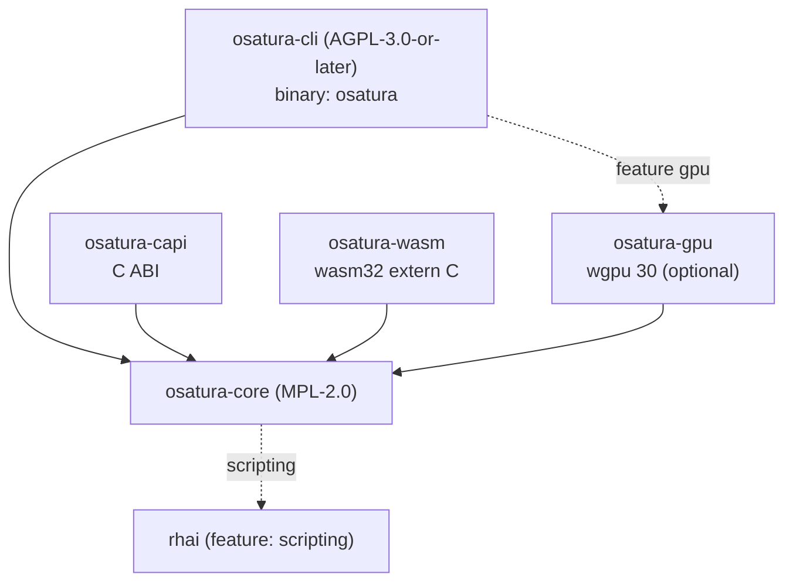

<!-- SPDX-License-Identifier: CC-BY-4.0 -->
<!-- Copyright (c) 2026 Alexandru-Ionuț Chiuță (Alexio) -->

# OSATURA-Architektur

Dieses Dokument erklärt, wie der Workspace organisiert ist, wie Daten von einer Projektdatei zu
Pixeln fließen, welche Garantien die Engine gibt und welche nicht, und wie man sie erweitert. Details
des Dateiformats auf Feldebene stehen in [PROJECT_FORMAT.md](PROJECT_FORMAT.md). Begriffe sind in
[GLOSSARY.md](GLOSSARY.md) definiert. Das Bedrohungsmodell und die Härtungsliste stehen in
[SECURITY.md](SECURITY.md). Die öffentliche Bibliotheksoberfläche ist in [API.md](API.md) beschrieben.

Inhalt

1. [Crates und Abhängigkeitsgraph](#1-crates-und-abhängigkeitsgraph)
2. [Datenfluss](#2-datenfluss)
3. [Modulübersicht von osatura-core](#3-modulübersicht-von-osatura-core)
4. [Das nicht-destruktive Bake-Muster](#4-das-nicht-destruktive-bake-muster)
5. [Editor, Ops und Undo](#5-editor-ops-und-undo)
6. [Determinismus: Garantien und Grenzen](#6-determinismus-garantien-und-grenzen)
7. [Richtlinie zur Fehlerbehandlung](#7-richtlinie-zur-fehlerbehandlung)
8. [Sicherheitsüberblick](#8-sicherheitsüberblick)
9. [Architektur des Studio-Servers](#9-architektur-des-studio-servers)
10. [Architektur der Zusammenarbeit](#10-architektur-der-zusammenarbeit)
11. [Hinweise zur Performance](#11-hinweise-zur-performance)
12. [Leitfaden zur Erweiterung](#12-erweiterungsleitfaden)
13. [Feature-Flags](#13-feature-flags)
14. [Build-Ziele](#14-build-ziele)

## 1. Crates und Abhängigkeitsgraph

| Crate | Lizenz | Art | Rolle |
| --- | --- | --- | --- |
| `osatura-core` | MPL-2.0 | Bibliothek | Alles, was kein Frontend ist: Datenmodell, Engine, Renderer, Werkzeuge, Kern der Zusammenarbeit. Standard-Feature `scripting`. |
| `osatura-cli` | AGPL-3.0-or-later | Binary `osatura` | Kommandozeile, der Studio-Webserver und die HTTP-Routen der Zusammenarbeit. Hängt von core mit `default-features = false` ab und exponiert `scripting` erneut; optionales Feature `gpu`. |
| `osatura-capi` | MPL-2.0 | `cdylib`, `staticlib`, `rlib` | C-ABI (`osatura.h`, `ABI_VERSION` 1). Hängt von core mit `default-features = false` ab. |
| `osatura-wasm` | MPL-2.0 | `cdylib`, `rlib` | Reines `extern "C"`-WebAssembly-Modul, ohne wasm-bindgen. Hängt von core mit `default-features = false` ab. |
| `osatura-gpu` | MPL-2.0 | Bibliothek | Optionaler wgpu-Renderer. Hängt von core mit `default-features = false` ab. |



```text
            osatura-cli  (AGPL, bin "osatura")
              |        \.........(feature "gpu").........  osatura-gpu
              v                                              |
  osatura-capi --->  osatura-core  <---  osatura-wasm  <--+  (gpu also depends on core)
                          :
                          :.....(feature "scripting")..... rhai
```

Warum sich die Lizenzen unterscheiden: core steht unter MPL-2.0, damit Closed-Source-Anwendungen es über die
Bibliothek, die C-ABI oder das WASM-Modul einbetten können, ohne die AGPL zu übernehmen; die Kommandozeile und der Studio-
Server stehen unter der AGPL. Jede Quelldatei trägt eine SPDX-Zeile, die der Lizenz ihres Crates entspricht; ein Test
(`osatura-cli/tests/spdx_audit.rs`) und `scripts/licence-audit.sh` prüfen das. Siehe `LICENSING.md`.

Stabilität: Nur `osatura_core::api` und `osatura_core::prelude` bilden die stabile Oberfläche
(`API_VERSION` 1.4.0). Ein Snapshot-Test vergleicht die öffentlichen Items mit `api_surface.txt`; eine Änderung der
Oberfläche erzwingt eine bewusste Bearbeitung dieser Datei und eine Versionsentscheidung.

## 2. Datenfluss

```text
 project.json
     |
     v   Project::from_json      parse, magnitude check (+-1e7), format gate
 Project (serde structs)
     |
     v   Engine::new / with_asset_dir
     |     validate everything (all problems returned), resolve names to indices,
     |     bake springs, resolve links and containers
 Engine
     |
     v   Engine::evaluate(frame)         pure function of the frame
 Frame  (bones, resolved geometry per node, camera, masks, effects, nonfinite flag)
     |
     +--> svg::      vector text (SVG)
     +--> raster::   tiny-skia, 8-bit RGBA
     +--> fraster::  own f32 scanline rasteriser (HDR / EXR path)
     +--> osatura-gpu  wgpu, stencil-then-cover
     +--> export / gltf / lottie_export / open_formats / ...
```

Einstiegspunkte, die diese Kette umhüllen:

- **CLI**: `load` / `load_sized` (liest eine Datei mit `--max-input-bytes`), `Engine::with_asset_dir`,
  dann der Befehl. Writer rufen `write_json` auf, das vor dem Schreiben über `Engine::new` erneut validiert
  und Asset-Pfade relativ zur Ausgabe umschreibt.
- **`api::Animation`**: die stabile Fassade, die von der C-ABI und dem WASM-Modul verwendet wird. `check_frame`
  begrenzt den Frame-Index; `guard()` führt den Aufruf unter `catch_unwind` aus und bildet eine Panic auf
  `ApiError::Internal` ab. `Player` ergänzt Laufzeit-Zustandsautomaten und Bindings auf einer
  `Animation`.
- **Studio**: hält einen `Editor` (Abschnitt 5) in einem Handler-Thread; jede Anfrage wertet einen Frame aus
  und rendert ihn.

Die Renderer sehen nur einen `Frame`. Sie führen die Rig-Logik nie erneut aus, daher sind IK, Skinning und Deformer
nur einmal implementiert, in `engine`.

## 3. Modulübersicht von osatura-core

`osatura-core/src` hat etwa 100 Module. Sie sind nach Bereichen gruppiert. Bei jedem Modul ist die „Basis“ die
öffentliche Norm, das Paper oder die Lehrbuchtechnik, die in `CLEANROOM.md` festgehalten ist; „eigenes Design“ bedeutet, dass das
Clean-Room-Protokoll keine externe Quelle verzeichnet. Namen, die auf `_tests` enden, sind Testmodule und werden weggelassen.

### 3.1 Datenmodell und Sprache

**project** definiert die serde-Structs der Datei (`Project`, `Bone`, `Layer`, `Channel`, `Camera`
und den Rest) und `Project::from_json`, das das Format-Gate und die Größenprüfung durchführt.
Eigenes Design. **path** enthält Vektorpfade, Anker, Morphs und Bone-Gewichte; die Glättung von Bézier-
Kurven ist das Lehrbuchverfahren von de Casteljau. **style** hat Farben, Paints, Verläufe und Strichstile; die sRGB-
Übertragung folgt IEC 61966-2-1. **anim** hat Keys, Tracks und Easing-Kurven; `Bounce` und `Back` sind
eigene Herleitungen aus der elementaren Mechanik (CLEANROOM-Zeile `anim`); `Smooth` ist ein nicht uniformer
Catmull-Rom-Spline. **math** ist 2D-affine Algebra. **rig** hat Bones, FK, die analytische Zwei-Bone-
IK, FABRIK, Soft- und Stretch-IK (eigene Parametrisierung) und Constraints. **expr** ist eine kleine
Recursive-Descent-Ausdruckssprache mit einer Grenze von 4096 Byte und Tiefe 64. **noise** ist hashbasiertes
Value Noise; der Integer-Finalizer ist lowbias32 von Chris Wellons (Public Domain) mit Konstanten von Knuth und
MurmurHash3. **base64** ist ein schlichter RFC-4648-Codec.

### 3.2 Engine und Rendering

**engine** validiert das Projekt, wertet einen Frame aus (die Reihenfolge steht in PROJECT_FORMAT.md Abschnitt 16)
und repariert nicht endliche Geometrie. **raster** rendert einen `Frame` mit tiny-skia (Blend-Modi, Masken,
Ebeneneffekte, Verläufe). **fraster** ist ein eigener Scanline-Rasterisierer in `f32` (16 Sub-Scanlines,
exakte Spanfläche, Non-Zero- und Even-Odd-Windung) mit den Formeln aus W3C Compositing and Blending Level 1,
verwendet vom HDR-Pfad. **svg** schreibt SVG. **hdr** erzeugt farbverwaltete hochpräzise Ausgabe: sRGB-/Linear-Umrechnung (IEC 61966-2-1), 16-Bit-
PNG und OpenEXR (öffentliche Spezifikation, unkomprimierte einteilige Scanlines, IEEE 754 binary16). **postfx** und **fx** enthalten die Post-Effekt-Kette (Blur, Levels,
`relight` mit Lambert-Shading aus einer Normal Map, morphologische Operationen; der Gaußsche Blur ist separierbar);
`fx` baut außerdem Liquid-, Boolean- und Emitter-Geometrie (Marching Squares, Polygon-Clipping,
geschlossene Partikelformeln). **layerfx** implementiert Ebeneneffekte mit der Semantik der SVG-Filter-
Primitive (`feGaussianBlur`, `feOffset`, `feColorMatrix`, `feMerge`). **dof** ist eine eigene geschichtete
Zerstreuungskreis-Näherung mit Gaußschem Blur, zusammengesetzt über den Engine-Compositor, sodass
Blend-Modi, Masken und Ebeneneffekte erhalten bleiben. **export** schreibt animiertes GIF, den eigenständigen HTML-Player und Lottie-JSON (MP4 läuft in der CLI über
das `ffmpeg` des Nutzers);
**animimport**, **seqimport** und **open_formats** lesen GIF89a, APNG, PNG-Sequenzen und
OpenRaster-/OCA-Container (Zip-Grenzen werden durchgesetzt). **gltf** schreibt glTF 2.0 / GLB nach der Khronos-
Spezifikation (Triangulierung per Ear Clipping). **lottie_export** und **lottie_import** bilden auf das
öffentliche Lottie-JSON-Layout ab (Teilmenge, mit Warnungen). **importers** liest die SVG-1.1-Pfadgrammatik, BVH und
Klartext-Cue-Sheets.

### 3.3 Audio und Sprache

**soundtrack** platziert Sounds auf der Timeline und baut einen ffmpeg-Filtergraphen (atrim, afade,
adelay, amix) für das eigene ffmpeg des Nutzers; Trim- und Fade-Werte sind Sekunden. **audio** ist audiogesteuerte
Lippensynchronisation: eine Heuristik aus Amplitude und Nulldurchgängen (keine Phonemerkennung), die pro Frame eine von fünf
Mundformen auswählt. **audiomap** wandelt Audio in Hüllkurven und Onsets um (RMS mit One-Pole-Attack/Release; Onset-Energie
gegen einen gleitenden Mittelwert). **speech** macht Voice-Activity-Detection, erzwungene Ausrichtung per dynamischer
Programmierung (Viterbi) gegen ein Dauer-Prior und Buchstaben-zu-Mund-Regeln, die Switch-Ebenen ansteuern.

### 3.4 Deformation und Geometrieverarbeitung

**cage** ist der Cage-Deformer mit Mean-Value-Koordinaten (M. S. Floater, CAGD 20(1), 2003). **pinwarp**
ist der Pin-Warp mit der kompakt getragenen radialen Basisfunktion von Wendland 1995, gelöst per
Gauß-Jordan-Elimination. **cloth** und **physics** verwenden Position-Based Dynamics mit Verlet-
Integration (Lehrbuch) für Stoffflächen, Streifen und Collider; die Ergebnisse werden gebacken. **warp** enthält Bearbeitungsoperationen für die Kontrollpunkte von Deformern:
Pivots, proportionale (weiche) Skalierung und Größenänderung des ganzen Meshes. **weights** berechnet Bone-Gewichte per Laplace-/Wärme-
diffusion mit Gauß-Seidel-Iteration. **meshtrace** baut Meshes aus Rasterformen: Marching
Squares, Douglas-Peucker, Poisson-Disc-Sampling nach Bridson, Delaunay-Triangulierung nach Bowyer-Watson und
Laplace-/Taubin-Glättung. **trace** vektorisiert Bitmaps (Marching Squares und
Ramer-Douglas-Peucker). **autotrace** ergänzt k-Means (Lloyd 1982, k-means++), Median Cut, Suzuki-Abe-
Randverfolgung, Zhang-Suen-Ausdünnung, Otsu-Schwellenwert und Borgefors-Chamfer-Distanz. **links**
löst Mesh-Locks und Glues auf (baryzentrische Koordinaten, topologische Sortierung nach Kahn).

### 3.5 Rigging-Helfer und Animationswerkzeuge (Bake-Erzeuger)

**autorig** und **vocab** gleichen Anatomiewörter nach Namen ab, um ein einfaches Rig mit einer Zwei-Bone-IK bei Mix 0,
einem geloopten Atem und einem geseedeten Blinzeln zu bauen. **rigedit** bearbeitet die Ruhepose. **eyeclip** fügt gewöhnliche Masken
zu Augenebenen hinzu. **parentswitch** wechselt Parents mit affiner Algebra (`relative = parent^-1 * child`) und
backt Keys. **stretch** ist Lehrbuch-2D-Aim plus Distanzskalierung. **footlock** und **magnet**
korrigieren Positionen per Kontakterkennung und Smoothstep-Abfall. **pathfollow** tastet geglättete
Bézier-Kurven nach Bogenlänge ab und backt Keys. **drivers** bildet einen Controller auf Posen ab per stückweise linearer
Interpolation. **procgen** und **looper** erzeugen Idle-Bewegung und reparieren Loops (lineares Detrending).
**springfit** fittet Parameter von Federn zweiter Ordnung. **clipstack** ist der geschichtete Clip-Stack mit
Replace-, Additive- und Multiply-Blending, Smoothstep-Fades und Glob-Masken. **skins** sind benannte Ebenen-
Gruppen. **camshots** animiert Kameraeinstellungen. **comps** speichert Snapshots von Ebenenzuständen. **bonevis**
und **chanmeta** enthalten Editor-Metadaten. **depth** verteilt den `parallax`-Faktor von Ebenen der obersten Ebene von fern nach nah für eine Multiplane-Kamera.
**motionlib** kopiert Key-Bereiche mit Umbenennung und Zeitskalierung. **anim_tools**, **keyops**,
**timeline** und **timeline_graph** implementieren die Mathematik des Dope Sheets (Verschieben, Skalieren um einen Pivot,
Ripple), die Umwandlung von Hermite in Bézier und den monotonen Limiter nach Fritsch-Carlson.

### 3.6 Interaktive Laufzeit

**machine** ist der Laufzeit-Zustandsautomat (eigenes Design: endlicher Automat, eindimensionaler Blend Tree, Easing-
Cross-Fade). **binding** bildet externe Daten auf Eigenschaften ab (affines Remapping, One-Pole-Glättung).
**statemachine** ist der frühere Event-Log-Zustandsautomat mit Baken. **containers**
implementiert eindimensionale Verteilung im Flexbox-Stil, Pin- und Aspect-Rechtecke und das elastische
Scrollen (gedämpfte Feder, semi-implizites Euler-Verfahren). **layout** hat Hilfen zum Ausrichten und Verteilen sowie eine
gebackene Trim-Path-Operation (Begrenzungsrahmen geglätteter Kurven, Abtastung nach Bogenlänge). **liveinput** und **midi** parsen MIDI-1.0-Nachrichten und
Standard MIDI Files und zeichnen Live-Eingaben auf. **perf** wandelt aufgezeichnete Samples in minimale Keys um, bildet Eingangssignale (Slider, MIDI, Audiopegel)
auf Parameter ab und retargetet Bewegung nach Reichweite der Gliedmaßen. **faceparam**
berechnet das Eye Aspect Ratio (Soukupova und Cech 2016) und den One-Euro-Filter (Casiez, Roussel und
Vogel, CHI 2012). **facedet** und **facegen** sind ein kleiner Gesichtsdetektor, trainiert auf synthetischen Gesichtern
(HOG-Merkmale nach Dalal und Triggs 2005, logistische Regression, Supervised Descent). **mocap** liest
BVH. **posesuggest**, **posematch** und **tinymlp** sind klassische lokale ML-Hilfen mit einer
(mu/mu_w, lambda)-Evolutionsstrategie (Beyer und Schwefel 2002) und ohne mitgelieferte Modellgewichte.

### 3.7 Editor und Zusammenarbeit

**edit** ist der `Editor` mit Ops und Undo. **pick** und **gizmo** machen Hit-Testing (Windungszahl,
Abstand zum Segment) und Transformations-Handles (QR-Zerlegung einer 2-mal-2-Matrix). **overlays** und
**scrub** erzeugen Onion Skins, Bewegungsspuren und einen revisionsgeschlüsselten LRU-Frame-Cache mit einem Proxy-
Worker. **collab**, **collabhub** und **collablog** sind das CRDT-Replikat, der Sequencer und das
persistente Log (Abschnitt 10). **script** und **scriptops** stellen eine sandboxed Rhai-API bereit (Feature
`scripting`). **agent** ist ein Tool-Server im Stil von JSON-RPC 2.0 / MCP für ein einzelnes Projekt.
**snapshots** hält nummerierte Projektkopien mit Unterdrückung von Duplikaten und Bereinigung (ein Zähler, keine
Uhr, daher verhält es sich überall gleich) zur Absturzwiederherstellung. **explain** liefert eine geordnete Darstellung von allem, was den Wert eines Bones oder einer Ebene bei einem
Frame bestimmt; **inspect** hat Statistiken, semantischen Diff und Hashes für Golden-Frame-Regression (exaktes FNV-1a
pro Frame plus ein 16-mal-16-Thumbnail).

### 3.8 Qualität, Größe und Versionskontrolle

**lint** prüft Animations-Heuristiken (Codes ab L001). **safety** prüft Flash- und Rotflash-
Schwellenwerte nach WCAG 2.3.1 mit relativer Luminanz. **ci** und **percep** implementieren Animation-CI:
CIE76 und CIEDE2000 (CIE TR 142-2001, Formeln wie abgedruckt in Sharma, Wu und Dalal 2005), Block-SSIM
(Wang et al. 2004), einen perzeptuellen DCT-Hash, PSNR. **fuzz** belastet Posen (SplitMix64, Latin
Hypercube, Halton-Folgen, 2-mal-2-Deformationsgradient, ddmin). **sizefit** passt die Ausgabe an ein Byte-
Budget an (Median Cut, Floyd-Steinberg, RDP mit Reparaturschleife). **lod** erzeugt Detailstufen mit
einer deklarierten Fehlerschranke (Douglas-Peucker 1973, Visvalingam-Whyatt 1993, Schneiders Least-Squares-
Bézier-Fit, Quadric Error Metrics nach Garland-Heckbert, diskrete Fréchet-Distanz nach Eiter und
Mannila). **semdiff** und **vcs** sind der semantische Diff und eine inhaltsadressierte Versionskontrolle (Merkle-
DAG, SHA-256 nach FIPS 180-4, diff3 nach Khanna, Kunal und Pierce 2007). **unknownfields**
erkennt ignorierte JSON-Schlüssel. **assets** und **fsutil** erzwingen Pfad- und Größenregeln für Dateien.
**api** ist die stabile Fassade; **demo** baut das Demoprojekt; **robustness** und **fuzz** enthalten
Tests und Generatoren, die die Eingabeverarbeitung panikfrei halten.

## 4. Das nicht-destruktive Bake-Muster

Viele Werkzeuge berechnen etwas über die Zeit: Physik, Magnet, Footlock, Stretch, Pfadverfolgung, prozedurale
Erzeugung, Clip-Stack, Kameraeinstellungen, Skins, Driver, das Baken von Zustandsautomaten und Live-Eingaben und
mehr. Sie alle tun dasselbe:

1. Das Projekt lesen und es so auswerten, wie es ist.
2. Neue Werte pro Frame berechnen.
3. **Gewöhnliche Kanäle** an `project.channels` anhängen (Standard-Merge-Modus `keep`).
4. Die ursprüngliche Animation unangetastet lassen.

Weil die Ausgabe aus einfachen Kanälen besteht, braucht sie kein besonderes Format, läuft in jedem Renderer und kann
von Hand bearbeitet werden. Die Regeln, die jeder Baker befolgt:

- Niemals von Hand erstellte Keys löschen. Angehängte `replace`-Kanäle überschreiben frühere Winkel-Keys bei der
  Auswertung; das Entfernen des gebackenen Kanals stellt das Original wieder her.
- Sperren beachten: Kanäle, die von `channel_meta` `lock` erfasst sind, und Ebenen mit `locked` werden übersprungen.
- Idempotent sein, wo ein Baker seine eigene Ausgabe erkennen kann. Der Clip-Stack hält einen Snapshot dessen, was er gebacken hat,
  in `clip_baked` und ersetzt beim erneuten Baken genau das.
- Deterministisch bleiben: geseedete RNGs und feste Iterationszahlen.

Laufzeitfunktionen folgen beim Export derselben Idee. Die Maschinenzustände und Bindings eines Players werden
zu konstanten `replace`-Kanälen, die an das Projekt angehängt werden, sodass eine exportierte Datei die
Laufzeit nicht braucht.

## 5. Editor, Ops und Undo

`edit.rs` definiert `Editor`, der ein `Project` und den gesamten Bearbeitungsverlauf besitzt.

- Ein `Op` ist `set`, `insert`, `remove` oder `batch` und adressiert das JSON des Projekts per RFC-6901-
  Pointer. `raw_apply` wendet einen Op an und gibt sein **Inverses** zurück.
- Jedes `apply` führt den Op aus und baut dann aus dem neuen JSON eine vollständige `Engine` neu auf. Scheitert die Validierung, wird der
  Op zurückgerollt und die Fehlerliste zurückgegeben, sodass der Editor kein ungültiges Projekt halten kann.
- Die Undo- und Redo-Stacks enthalten inverse Ops. Ein Revisionszähler wird bei jeder Änderung erhöht; Caches
  (Scrub-Frames, Proxys) verwenden ihn als Schlüssel.
- High-Level-Operationen (`set_key`, Verschieben, Löschen, Container hinzufügen und so weiter) sind aus Ops aufgebaut. Sie
  rufen zuerst `assert_unlocked` auf, sodass `locked`-Ebenen und gesperrte Kanäle Editor-Operationen widerstehen;
  einfache `Op`s umgehen diese Prüfung, weil sie die Low-Level-Schicht sind.
- `replace_doc` tauscht ein ganzes Dokument ein (von der Zusammenarbeit verwendet) und löscht den Verlauf.

Weil alles als JSON-Pointer-Ops ausgedrückt wird, dient dieselbe Darstellung für Undo, das CRDT der
Zusammenarbeit (Abschnitt 10), die Scripting-API und den Agent-Server.

## 6. Determinismus: Garantien und Grenzen

Was garantiert ist:

- `Engine::evaluate(frame)` ist eine reine Funktion des Projekts und der Frame-Nummer. Springs werden
  beim Laden simuliert; Noise ist hashbasiert; Partikel sind geschlossene Funktionen der Zeit; RNGs werden
  geseedet; Cloth und Physik werden gebacken.
- Das Auswerten von Frames in beliebiger Reihenfolge oder zweimal liefert identische Ergebnisse.
- Das zweimalige Rendern desselben Frames auf einer Maschine mit einem Build liefert byteidentische Ausgabe. Die CI
  enthält dafür eine Determinismus-Prüfung.

Was nicht garantiert ist:

- Gleichheit über Betriebssysteme, CPUs oder Compiler-Versionen hinweg wurde nicht verifiziert. Unterschiede bei
  `libm`, Fused Multiply-Add und SIMD-Codepfaden können Anti-Aliasing-Kantenpixel verschieben.
- Der GPU-Renderer liegt außerhalb des Harness für exakte Hashes; er stimmt nur innerhalb einer
  Toleranz mit dem CPU-Renderer überein (siehe ROADMAP, Abschnitt 9).
- Die Animation-CI verwendet aus diesem Grund eine perzeptuelle Toleranz statt exakter Hashes.

Threads: Die Engine-Auswertung ist single-threaded. Threads gibt es im Gesichtsdetektor (scoped), im
Scrub-/LOD-Proxy-Worker, in `sizefit` und im Studio-HTTP-Server. Keiner davon verändert Ergebnisse
der Auswertung.

## 7. Richtlinie zur Fehlerbehandlung

- Eingaben dürfen nie eine Panic auslösen. Robustheitstests und die Fuzz-Generatoren prüfen das, und die
  Fassade, die C-ABI und die WASM-Einstiegspunkte umhüllen Aufrufe mit `catch_unwind`.
  Auf `wasm32-unknown-unknown` ist der Standard `panic=abort`, daher hat `catch_unwind` dort keine Wirkung;
  dieses Modul verlässt sich stattdessen auf die Validierung.
- Die Validierung gibt **alle** Probleme als `Err(Vec<String>)` zurück, damit ein Nutzer eine Datei in einem Durchgang korrigieren kann.
- Meldungen sind für Menschen; parse sie nicht. Tests, die Stabilität brauchen, gleichen auf charakteristische
  Fragmente ab.
- Alles, was mit der Eingabe wächst, hat eine Obergrenze: JSON-Bytes, Bones, Mesh-Vertices, Effekte pro Ebene,
  Bildseiten und Pixel, Frames mal Anker, Container-Member, Größen von HTTP-Header und -Body. Die
  Zahlen stehen in PROJECT_FORMAT.md Abschnitt 12 und Abschnitt 18.
- Nicht endliche Werte werden eingedämmt statt weitergereicht: Kanäle überspringen sie, `repair_nonfinite`
  blendet einen fehlerhaften Node aus, und `Frame.nonfinite` informiert die Aufrufer. `evaluate_checked` und
  `check_all_frames_finite` machen daraus einen Fehler für Batch-Werkzeuge.
- Die C-ABI speichert den letzten Fehler im Thread-lokalen Speicher und gibt Codes zurück; sie entrollt nie über
  die Grenze hinweg.

## 8. Sicherheitsüberblick

Die Kurzfassung: OSATURA liest nicht vertrauenswürdiges JSON und Asset-Dateien, und das Studio lauscht auf einem
Netzwerk-Socket. Die Abwehr ist geschichtet: strenge Ladegrenzen (Größenordnung, Größe, Obergrenzen für Anzahlen), Pfad-
Einschränkung für Assets, ein HTTP-Server nur mit der Standardbibliothek mit
Deadlines und Host-/Origin-Prüfungen, Token-Authentifizierung für die Zusammenarbeit und eine Sandbox-Scripting-
Engine mit expliziten Grenzen. Das Bedrohungsmodell und die Härtungsmaßnahmen stehen in [SECURITY.md](SECURITY.md).

## 9. Architektur des Studio-Servers

`osatura studio` liefert eine einzelne HTML-Seite (`studio.html`) und eine JSON-API aus einem Prozess.

```text
 browser  <--HTTP/1.1-->  http.rs  (accept loop; bounded connection threads, I/O only)
                             |  parsed request over a channel
                             v
                       handler thread  (single owner of the Editor and caches)
                             |   studio.rs  ~52 /api routes
                             |   uiconfig.rs  command registry, key map
                             |   collab_srv.rs  /api/collab/* routes
                             v
                      osatura-core: Editor, Engine, raster, svg, scrub, collab
```

- **http.rs** ist ein HTTP/1.1-Server nur mit der Standardbibliothek (die frühere Abhängigkeit `tiny_http` wurde nach einem
  Security-Review entfernt). Verbindungs-Threads sind in der Anzahl begrenzt und lesen und schreiben nur Sockets; sie
  übergeben Anfragen an den einzelnen Handler-Thread, der den `Editor` besitzt. Daher schützt keine Sperre den Projekt-
  zustand, und keine zwei Anfragen verändern ihn gleichzeitig.
- Grenzen und Antworten: Lese- und Schreib-Deadlines (408), Größengrenzen (413), Verbindungsobergrenze (503),
  `Connection: close` bei jeder Antwort. Antworten tragen eine Content-Security-Policy,
  `X-Content-Type-Options: nosniff`, `X-Frame-Options` und `Referrer-Policy`.
- **Netzwerkexposition**: Die Standard-Bindung ist `127.0.0.1`. Jede andere Bindung erfordert ein Token. Eine Host-
  Allowlist schützt gegen DNS-Rebinding, und POST-Anfragen brauchen eine Same-Origin-Prüfung.
- **studio.rs** implementiert etwa 52 `/api`-Routen (Bearbeiten, Undo und Redo, Frame-Rendering, Proxys,
  Picking und Gizmos, Overlays, Importe und Exporte, LOD-Hintergrund-Builds). **uiconfig.rs** enthält die Befehlsregistrierung: Ids, Titel, Standard-Tastenbelegung,
  voreingestellte Panel-Anordnungen.
- Die Seite wird aus dem Speicher ausgeliefert. Eine Route `/source` bietet den zugehörigen Quellcode an, entsprechend
  der AGPL.
- **Proxys**: Beim Scrubben fragt die Seite ein Bild mit reduziertem Detail an (`LodProxy`, von einem
  Hintergrund-Worker gebaut) und fordert beim Loslassen volle Qualität an.

## 10. Architektur der Zusammenarbeit

Die Mehrbenutzerbearbeitung ist in drei Schichten aufgebaut, alle deterministisch und ohne Netzwerk testbar.

**collab.rs, das Replikat.** Ein CRDT über das JSON des Projekts. Ein Objektschlüssel ist ein Last-Writer-Wins-
Register. Ein Array ist eine RGA (Replicated Growable Array, Roh et al. 2011) mit Tombstones, und Entfernen
gewinnt gegenüber gleichzeitigen Bearbeitungen. Die Ordnung verwendet Lamport-Uhren (Lamport 1978) und Vektoruhren (Fidge,
Mattern). Änderungen reisen als `Envelope { replica, seq, lamport, deps, ops }`. Die Zustellung ist kausal
(ein Envelope wartet, bis seine Abhängigkeiten angewendet wurden) und idempotent (erneute Zustellung hat keine
Wirkung). Jeder Nutzer hat einen Undo-Stack, der nur seine eigenen Ops invertiert. `compaction` verwirft
Tombstones, die jedes Replikat gesehen hat. Das Design folgt Shapiro et al. 2011 (operationsbasierte
CRDTs).

**collabhub.rs, der Sequencer.** Ein maßgeblicher `Hub` besitzt das Haupt-Replikat. Nutzer sind entweder
*Thin* (ein vom Hub gehaltenes Proxy-Replikat, für Browser) oder *Replica* (ihr eigenes Replikat). Der Hub
validiert das zusammengeführte JSON mit einer vom Aufrufer gelieferten Closure, sodass ein Merge, der ein
ungültiges Projekt erzeugen würde, abgelehnt wird. Er verfolgt außerdem Präsenz (Cursor, Auswahlen) und einen Event-Stream
(Server-Sent Events). Grenzen: 32 Nutzer (`MAX_USERS`), und Nutzer, die 10 Minuten untätig sind, werden entfernt.

**collablog.rs, Persistenz.** Ein zeilenorientiertes JSON-Log. Jeder Eintrag ist mit dem vorherigen über einen
Hash verkettet (FNV-1a 64-Bit in Version 1, SHA-256 in Version 2), sodass Beschädigungen erkannt werden; Schreibvorgänge verwenden
`fdatasync`, wenn `--collab-log` gesetzt ist.

**collab_srv.rs (CLI), die HTTP-Seite.** Routen unter `/api/collab/`: `join`, `leave`, `state`, `log`,
`ops`, `undo`, `redo`, `presence`, `compact`, `events`. Authentifizierung: ein Token von mindestens 16
Zeichen, gesendet im Header `X-Collab-Token` oder im Cookie `arm_token` (gesetzt von `/api/login`),
in konstanter Zeit verglichen, mit einem Rate-Limit, das mit 429 antwortet. Jeder Teilnehmer erhält außerdem ein Geheimnis
(`X-Collab-Secret`), damit ein Nutzer nicht als ein anderer handeln kann. Der Transport ist reines HTTP ohne TLS:
Schalte für alles jenseits eines vertrauenswürdigen Netzwerks einen TLS-terminierenden Proxy davor.

`osatura collab-sim` lässt viele simulierte Clients in einem Prozess gegen einen Hub laufen, womit die Konvergenz
getestet wird.

## 11. Hinweise zur Performance

Die folgenden Zahlen sind die in `ROADMAP.md` Abschnitt 9 festgehaltenen Messungen. Sie werden wiedergegeben, nicht
hier neu gemessen. Behandle sie als Größenordnungen für die genannte Maschine und den genannten Build.

| Messung | Ergebnis |
| --- | --- |
| 640x480-Demo, Release-Build, ein Thread, Mittel über 48 Frames: Raster Stufe 0 | 14.4 ms pro Frame |
| dasselbe, Proxy Stufe 1 / Stufe 2 / Stufe 4 | 3.5 ms / 0.7 ms / 0.09 ms |
| SVG-Writer; vereinfachtes SVG | 0.17 ms; 0.10 bis 0.15 ms |
| synthetisches Projekt mit 671 Ebenen, Raster Stufe 0 vs. Stufe 2 | 1832 ms vs. 106 ms |
| Browser-Dekodierung dieses Projekts: volles SVG, Proxy 2, Proxy 4 | 45 ms, 28 ms, 25 ms |
| Cache-Treffer im Scrub-Cache | etwa 0.002 ms |
| GPU-Renderer auf Mesa llvmpipe (Software, keine echte GPU), Skalierung 1 | 253 bis 295 ms pro Frame (GL 253, Vulkan 295) gegenüber 13.8 ms für tiny-skia |
| dasselbe, Skalierung 2 | 1260 ms gegenüber 56 ms |
| Studio-Proxy-Test (Debug-Build): Bitmap, Vektor | 51.6 bis 34.2 ms; 2.12 bis 0.30 ms |
| LOD-Hintergrund-Build, Debug-Build | 19.5 s |
| End-to-End-Suite | etwa 19 s Debug, etwa 40 s Release |
| Training des Gesichtsdetektors, 2 Kerne | 91 s; 99.3 Prozent der Boxen gefunden |
| LOD-Demo, deklarierter vs. gemessener Fehler (px) | 0.104/0.386/0.928/1.537/1.657 vs 0.099/0.334/0.819/1.337/1.337 |

Zum Lesen dieser Zahlen: Der Vektorpfad ist günstig, daher bringt ein Proxy im Browser bei kleinen
Projekten wenig, aber viel beim Bitmap-Rendering und bei Projekten mit Hunderten von Ebenen. Die GPU-
Werte sagen nichts über die Hardware-Performance aus; es stand kein Hardware-Adapter zur Verfügung. LOD-Stufen überschreiten
ihren deklarierten Fehler nie, und der gemessene Fehler liegt unter der deklarierten Schranke.

Praktische Hinweise: Die Auswertungskosten wachsen mit Kanälen, Bones und Deformer-Größen; die Renderkosten wachsen
mit Auflösung, Effekten (jeder nutzt eine Offscreen-Ebene) und Masken. Verwende `--proxy N` oder LOD-Stufen
beim Scrubben und den vollen Renderer für die endgültige Ausgabe.

## 12. Erweiterungsleitfaden

Allgemeine Regeln für jede Änderung:

- Jede neue Quelldatei beginnt mit der SPDX-Zeile ihres Crates und der Copyright-Zeile. Andernfalls schlägt ein Test fehl.
- Neue Eingaben müssen Obergrenzen haben, und neue Validierungsmeldungen müssen alle Probleme auflisten, statt beim ersten aufzuhören.
- Alles Neue, das eine externe Methode oder einen externen Standard verwendet, muss in `CLEANROOM.md` festgehalten werden (siehe dessen Regeln und die optionale Vorlage für Spec-Notizen).
- Aktualisiere `PROJECT_FORMAT.md`, wenn sich die Datei ändert, und `API.md`, wenn sich die Fassade ändert.

### 12.1 Eine Layer-Eigenschaft hinzufügen

Beispiel: eine neue Zahl pro Ebene.

1. Füge das Feld zu `Layer` in `osatura-core/src/project.rs` hinzu, mit
   `#[serde(default = "...", skip_serializing_if = "...")]`, damit alte Dateien unverändert geladen werden und Standardwerte nicht zurückgeschrieben werden. Das Hinzufügen eines optionalen Feldes ändert `FORMAT_VERSION` nicht.
2. Füge die Validierung in `Engine::new` hinzu (endlich, Wertebereich), mit einer Meldung, die die Ebene nennt.
3. Wenn die Eigenschaft animierbar ist, füge eine `Prop`-Variante, ihre `target_kind`-Zuordnung, die Begrenzung beim Schreiben, den Anfangswert in `initial_state` und den Fall in `apply_channels` hinzu. Wenn sie ein Unterziel verwendet, erweitere den `layer::sub`-Resolver.
4. Verwende sie in `evaluate` und in den Renderern, die sie betrifft (`svg`, `raster`, `fraster`, GPU), damit sie übereinstimmen.
5. Prüfe, dass die Exporter (`lottie_export`, `gltf`, ...) sie entweder abbilden oder melden, dass sie sie verwerfen.
6. Tests:
   - ein serde-Roundtrip, der beweist, dass der Standardwert weggelassen wird;
   - ein Validierungstest für jede Regel, mit der Fehlermeldung;
   - ein Auswertungstest, einschließlich eines Kanals, der sie animiert;
   - die Prüfung auf unbekannte Felder (`unknownfields`) darf das neue Feld nicht beanstanden;
   - Robustheit: NaN, Unendlich und Grenzwerte von 1e7 (zu den bestehenden Robustheitstests hinzufügen);
   - der Snapshot `api_surface.txt`, falls sich ein öffentlicher Typ geändert hat.
7. Dokumentiere sie in PROJECT_FORMAT.md (Name, Typ, Standardwert, Wertebereich, Semantik, Beispiel).

### 12.2 Einen CLI-Befehl hinzufügen

1. Schreibe die Logik in `osatura-core` als Funktion mit typisierter Eingabe und `Result<_, String>` oder einer Fehlerliste; die CLI soll nur Flags parsen und ausgeben. So bleibt die Logik aus der C-ABI, aus WASM und aus dem Studio nutzbar.
2. Füge in `osatura-cli/src/usage.rs` einen `USAGE`-Eintrag hinzu. `usage_for`, `documented_options` und `check_flags` lesen ihn, und ein Test vergleicht USAGE mit dem Parser, sodass ein Flag, den der Parser akzeptiert, den USAGE aber nicht erwähnt, den Test fehlschlagen lässt.
3. Registriere Optionen, die einen Wert annehmen, in `VALUE_OPTS` (oder in der befehlsspezifischen `takes_value`-Tabelle).
4. Füge in `run` einen Match-Zweig hinzu (es verzweigt per `match pos.as_slice()`).
5. Lies Projekte über `load` oder `load_sized`, damit Größenlimits und die Einschränkung von Assets gelten.
6. Schreibe Projekte über `write_json` (validiert erneut und schreibt Asset-Pfade um). Wenn der Befehl eine andere Art von Datei schreibt als die Eingabe, rufe `guard_out` auf, damit ein falsch getippter Ausgabepfad das Eingabeprojekt nicht überschreiben kann.
7. Tests in `osatura-cli/tests/`: `e2e.rs` für den Normalfall, `robust.rs` für feindselige Eingaben, `fixes.rs` oder `wave4.rs` für Regressionen; `scripts/e2e.sh` führt den gesamten Ablauf aus.
8. Dokumentiere ihn in der Befehlsreferenz.

### 12.3 Einen Exporter hinzufügen

1. Lege den Writer in `osatura-core` ab (zum Beispiel neben `export.rs`, `gltf.rs` oder `lottie_export.rs`). Er nimmt eine `Engine` oder ein `Project`, wertet Frames über `evaluate_checked` aus und darf keinen privaten Zustand lesen.
2. Lege fest und dokumentiere, was er nicht darstellen kann. Gib für verworfene Features Warnungen aus, keine Vermutungen.
3. Wende Obergrenzen an: Frames mal Anker (Budget von 40 Millionen), Bildseiten (16384) und Pixel, Ausgabegröße.
4. Überschreibe niemals die Eingabe: verwende in der CLI `guard_out`.
5. Tests: Die Ausgabe lässt sich mit einem unabhängigen Reader oder dem eigenen Importer des Moduls parsen (ein Roundtrip); Determinismus (gleiche Eingabe, gleiche Bytes); ein Test mit einem feindseligen Projekt, der einen Fehler erwartet, keine Panik; und ein Golden- oder Hash-Test mit dem Demoprojekt. Halte im Modulkommentar fest, ob ein unabhängiger Player die Ausgabe verifiziert hat (der Lottie-Exporter vermerkt zum Beispiel, dass diese Prüfung noch aussteht).
6. Füge die Verdrahtung hinzu (CLI-Befehl, optionale Fassadenfunktion, Studio-Route) sowie die Herkunftszeile in CLEANROOM.md.

## 13. Feature-Flags

| Crate | Feature | Standard | Wirkung |
| --- | --- | --- | --- |
| `osatura-core` | `scripting` | an | Baut die Rhai-Scripting-API (`script`, `scriptops`). Zieht `rhai` und dessen Abhängigkeit `smartstring` (MPL-2.0) hinein. |
| `osatura-cli` | `scripting` | an | Aktiviert `osatura-core/scripting` und den Befehl `script`. `--no-default-features` lässt es weg. |
| `osatura-cli` | `gpu` | aus | Zieht `osatura-gpu` hinein und fügt den Befehl `render-gpu` hinzu. Bleibt aus, damit gewöhnliche Builds klein bleiben. |

`osatura-capi`, `osatura-wasm` und `osatura-gpu` verwenden Core mit `default-features = false`, sodass sie die Scripting-Engine nicht mitführen.

## 14. Build-Ziele

| Ziel | Befehl | Hinweise |
| --- | --- | --- |
| CLI und Studio | `cargo build -p osatura-cli` (für mehr Geschwindigkeit `--release` hinzufügen) | Binärdatei `osatura`. |
| CLI mit GPU | `cargo build -p osatura-cli --features gpu` | wgpu 30 nur mit Vulkan und GL. Nur auf Mesa llvmpipe verifiziert. |
| Bibliothek | `cargo build -p osatura-core` | Rust-API. |
| C-Bibliothek | `cargo build -p osatura-capi` | `cdylib`, `staticlib` und der Header `osatura-capi/osatura.h`; `ABI_VERSION` 1. |
| WebAssembly | `osatura-wasm/build-wasm.sh` (erfordert `rustup target add wasm32-unknown-unknown`) | Einfache extern-"C"-Schnittstelle, mit `index.html` und Hilfsdateien in `js/`. Die Entwicklungsumgebung konnte das Target nicht installieren; das Modul wird (Release-Profil) von `.github/workflows/release.yml` gebaut, und ein Debug-Build wird von `ci.yml` unter Node getestet. Das Skript selbst führt CI nicht aus. |
| Fenster-App (Windows, macOS) | `cargo build --release -p osatura-gui` | Binärdatei `osatura-studio`: Fenster mit `tao` + Webview mit `wry` um das Studio; unter Linux ein Platzhalter. |
| Tests | `cargo test --workspace` | End-to-End-Shell-Ablauf in `scripts/e2e.sh`; Lizenzprüfung in `scripts/licence-audit.sh`. |

Die Standard-Mitglieder des Workspace enthalten `osatura-gpu` nicht.
