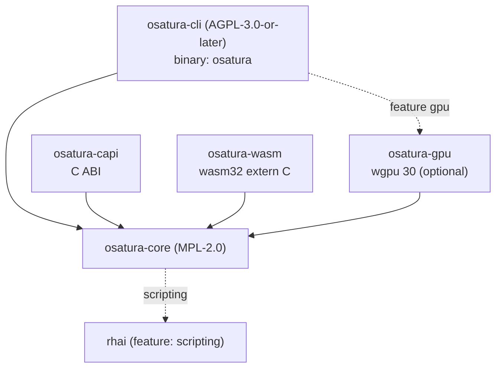

<!-- SPDX-License-Identifier: CC-BY-4.0 -->
<!-- Copyright (c) 2026 Alexandru-Ionuț Chiuță (Alexio) -->

# Arquitectura de OSATURA

Este documento explica cómo está organizado el workspace, cómo fluyen los datos desde un archivo de proyecto hasta
los píxeles, qué garantías ofrece el motor y cuáles no, y cómo ampliarlo. El detalle a nivel de campo del
formato de archivo está en [PROJECT_FORMAT.md](PROJECT_FORMAT.md). Los términos se definen en
[GLOSSARY.md](GLOSSARY.md). El modelo de amenazas y la lista de medidas de refuerzo están en
[SECURITY.md](SECURITY.md). La superficie pública de la biblioteca se describe en [API.md](API.md).

Contenido

1. [Crates y grafo de dependencias](#1-crates-y-grafo-de-dependencias)
2. [Flujo de datos](#2-flujo-de-datos)
3. [Mapa de módulos de osatura-core](#3-mapa-de-módulos-de-osatura-core)
4. [El patrón de bake no destructivo](#4-el-patrón-de-bake-no-destructivo)
5. [Editor, ops y deshacer](#5-editor-ops-y-deshacer)
6. [Determinismo: garantías y límites](#6-determinismo-garantías-y-límites)
7. [Política de gestión de errores](#7-política-de-gestión-de-errores)
8. [Resumen de seguridad](#8-resumen-de-seguridad)
9. [Arquitectura del servidor del Studio](#9-arquitectura-del-servidor-del-studio)
10. [Arquitectura de colaboración](#10-arquitectura-de-colaboración)
11. [Notas de rendimiento](#11-notas-de-rendimiento)
12. [Guía de extensión](#12-guía-de-extensión)
13. [Feature flags](#13-feature-flags)
14. [Destinos de compilación](#14-destinos-de-compilación)

## 1. Crates y grafo de dependencias

| Crate | Licencia | Tipo | Función |
| --- | --- | --- | --- |
| `osatura-core` | MPL-2.0 | biblioteca | Todo lo que no es un front end: modelo de datos, motor, renderizadores, herramientas, núcleo de colaboración. Feature por defecto `scripting`. |
| `osatura-cli` | AGPL-3.0-or-later | binario `osatura` | Línea de comandos, el servidor web del Studio y las rutas HTTP de colaboración. Depende de core con `default-features = false` y vuelve a exponer `scripting`; feature opcional `gpu`. |
| `osatura-capi` | MPL-2.0 | `cdylib`, `staticlib`, `rlib` | ABI de C (`osatura.h`, `ABI_VERSION` 1). Depende de core con `default-features = false`. |
| `osatura-wasm` | MPL-2.0 | `cdylib`, `rlib` | Módulo WebAssembly con `extern "C"` simple, sin wasm-bindgen. Depende de core con `default-features = false`. |
| `osatura-gpu` | MPL-2.0 | biblioteca | Renderizador wgpu opcional. Depende de core con `default-features = false`. |



```text
            osatura-cli  (AGPL, bin "osatura")
              |        \.........(feature "gpu").........  osatura-gpu
              v                                              |
  osatura-capi --->  osatura-core  <---  osatura-wasm  <--+  (gpu also depends on core)
                          :
                          :.....(feature "scripting")..... rhai
```

Por qué difieren las licencias: core es MPL-2.0 para que las aplicaciones de código cerrado puedan incorporarlo mediante la
biblioteca, la ABI de C o el módulo WASM sin adoptar la AGPL; la línea de comandos y el servidor del Studio
son AGPL. Cada archivo fuente lleva una línea SPDX igual a la licencia de su crate; una prueba
(`osatura-cli/tests/spdx_audit.rs`) y `scripts/licence-audit.sh` lo comprueban. Véase `LICENSING.md`.

Estabilidad: solo `osatura_core::api` y `osatura_core::prelude` son la superficie estable
(`API_VERSION` 1.4.0). Una prueba de instantánea compara los elementos públicos con `api_surface.txt`; cambiar la
superficie obliga a editar conscientemente ese archivo y a tomar una decisión de versión.

## 2. Flujo de datos

```text
 project.json
     |
     v   Project::from_json      parse, magnitude check (+-1e7), format gate
 Project (serde structs)
     |
     v   Engine::new / with_asset_dir
     |     validate everything (all problems returned), resolve names to indices,
     |     bake springs, resolve links and containers
 Engine
     |
     v   Engine::evaluate(frame)         pure function of the frame
 Frame  (bones, resolved geometry per node, camera, masks, effects, nonfinite flag)
     |
     +--> svg::      vector text (SVG)
     +--> raster::   tiny-skia, 8-bit RGBA
     +--> fraster::  own f32 scanline rasteriser (HDR / EXR path)
     +--> osatura-gpu  wgpu, stencil-then-cover
     +--> export / gltf / lottie_export / open_formats / ...
```

Puntos de entrada que envuelven esta cadena:

- **CLI**: `load` / `load_sized` (lee un archivo con `--max-input-bytes`), `Engine::with_asset_dir`,
  y después el comando. Los escritores llaman a `write_json`, que vuelve a validar mediante `Engine::new` antes de
  escribir y reescribe las rutas de los recursos relativas a la salida.
- **`api::Animation`**: la fachada estable que usan la ABI de C y el módulo WASM. `check_frame`
  limita el índice de fotograma; `guard()` ejecuta la llamada bajo `catch_unwind` y convierte un pánico en
  `ApiError::Internal`. `Player` añade máquinas de estados y bindings en tiempo de ejecución sobre una
  `Animation`.
- **Studio**: mantiene un `Editor` (sección 5) dentro de un hilo manejador; cada petición evalúa un fotograma
  y lo renderiza.

Los renderizadores solo ven un `Frame`. Nunca vuelven a ejecutar la lógica del rig, de modo que IK, skinning y deformadores se
implementan una sola vez, en `engine`.

## 3. Mapa de módulos de osatura-core

`osatura-core/src` tiene unos 100 módulos. Están agrupados por área. De cada módulo, la «base» es
el estándar público, el artículo o la técnica de manual registrados en `CLEANROOM.md`; «diseño propio» significa que el registro clean-room
no consigna ninguna fuente externa. Los nombres que terminan en `_tests` son módulos de prueba y se omiten.

### 3.1 Modelo de datos y lenguaje

**project** define las estructuras serde del archivo (`Project`, `Bone`, `Layer`, `Channel`, `Camera`
y el resto) y `Project::from_json`, que aplica la puerta de formato y la comprobación de magnitud.
Diseño propio. **path** contiene rutas vectoriales, anclajes, morphs y pesos de huesos; el aplanamiento de curvas
Bézier es el de Casteljau de los manuales. **style** tiene colores, pinturas, degradados y estilos de trazo; la función de transferencia
sRGB sigue IEC 61966-2-1. **anim** tiene claves, pistas y curvas de easing; `Bounce` y `Back` son
derivaciones propias de la mecánica elemental (fila `anim` de CLEANROOM); `Smooth` es una spline
Catmull-Rom no uniforme. **math** es álgebra afín 2D. **rig** tiene huesos, FK, el IK analítico de dos huesos,
FABRIK, IK soft y stretch (parametrización propia) y restricciones. **expr** es un pequeño lenguaje de expresiones
de descenso recursivo con un límite de 4096 bytes y profundidad 64. **noise** es ruido de valor basado en hash; el finalizador de enteros
es lowbias32 de Chris Wellons (dominio público) con constantes de Knuth y
MurmurHash3. **base64** es un códec RFC 4648 simple.

### 3.2 Motor y renderizado

**engine** valida el proyecto, evalúa un fotograma (el orden está en la sección 16 de PROJECT_FORMAT.md)
y repara la geometría no finita. **raster** renderiza un `Frame` con tiny-skia (modos de mezcla, máscaras,
efectos de capa, degradados). **fraster** es un rasterizador por líneas de barrido propio en `f32` (16 sublíneas de barrido,
área exacta de tramo, devanado distinto de cero y par-impar) con las fórmulas de W3C Compositing and Blending Level 1,
usado por la ruta HDR. **svg** escribe SVG. **hdr** produce salida de alta precisión con gestión del color: conversión sRGB/lineal (IEC 61966-2-1), PNG
de 16 bits y OpenEXR (especificación pública, líneas de barrido sin comprimir de una sola parte, IEEE 754 binary16). **postfx** y **fx** contienen la cadena de postefectos (desenfoque, niveles,
`relight` con sombreado de Lambert a partir de un normal map, operaciones morfológicas; el desenfoque gaussiano es separable);
`fx` también construye la geometría de liquid, boolean y emitter (marching squares, recorte de polígonos,
partículas en forma cerrada). **layerfx** implementa los efectos de capa con la semántica de las primitivas de filtro SVG
(`feGaussianBlur`, `feOffset`, `feColorMatrix`, `feMerge`). **dof** es una aproximación propia por capas del
círculo de confusión con desenfoque gaussiano, compuesta mediante el compositor del motor, de modo que los modos de mezcla, las máscaras y los efectos de capa se conservan. **export** escribe GIF animado, el reproductor HTML autocontenido y JSON de Lottie (MP4 pasa por
el `ffmpeg` del usuario en la CLI);
**animimport**, **seqimport** y **open_formats** leen GIF89a, APNG, secuencias PNG y
contenedores OpenRaster/OCA (con los límites de zip aplicados). **gltf** escribe glTF 2.0 / GLB según la especificación de
Khronos (triangulación por ear clipping). **lottie_export** y **lottie_import** se corresponden con la
disposición pública del JSON de Lottie (subconjunto, con advertencias). **importers** lee la gramática de rutas de SVG 1.1, BVH y
hojas de indicaciones en texto plano.

### 3.3 Audio y habla

**soundtrack** coloca sonidos en la línea de tiempo y construye un grafo de filtros de ffmpeg (atrim, afade,
adelay, amix) para el ffmpeg del propio usuario; los valores de recorte y fundido son segundos. **audio** es lip-sync
dirigido por audio: una heurística de amplitud y cruces por cero (no reconocimiento de fonemas) que elige una de cinco
formas de boca por fotograma. **audiomap** convierte el audio en envolventes y ataques (RMS con ataque/liberación de un polo; energía de ataque
frente a una media móvil). **speech** hace detección de actividad de voz, alineación forzada mediante programación
dinámica (Viterbi) frente a un a priori de duración, y reglas de letra a boca que dirigen capas switch.

### 3.4 Deformación y procesamiento de geometría

**cage** es el deformador de jaula de coordenadas de valor medio (M. S. Floater, CAGD 20(1), 2003). **pinwarp**
es la deformación por pines con la función de base radial de soporte compacto de Wendland 1995, resuelta por
eliminación de Gauss-Jordan. **cloth** y **physics** usan dinámica basada en posiciones con integración
de Verlet (de manual) para superficies de tela, tiras y colisionadores; los resultados se hornean. **warp** contiene operaciones de edición sobre los puntos de
control de los deformadores: pivotes, escalado proporcional (soft) y redimensionado de malla completa. **weights** calcula pesos de huesos por difusión
de Laplace/calor con iteración de Gauss-Seidel. **meshtrace** construye mallas a partir de formas ráster: marching
squares, Douglas-Peucker, muestreo de disco de Poisson de Bridson, triangulación de Delaunay de Bowyer-Watson y
suavizado Laplaciano/Taubin. **trace** vectoriza mapas de bits (marching squares y
Ramer-Douglas-Peucker). **autotrace** añade k-means (Lloyd 1982, k-means++), corte por mediana, seguimiento de bordes
de Suzuki-Abe, adelgazamiento de Zhang-Suen, umbralización de Otsu y distancia chamfer de Borgefors. **links**
resuelve mesh locks y glues (coordenadas baricéntricas, ordenación topológica de Kahn).

### 3.5 Ayudantes de rigging y herramientas de animación (productores de bake)

**autorig** y **vocab** emparejan por nombre palabras de anatomía para construir un rig básico con un IK de dos huesos con mix 0,
una respiración en bucle y un parpadeo con semilla. **rigedit** edita la pose de reposo. **eyeclip** añade máscaras ordinarias
a las capas de ojos. **parentswitch** cambia de padre con álgebra afín (`relative = parent^-1 * child`) y
hornea claves. **stretch** es el aim 2D de manual más escalado por distancia. **footlock** y **magnet**
corrigen posiciones mediante detección de contacto y caída smoothstep. **pathfollow** muestrea Bézier aplanadas
por longitud de arco y hornea claves. **drivers** asigna un controlador a poses mediante interpolación
lineal a trozos. **procgen** y **looper** generan movimiento idle y corrigen bucles (eliminación de tendencia lineal).
**springfit** ajusta parámetros de spring de segundo orden. **clipstack** es la pila de clips por capas con
mezcla replace, additive y multiply, fundidos smoothstep y máscaras glob. Los **skins** son grupos de capas con
nombre. **camshots** pone claves a los shots de cámara. **comps** guarda instantáneas del estado de las capas. **bonevis**
y **chanmeta** contienen metadatos del editor. **depth** reparte el factor `parallax` de las capas de nivel superior de lejos a cerca para una cámara multiplano.
**motionlib** copia rangos de claves con cambio de nombre y escalado de tiempo. **anim_tools**, **keyops**,
**timeline** y **timeline_graph** implementan las matemáticas del dope sheet (traslación, escalado respecto a un pivote,
ripple), la conversión de Hermite a Bézier y el limitador monótono de Fritsch-Carlson.

### 3.6 Runtime interactivo

**machine** es la máquina de estados en tiempo de ejecución (diseño propio: máquina de estados finitos, blend tree 1D, fundido cruzado
con easing). **binding** asigna datos externos a propiedades (remapeo afín, suavizado de un polo).
**statemachine** es la máquina de estados anterior basada en un registro de eventos, con baking. **containers**
implementa la distribución unidimensional al estilo flexbox, los rectángulos pin y aspect y el
scroll elástico (muelle amortiguado, Euler semiimplícito). **layout** tiene ayudantes de alineación y distribución y una
operación de trim path horneada (cajas delimitadoras de curvas aplanadas, muestreo por longitud de arco). **liveinput** y **midi** analizan mensajes MIDI 1.0 y
Standard MIDI Files y graban la entrada en directo. **perf** convierte muestras grabadas en claves mínimas, asigna señales de entrada (deslizadores, MIDI, nivel de audio)
a parámetros y reorienta el movimiento según el alcance de las extremidades. **faceparam**
calcula la relación de aspecto del ojo (Soukupova y Cech 2016) y el filtro One-Euro (Casiez, Roussel y
Vogel, CHI 2012). **facedet** y **facegen** son un pequeño detector de rostros entrenado con rostros sintéticos
(características HOG según Dalal y Triggs 2005, regresión logística, descenso supervisado). **mocap** lee
BVH. **posesuggest**, **posematch** y **tinymlp** son asistencia clásica de ML local con una
estrategia de evolución (mu/mu_w, lambda) (Beyer y Schwefel 2002) y sin pesos de modelo incluidos.

### 3.7 Editor y colaboración

**edit** es el `Editor` con ops y deshacer. **pick** y **gizmo** hacen pruebas de impacto (número de devanado,
distancia a un segmento) y manejan los tiradores de transformación (descomposición QR de una matriz de 2 por 2). **overlays** y
**scrub** producen onion skins, trayectorias de movimiento y una caché LRU de fotogramas con clave de revisión y un worker
de proxies. **collab**, **collabhub** y **collablog** son la réplica CRDT, el secuenciador y el
registro persistente (sección 10). **script** y **scriptops** exponen una API Rhai en sandbox (feature
`scripting`). **agent** es un servidor de herramientas con forma de JSON-RPC 2.0 / MCP para un solo proyecto.
**snapshots** guarda copias numeradas del proyecto con supresión de duplicados y poda (un contador, sin
reloj, de modo que se comporta igual en todas partes) para la recuperación tras un fallo. **explain** ofrece un relato ordenado de todo lo que determina el valor de un hueso o capa en un
fotograma; **inspect** tiene estadísticas, diff semántico y hashes de regresión de golden frame (FNV-1a exacto
por fotograma más una miniatura de 16 por 16).

### 3.8 Calidad, tamaño y control de versiones

**lint** comprueba heurísticas de animación (códigos L001 en adelante). **safety** comprueba los umbrales de destellos y destellos rojos
según WCAG 2.3.1 usando luminancia relativa. **ci** y **percep** implementan la CI de animación:
CIE76 y CIEDE2000 (CIE TR 142-2001, fórmulas tal como se imprimen en Sharma, Wu y Dalal 2005), SSIM por bloques
(Wang et al. 2004), un hash perceptual DCT, PSNR. **fuzz** somete a estrés las poses (SplitMix64, hipercubo latino, secuencias de Halton, gradiente de deformación
de 2 por 2, ddmin). **sizefit** ajusta la salida a un presupuesto de bytes (corte por mediana, Floyd-Steinberg, RDP con un bucle de reparación). **lod** produce niveles de detalle con
una cota de error declarada (Douglas-Peucker 1973, Visvalingam-Whyatt 1993, el ajuste Bézier por mínimos cuadrados de Schneider, métricas de error cuádrico de Garland-Heckbert,
distancia de Fréchet discreta según Eiter y
Mannila). **semdiff** y **vcs** son un diff semántico y un control de versiones direccionado por contenido (DAG de Merkle,
SHA-256 según FIPS 180-4, diff3 según Khanna, Kunal y Pierce 2007). **unknownfields**
detecta claves JSON ignoradas. **assets** y **fsutil** aplican reglas de rutas y tamaños a los archivos.
**api** es la fachada estable; **demo** construye el proyecto de demostración; **robustness** y **fuzz** contienen
pruebas y generadores que mantienen el tratamiento de entradas libre de pánicos.

## 4. El patrón de bake no destructivo

Muchas herramientas calculan algo a lo largo del tiempo: physics, magnet, footlock, stretch, path following, generación
procedural, clip stack, shots de cámara, skins, drivers, baking de máquinas de estados y de entrada en directo, y
más. Todas hacen lo mismo:

1. Leen el proyecto y lo evalúan tal como está.
2. Calculan nuevos valores por fotograma.
3. Añaden **canales ordinarios** a `project.channels` (modo de fusión por defecto `keep`).
4. Dejan intacta la animación original.

Como la salida son canales simples, no necesita ningún formato especial, funciona en todos los renderizadores y puede
editarse a mano. Las reglas que sigue todo baker:

- Nunca eliminar claves hechas a mano. Los canales `replace` añadidos sustituyen a las claves de ángulo anteriores en el
  momento de la evaluación; quitar el canal horneado restaura el original.
- Respetar los bloqueos: se omiten los canales cubiertos por `lock` de `channel_meta` y las capas con `locked`.
- Ser idempotente cuando un baker pueda reconocer su propia salida. La pila de clips guarda una instantánea de lo que horneó
  en `clip_baked` y sustituye exactamente eso en un nuevo baking.
- Seguir siendo determinista: RNG con semilla y números de iteraciones fijos.

Las funciones de tiempo de ejecución siguen la misma idea al exportar. Los estados de las máquinas y los bindings de un Player se
convierten en canales `replace` constantes añadidos al proyecto, de modo que un archivo exportado no necesita
el runtime.

## 5. Editor, ops y deshacer

`edit.rs` define `Editor`, que posee un `Project` y todo el historial de ediciones.

- Un `Op` es uno de `set`, `insert`, `remove` o `batch`, y direcciona el JSON del proyecto mediante un puntero RFC 6901.
  `raw_apply` aplica un op y devuelve su **inverso**.
- Cada `apply` ejecuta el op y después reconstruye un `Engine` completo a partir del nuevo JSON. Si la validación falla, el
  op se revierte y se devuelve la lista de errores, de modo que el editor no puede contener un proyecto no válido.
- Las pilas de deshacer y rehacer contienen ops inversos. Un contador de revisión se incrementa en cada cambio; las cachés
  (fotogramas de scrub, proxies) usan esa clave.
- Las operaciones de alto nivel (`set_key`, mover, eliminar, añadir container, etcétera) se construyen a partir de ops. Llaman primero
  a `assert_unlocked`, de modo que las capas `locked` y los canales bloqueados resisten las operaciones del editor;
  los `Op` simples omiten esa comprobación, porque son la capa de bajo nivel.
- `replace_doc` sustituye un documento entero (lo usa la colaboración) y borra el historial.

Como todo se expresa mediante ops de punteros JSON, la misma representación sirve para deshacer, para el CRDT de
colaboración (sección 10), para la API de scripting y para el servidor de agentes.

## 6. Determinismo: garantías y límites

Lo que se garantiza:

- `Engine::evaluate(frame)` es una función pura del proyecto y del número de fotograma. Los springs se
  simulan al cargar; el ruido se basa en hash; las partículas son funciones en forma cerrada del tiempo; los RNG tienen
  semilla; cloth y physics se hornean.
- Evaluar los fotogramas en cualquier orden, o dos veces, da resultados idénticos.
- Renderizar el mismo fotograma dos veces en una máquina con una compilación da una salida idéntica byte a byte. La CI
  incluye una comprobación de determinismo para ello.

Lo que no se garantiza:

- No se ha verificado la igualdad entre sistemas operativos, CPU o versiones del compilador. Las diferencias en
  `libm`, la multiplicación-suma fusionada y los caminos de código SIMD pueden mover píxeles de borde con antialiasing.
- El renderizador de GPU queda fuera del arnés de hashes exactos; coincide con el renderizador de CPU solo dentro de una
  tolerancia (véase ROADMAP, sección 9).
- La CI de animación usa una tolerancia perceptual en lugar de hashes exactos por ese motivo.

Hilos: la evaluación del motor es monohilo. Hay hilos en el detector de rostros (con ámbito), el worker de proxies de
scrub/LOD, `sizefit` y el servidor HTTP del Studio. Ninguno cambia los resultados de la
evaluación.

## 7. Política de gestión de errores

- La entrada nunca debe causar un pánico. Las pruebas de robustez y los generadores fuzz lo ejercitan, y la
  fachada, la ABI de C y los puntos de entrada WASM envuelven las llamadas en `catch_unwind`.
  En `wasm32-unknown-unknown` el valor por defecto es `panic=abort`, por lo que `catch_unwind` no tiene efecto allí;
  ese módulo se apoya en la validación.
- La validación devuelve **todos** los problemas como `Err(Vec<String>)` para que un usuario pueda corregir un archivo de una sola vez.
- Los mensajes son para personas; no los analices. Las pruebas que necesitan estabilidad comparan con fragmentos
  distintivos.
- Todo lo que crece con la entrada tiene un límite: bytes de JSON, huesos, vértices de malla, efectos por capa,
  lados y píxeles de imagen, fotogramas por anclajes, miembros de container, tamaños de cabecera y cuerpo HTTP. Los
  números están en PROJECT_FORMAT.md sección 12 y sección 18.
- Los valores no finitos se contienen en lugar de propagarse: los canales los omiten, `repair_nonfinite`
  oculta un nodo defectuoso y `Frame.nonfinite` avisa a quien llama. `evaluate_checked` y
  `check_all_frames_finite` lo convierten en un error para las herramientas por lotes.
- La ABI de C guarda el último error en almacenamiento local al hilo y devuelve códigos; nunca desenrolla la pila a través de
  la frontera.

## 8. Resumen de seguridad

La versión corta: OSATURA lee JSON y archivos de recursos no confiables, y el Studio escucha en un
socket de red. Las defensas están en capas: límites estrictos de carga (magnitud, tamaño, topes de recuento), confinamiento de rutas
para los recursos, un servidor HTTP solo con std con
plazos y comprobaciones de host/origen, autenticación por token para la colaboración y un motor de scripting
en sandbox con límites explícitos. El modelo de amenazas y las medidas de refuerzo están en [SECURITY.md](SECURITY.md).

## 9. Arquitectura del servidor del Studio

`osatura studio` sirve una única página HTML (`studio.html`) y una API JSON desde un solo proceso.

```text
 browser  <--HTTP/1.1-->  http.rs  (accept loop; bounded connection threads, I/O only)
                             |  parsed request over a channel
                             v
                       handler thread  (single owner of the Editor and caches)
                             |   studio.rs  ~52 /api routes
                             |   uiconfig.rs  command registry, key map
                             |   collab_srv.rs  /api/collab/* routes
                             v
                      osatura-core: Editor, Engine, raster, svg, scrub, collab
```

- **http.rs** es un servidor HTTP/1.1 solo con std (la dependencia anterior `tiny_http` se eliminó tras una
  revisión de seguridad). Los hilos de conexión están acotados en número y solo leen y escriben sockets; pasan
  las peticiones al único hilo manejador, que posee el `Editor`. Así, ningún bloqueo protege el estado del proyecto
  y dos peticiones nunca lo modifican a la vez.
- Límites y respuestas: plazos de lectura y escritura (408), límites de tamaño (413), tope de conexiones (503),
  `Connection: close` en cada respuesta. Las respuestas llevan una Content-Security-Policy,
  `X-Content-Type-Options: nosniff`, `X-Frame-Options` y `Referrer-Policy`.
- **Exposición de red**: el bind por defecto es `127.0.0.1`. Cualquier otro bind requiere un token. Una lista de hosts
  permitidos defiende contra el DNS rebinding, y las peticiones POST necesitan una comprobación de mismo origen.
- **studio.rs** implementa unas 52 rutas `/api` (edición, deshacer y rehacer, renderizado de fotogramas, proxies,
  selección y gizmos, superposiciones, importaciones y exportaciones, construcciones de LOD en segundo plano). **uiconfig.rs** contiene el registro de comandos: ids, títulos, mapa de teclas por defecto,
  disposiciones preestablecidas de paneles.
- La página se sirve desde memoria. Una ruta `/source` ofrece el código fuente correspondiente, conforme a
  la AGPL.
- **Proxies**: mientras se hace scrubbing, la página pide una imagen de detalle reducido (`LodProxy`, construida por un
  worker en segundo plano) y solicita calidad completa al soltar.

## 10. Arquitectura de colaboración

La edición multiusuario se construye en tres capas, todas deterministas y comprobables sin red.

**collab.rs, la réplica.** Un CRDT sobre el JSON del proyecto. Una clave de objeto es un registro de
último escritor gana. Un array es un RGA (replicated growable array, Roh et al. 2011) con lápidas, y la eliminación
prevalece sobre las ediciones concurrentes. La ordenación usa relojes de Lamport (Lamport 1978) y relojes vectoriales (Fidge,
Mattern). Los cambios viajan como un `Envelope { replica, seq, lamport, deps, ops }`. La entrega es causal
(un envelope espera hasta que se hayan aplicado sus dependencias) e idempotente (una reentrega no tiene
efecto). Cada usuario tiene una pila de deshacer que invierte solo sus propios ops. `compaction` descarta las
lápidas que todas las réplicas han visto. El diseño sigue a Shapiro et al. 2011 (CRDT basados en operaciones).

**collabhub.rs, el secuenciador.** Un `Hub` autoritativo posee la réplica principal. Los usuarios son *Thin* (una réplica proxy mantenida por el hub, para navegadores) o *Replica* (su propia réplica). El hub
valida el JSON fusionado con una clausura proporcionada por quien llama, de modo que una fusión que produjera un
proyecto no válido se rechaza. También rastrea la presencia (cursores, selecciones) y un flujo de eventos
(server-sent events). Límites: 32 usuarios (`MAX_USERS`), y los usuarios inactivos durante 10 minutos se descartan.

**collablog.rs, la persistencia.** Un registro JSON orientado a líneas. Cada registro está encadenado al anterior mediante un
hash (FNV-1a de 64 bits en la versión 1, SHA-256 en la versión 2) para detectar daños; las escrituras usan
`fdatasync` cuando se indica `--collab-log`.

**collab_srv.rs (CLI), el lado HTTP.** Rutas bajo `/api/collab/`: `join`, `leave`, `state`, `log`,
`ops`, `undo`, `redo`, `presence`, `compact`, `events`. Autenticación: un token de al menos 16
caracteres, enviado en la cabecera `X-Collab-Token` o en la cookie `arm_token` (establecida por `/api/login`),
comparado en tiempo constante, con un límite de frecuencia que responde 429. Cada participante recibe además un secreto
(`X-Collab-Secret`) para que un usuario no pueda actuar como otro. El transporte es HTTP simple sin TLS:
pon un proxy que termine TLS delante para cualquier cosa más allá de una red de confianza.

`osatura collab-sim` ejecuta muchos clientes simulados contra un hub dentro del proceso, y así se prueba
la convergencia.

## 11. Notas de rendimiento

Los números siguientes son las mediciones registradas en `ROADMAP.md` sección 9. Se reproducen, no se
vuelven a medir aquí. Tómalos como órdenes de magnitud para la máquina y la compilación indicadas.

| Medición | Resultado |
| --- | --- |
| demo de 640x480, compilación release, un hilo, media de 48 fotogramas: raster nivel 0 | 14.4 ms por fotograma |
| lo mismo, proxy nivel 1 / nivel 2 / nivel 4 | 3.5 ms / 0.7 ms / 0.09 ms |
| escritor SVG; SVG simplificado | 0.17 ms; de 0.10 a 0.15 ms |
| proyecto sintético de 671 capas, raster nivel 0 frente a nivel 2 | 1832 ms frente a 106 ms |
| decodificación en el navegador de ese proyecto: SVG completo, proxy 2, proxy 4 | 45 ms, 28 ms, 25 ms |
| acierto de caché en la caché de scrub | unos 0.002 ms |
| renderizador de GPU en Mesa llvmpipe (software, no una GPU real), escala 1 | de 253 a 295 ms por fotograma (GL 253, Vulkan 295) frente a 13.8 ms con tiny-skia |
| lo mismo, escala 2 | 1260 ms frente a 56 ms |
| Prueba de proxy del Studio (compilación de depuración): mapa de bits, vector | de 51.6 a 34.2 ms; de 2.12 a 0.30 ms |
| construcción de LOD en segundo plano, compilación de depuración | 19.5 s |
| suite de extremo a extremo | unos 19 s en depuración, unos 40 s en release |
| entrenamiento del detector de rostros, 2 núcleos | 91 s; 99.3 por ciento de las cajas encontradas |
| demo de LOD, error declarado frente a medido (px) | 0.104/0.386/0.928/1.537/1.657 frente a 0.099/0.334/0.819/1.337/1.337 |

Cómo leerlo: la ruta vectorial es barata, así que un proxy aporta poco beneficio en el navegador para proyectos pequeños
pero uno grande para el renderizado de mapas de bits y para proyectos con cientos de capas. Las cifras de GPU
no dicen nada sobre el rendimiento del hardware; no había ningún adaptador de hardware disponible. Los niveles de LOD nunca
superan su error declarado, y el error medido queda por debajo de la cota declarada.

Notas prácticas: el coste de evaluación crece con los canales, los huesos y los tamaños de los deformadores; el coste de renderizado crece
con la resolución, los efectos (cada uno usa una capa fuera de pantalla) y las máscaras. Usa `--proxy N` o niveles de LOD
mientras haces scrubbing, y el renderizador completo para la salida final.

## 12. Guía de extensión

Reglas generales para cualquier cambio:

- Todo archivo fuente nuevo empieza con la línea SPDX de su crate y la línea de copyright. De lo
  contrario, una prueba falla.
- Toda entrada nueva debe tener límites, y los mensajes de validación nuevos deben enumerar los
  problemas en lugar de detenerse en el primero.
- Todo lo nuevo que use un método o un estándar externo debe registrarse en `CLEANROOM.md`
  (consulta sus reglas y la plantilla opcional de nota de especificación).
- Actualiza `PROJECT_FORMAT.md` cuando cambie el archivo y `API.md` cuando cambie la fachada.

### 12.1 Añadir una propiedad de capa

Ejemplo: un nuevo número por capa.

1. Añade el campo a `Layer` en `osatura-core/src/project.rs` con
   `#[serde(default = "...", skip_serializing_if = "...")]`, de modo que los archivos antiguos se carguen sin cambios y los valores
   por defecto no se vuelvan a escribir. Añadir un campo opcional no cambia `FORMAT_VERSION`.
2. Añade la validación en `Engine::new` (finito, rango) con un mensaje que nombre la capa.
3. Si es animable, añade una variante de `Prop`, su correspondencia con `target_kind`, el límite de escritura (clamp), el
   valor inicial en `initial_state` y el caso en `apply_channels`. Si usa un subdestino, amplía el
   resolvedor `layer::sub`.
4. Úsala en `evaluate` y en los renderizadores a los que afecte (`svg`, `raster`, `fraster`, GPU) para que
   coincidan.
5. Comprueba que los exportadores (`lottie_export`, `gltf`, ...) la reflejen o informen de que la descartan.
6. Pruebas:
   - un viaje de ida y vuelta con serde que demuestre que se omite el valor por defecto;
   - una prueba de validación por cada regla, con el mensaje de fallo;
   - una prueba de evaluación, que incluya un canal que la anime;
   - la comprobación de campos desconocidos (`unknownfields`) no debe marcar el campo nuevo;
   - robustez: NaN, infinito y límites de 1e7 (añádelo a las pruebas de robustez existentes);
   - la instantánea `api_surface.txt`, si cambió un tipo público.
7. Documéntala en PROJECT_FORMAT.md (nombre, tipo, valor por defecto, rango, semántica, ejemplo).

### 12.2 Añadir un comando de la CLI

1. Escribe la lógica en `osatura-core` como una función con entrada tipada y `Result<_, String>` o una
   lista de errores; la CLI solo debe analizar las opciones e imprimir. Así la lógica se puede usar desde la ABI de C,
   WASM y el Studio.
2. En `osatura-cli/src/usage.rs`, añade una entrada en `USAGE`. `usage_for`, `documented_options` y
   `check_flags` la leen, y una prueba compara USAGE con el analizador, de modo que una opción que el analizador
   acepta pero USAGE no menciona hace fallar la prueba.
3. Registra las opciones que reciben un valor en `VALUE_OPTS` (o en la tabla `takes_value` de cada comando).
4. Añade una rama de match en `run` (despacha con `match pos.as_slice()`).
5. Lee los proyectos mediante `load` o `load_sized` para que se apliquen los límites de tamaño y el confinamiento de recursos.
6. Escribe los proyectos mediante `write_json` (vuelve a validar y reescribe las rutas de recursos). Si el comando escribe
   un tipo de archivo distinto del de entrada, llama a `guard_out` para que una ruta de salida mal escrita no pueda
   sobrescribir el proyecto de entrada.
7. Pruebas en `osatura-cli/tests/`: `e2e.rs` para el camino feliz, `robust.rs` para entradas hostiles,
   `fixes.rs` o `wave4.rs` para regresiones; `scripts/e2e.sh` ejecuta todo el flujo.
8. Documéntalo en la referencia de comandos.

### 12.3 Añadir un exportador

1. Coloca el escritor en `osatura-core` (por ejemplo junto a `export.rs`, `gltf.rs` o
   `lottie_export.rs`). Recibe un `Engine` o un `Project`, evalúa los fotogramas mediante
   `evaluate_checked` y no debe leer estado privado.
2. Decide y documenta qué no puede representar. Emite advertencias, no suposiciones, para las funciones descartadas.
3. Aplica límites: fotogramas por anclas (presupuesto de 40 millones), lados de imagen (16384) y píxeles, tamaño de salida.
4. No sobrescribas nunca la entrada: usa `guard_out` en la CLI.
5. Pruebas: la salida se analiza con un lector independiente o con el propio importador del módulo (viaje de ida y vuelta);
   determinismo (misma entrada, mismos bytes); una prueba con un proyecto hostil que espere un error, no un pánico;
   y una prueba golden o de hash sobre el proyecto de demostración. Indica en el comentario del módulo si
   un reproductor independiente ha verificado la salida (el exportador de Lottie, por ejemplo, señala que esta comprobación
   está pendiente).
6. Añade la conexión (comando de la CLI, función opcional de la fachada, ruta del Studio) y la fila de procedencia en
   CLEANROOM.md.

## 13. Feature flags

| Crate | Feature | Por defecto | Efecto |
| --- | --- | --- | --- |
| `osatura-core` | `scripting` | activada | Compila la API de scripting Rhai (`script`, `scriptops`). Incorpora `rhai` y su dependencia `smartstring` (MPL-2.0). |
| `osatura-cli` | `scripting` | activada | Activa `osatura-core/scripting` y el comando `script`. `--no-default-features` la elimina. |
| `osatura-cli` | `gpu` | desactivada | Incorpora `osatura-gpu` y añade el comando `render-gpu`. Se mantiene desactivada para que las compilaciones ordinarias sigan siendo pequeñas. |

`osatura-capi`, `osatura-wasm` y `osatura-gpu` usan core con `default-features = false`, por lo que
no incluyen el motor de scripting.

## 14. Destinos de compilación

| Destino | Comando | Notas |
| --- | --- | --- |
| CLI y Studio | `cargo build -p osatura-cli` (añade `--release` para mayor velocidad) | Binario `osatura`. |
| CLI con GPU | `cargo build -p osatura-cli --features gpu` | wgpu 30 solo con Vulkan y GL. Verificado únicamente en Mesa llvmpipe. |
| Biblioteca | `cargo build -p osatura-core` | API de Rust. |
| Biblioteca C | `cargo build -p osatura-capi` | `cdylib`, `staticlib` y la cabecera `osatura-capi/osatura.h`; `ABI_VERSION` 1. |
| WebAssembly | `osatura-wasm/build-wasm.sh` (requiere `rustup target add wasm32-unknown-unknown`) | Interfaz extern "C" simple, con `index.html` y utilidades en `js/`. El entorno de desarrollo no pudo instalar el destino; el módulo lo compila (perfil release) `.github/workflows/release.yml` y `ci.yml` prueba una compilación debug con Node. El propio script no es lo que ejecuta la CI. |
| Aplicación de ventana (Windows, macOS) | `cargo build --release -p osatura-gui` | Binario `osatura-studio`: ventana `tao` + vista web `wry` alrededor del estudio; un stub en Linux. |
| Pruebas | `cargo test --workspace` | Flujo de shell de extremo a extremo en `scripts/e2e.sh`; auditoría de licencias en `scripts/licence-audit.sh`. |

Los miembros predeterminados del workspace no incluyen `osatura-gpu`.
