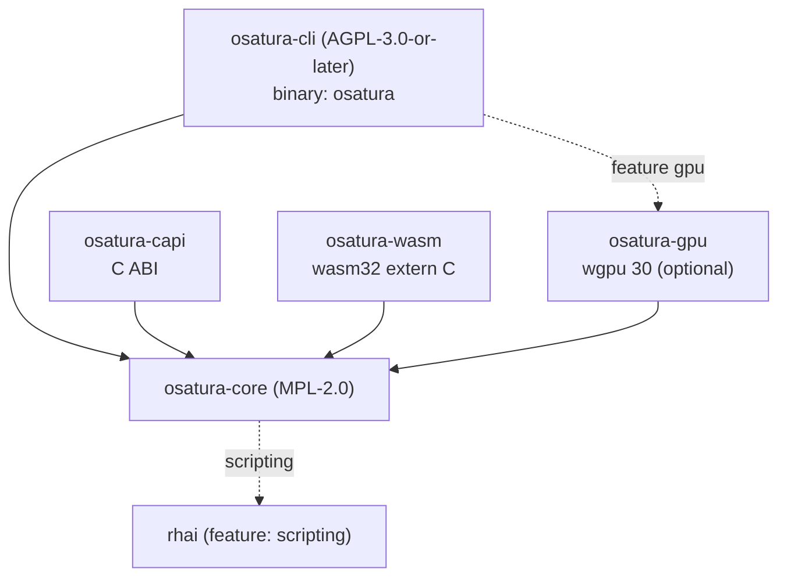

<!-- SPDX-License-Identifier: CC-BY-4.0 -->
<!-- Copyright (c) 2026 Alexandru-Ionuț Chiuță (Alexio) -->

# Architecture d'OSATURA

Ce document explique comment le workspace est organisé, comment les données circulent d'un fichier de projet jusqu'aux
pixels, quelles garanties le moteur donne et lesquelles il ne donne pas, et comment l'étendre. Le détail, champ par champ,
du format de fichier se trouve dans [PROJECT_FORMAT.md](PROJECT_FORMAT.md). Les termes sont définis dans
[GLOSSARY.md](GLOSSARY.md). Le modèle de menaces et la liste des mesures de durcissement figurent dans
[SECURITY.md](SECURITY.md). La surface publique de la bibliothèque est décrite dans [API.md](API.md).

Sommaire

1. [Crates et graphe de dépendances](#1-crates-et-graphe-de-dépendances)
2. [Flux de données](#2-flux-de-données)
3. [Carte des modules d'osatura-core](#3-carte-des-modules-dosatura-core)
4. [Le modèle de bake non destructif](#4-le-modèle-de-bake-non-destructif)
5. [Éditeur, ops et annulation](#5-éditeur-ops-et-annulation)
6. [Déterminisme : garanties et limites](#6-déterminisme--garanties-et-limites)
7. [Politique de gestion des erreurs](#7-politique-de-gestion-des-erreurs)
8. [Vue d'ensemble de la sécurité](#8-vue-densemble-de-la-sécurité)
9. [Architecture du serveur Studio](#9-architecture-du-serveur-studio)
10. [Architecture de la collaboration](#10-architecture-de-la-collaboration)
11. [Notes sur les performances](#11-notes-sur-les-performances)
12. [Guide d'extension](#12-guide-dextension)
13. [Feature flags](#13-feature-flags)
14. [Cibles de build](#14-cibles-de-compilation)

## 1. Crates et graphe de dépendances

| Crate | Licence | Type | Rôle |
| --- | --- | --- | --- |
| `osatura-core` | MPL-2.0 | bibliothèque | Tout ce qui n'est pas une interface : modèle de données, moteur, moteurs de rendu, outils, cœur de la collaboration. Feature par défaut `scripting`. |
| `osatura-cli` | AGPL-3.0-or-later | binaire `osatura` | Ligne de commande, serveur web du Studio et routes HTTP de collaboration. Dépend de core avec `default-features = false` et réexpose `scripting` ; feature facultative `gpu`. |
| `osatura-capi` | MPL-2.0 | `cdylib`, `staticlib`, `rlib` | ABI C (`osatura.h`, `ABI_VERSION` 1). Dépend de core avec `default-features = false`. |
| `osatura-wasm` | MPL-2.0 | `cdylib`, `rlib` | Module WebAssembly `extern "C"` simple, sans wasm-bindgen. Dépend de core avec `default-features = false`. |
| `osatura-gpu` | MPL-2.0 | bibliothèque | Moteur de rendu wgpu facultatif. Dépend de core avec `default-features = false`. |



```text
            osatura-cli  (AGPL, bin "osatura")
              |        \.........(feature "gpu").........  osatura-gpu
              v                                              |
  osatura-capi --->  osatura-core  <---  osatura-wasm  <--+  (gpu also depends on core)
                          :
                          :.....(feature "scripting")..... rhai
```

Pourquoi les licences diffèrent : core est sous MPL-2.0 afin que des applications à code source fermé puissent l'embarquer via la
bibliothèque, l'ABI C ou le module WASM sans adopter l'AGPL ; la ligne de commande et le serveur Studio
sont sous AGPL. Chaque fichier source porte une ligne SPDX égale à la licence de sa crate ; un test
(`osatura-cli/tests/spdx_audit.rs`) et `scripts/licence-audit.sh` le vérifient. Voir `LICENSING.md`.

Stabilité : seuls `osatura_core::api` et `osatura_core::prelude` forment la surface stable
(`API_VERSION` 1.4.0). Un test d'instantané compare les éléments publics à `api_surface.txt` ; modifier la
surface impose une modification consciente de ce fichier et une décision sur la version.

## 2. Flux de données

```text
 project.json
     |
     v   Project::from_json      parse, magnitude check (+-1e7), format gate
 Project (serde structs)
     |
     v   Engine::new / with_asset_dir
     |     validate everything (all problems returned), resolve names to indices,
     |     bake springs, resolve links and containers
 Engine
     |
     v   Engine::evaluate(frame)         pure function of the frame
 Frame  (bones, resolved geometry per node, camera, masks, effects, nonfinite flag)
     |
     +--> svg::      vector text (SVG)
     +--> raster::   tiny-skia, 8-bit RGBA
     +--> fraster::  own f32 scanline rasteriser (HDR / EXR path)
     +--> osatura-gpu  wgpu, stencil-then-cover
     +--> export / gltf / lottie_export / open_formats / ...
```

Points d'entrée qui enveloppent cette chaîne :

- **CLI** : `load` / `load_sized` (lit un fichier avec `--max-input-bytes`), `Engine::with_asset_dir`,
  puis la commande. Les écrivains appellent `write_json`, qui revalide via `Engine::new` avant
  d'écrire et réécrit les chemins d'assets relativement à la sortie.
- **`api::Animation`** : la façade stable utilisée par l'ABI C et le module WASM. `check_frame`
  borne l'indice d'image ; `guard()` exécute l'appel sous `catch_unwind` et convertit une panique en
  `ApiError::Internal`. `Player` ajoute par-dessus une `Animation` les machines à états et les liaisons
  à l'exécution.
- **Studio** : détient un `Editor` (section 5) dans un thread de gestionnaire ; chaque requête évalue une image
  et la rend.

Les moteurs de rendu ne voient qu'un `Frame`. Ils ne réexécutent jamais la logique du rig ; l'IK, le skinning et les déformateurs
sont donc implémentés une seule fois, dans `engine`.

## 3. Carte des modules d'osatura-core

`osatura-core/src` compte environ 100 modules. Ils sont regroupés par domaine. Pour chaque module, la « base » est
la norme publique, l'article ou la technique de manuel consignée dans `CLEANROOM.md` ; « conception propre » signifie que le journal clean-room
n'enregistre aucune source extérieure. Les noms se terminant par `_tests` sont des modules de test et sont omis.

### 3.1 Modèle de données et langage

**project** définit les structs serde du fichier (`Project`, `Bone`, `Layer`, `Channel`, `Camera`
et le reste) et `Project::from_json`, qui effectue le contrôle du format et celui des magnitudes.
Conception propre. **path** contient les chemins vectoriels, les ancres, les morphs et les poids d'os ; l'aplatissement des courbes
de Bézier est le de Casteljau classique. **style** contient les couleurs, les peintures, les dégradés et les styles de trait ; la fonction de transfert
sRGB suit l'IEC 61966-2-1. **anim** contient les clés, les pistes et les courbes d'interpolation ; `Bounce` et `Back` sont
des dérivations propres issues de la mécanique élémentaire (ligne `anim` de CLEANROOM) ; `Smooth` est une spline de
Catmull-Rom non uniforme. **math** est l'algèbre affine 2D. **rig** contient les os, la FK, l'IK analytique
à deux os, FABRIK, l'IK soft et stretch (paramétrage propre) et les contraintes. **expr** est un petit langage d'expressions
à descente récursive avec une limite de 4096 octets et de profondeur 64. **noise** est un bruit de valeur à base de hash ; le finaliseur d'entiers est le lowbias32 de Chris Wellons (domaine public) avec des constantes de Knuth et
de MurmurHash3. **base64** est un codec RFC 4648 simple.

### 3.2 Moteur et rendu

**engine** valide le projet, évalue une image (l'ordre figure à la section 16 de PROJECT_FORMAT.md)
et répare la géométrie non finie. **raster** rend un `Frame` avec tiny-skia (modes de fusion, masques,
effets de calque, dégradés). **fraster** est un rastériseur à lignes de balayage propre en `f32` (16 sous-lignes de balayage,
aire exacte des spans, règles de remplissage non nulle et pair-impair) avec les formules W3C Compositing and Blending Level 1,
utilisé par le chemin HDR. **svg** écrit du SVG. **hdr** produit une sortie haute précision gérée en couleur : conversion sRGB/linéaire (IEC 61966-2-1), PNG 16 bits
et OpenEXR (spécification publique, lignes de balayage non compressées en une seule partie, IEEE 754 binary16). **postfx** et **fx** contiennent la chaîne de post-effets (flou, niveaux,
`relight` avec ombrage de Lambert à partir d'une normal map, opérations morphologiques ; le flou gaussien est séparable) ;
`fx` construit aussi la géométrie des liquid, boolean et emitter (marching squares, découpage de polygones,
particules en forme close). **layerfx** implémente les effets de calque avec la sémantique des primitives de filtre SVG
(`feGaussianBlur`, `feOffset`, `feColorMatrix`, `feMerge`). **dof** est une approximation propre, par couches, du
cercle de confusion avec flou gaussien, composée par le compositeur du moteur de sorte que les modes de fusion, les masques et les effets de calque soient préservés. **export** écrit le GIF animé, le lecteur HTML autonome et le JSON Lottie (le MP4 passe par
le `ffmpeg` de l'utilisateur dans la CLI) ;
**animimport**, **seqimport** et **open_formats** lisent le GIF89a, l'APNG, les séquences PNG et les
conteneurs OpenRaster/OCA (limites de zip appliquées). **gltf** écrit du glTF 2.0 / GLB d'après la spécification
Khronos (triangulation par découpage d'oreilles). **lottie_export** et **lottie_import** correspondent à la
disposition publique du JSON Lottie (sous-ensemble, avec avertissements). **importers** lit la grammaire des chemins SVG 1.1, le BVH et
les feuilles de repères en texte brut.

### 3.3 Audio et parole

**soundtrack** place les sons sur la timeline et construit un graphe de filtres ffmpeg (atrim, afade,
adelay, amix) pour le ffmpeg de l'utilisateur ; les valeurs de rognage et de fondu sont en secondes. **audio** est la synchronisation labiale
pilotée par l'audio : une heuristique d'amplitude et de passages par zéro (pas de reconnaissance de phonèmes) qui choisit l'une de cinq
formes de bouche par image. **audiomap** transforme l'audio en enveloppes et en attaques (RMS avec attaque/relâchement à un pôle ; énergie d'attaque
par rapport à une moyenne mobile). **speech** fait la détection d'activité vocale, l'alignement forcé par programmation
dynamique (Viterbi) par rapport à un a priori de durée, et des règles lettre-vers-bouche qui pilotent les calques switch.

### 3.4 Déformation et traitement de la géométrie

**cage** est le déformateur à cage par coordonnées de valeur moyenne (M. S. Floater, CAGD 20(1), 2003). **pinwarp**
est la déformation par épingles utilisant la fonction à base radiale à support compact de Wendland 1995, résolue par
élimination de Gauss-Jordan. **cloth** et **physics** utilisent la dynamique basée sur les positions avec intégration de
Verlet (classique) pour les surfaces de tissu, les bandes et les colliders ; les résultats sont bakés. **warp** contient les opérations d'édition sur les points de contrôle des déformateurs :
pivots, mise à l'échelle proportionnelle (douce) et redimensionnement de mesh entier. **weights** calcule les poids d'os par diffusion de
Laplace/chaleur avec itération de Gauss-Seidel. **meshtrace** construit des meshes à partir de formes raster : marching
squares, Douglas-Peucker, échantillonnage de Poisson par disques de Bridson, triangulation de Delaunay de Bowyer-Watson et
lissage laplacien/de Taubin. **trace** vectorise des bitmaps (marching squares et
Ramer-Douglas-Peucker). **autotrace** ajoute k-means (Lloyd 1982, k-means++), median cut, suivi de contour de Suzuki-Abe,
amincissement de Zhang-Suen, seuillage d'Otsu et distance de chanfrein de Borgefors. **links**
résout les mesh locks et les glues (coordonnées barycentriques, tri topologique de Kahn).

### 3.5 Aides au rigging et outils d'animation (producteurs de bake)

**autorig** et **vocab** associent par nom des mots d'anatomie pour construire un rig de base avec une IK à deux os au mix 0,
une respiration en boucle et un clignement à graine. **rigedit** édite la pose de repos. **eyeclip** ajoute des masques ordinaires
aux calques d'yeux. **parentswitch** change de parent avec l'algèbre affine (`relative = parent^-1 * child`) et
bake les clés. **stretch** est le classique aim 2D plus mise à l'échelle par la distance. **footlock** et **magnet**
corrigent les positions par détection de contact et atténuation smoothstep. **pathfollow** échantillonne un Bézier aplati
par longueur d'arc et bake les clés. **drivers** associe un contrôleur à des poses par interpolation linéaire par morceaux.
**procgen** et **looper** génèrent un mouvement d'attente et corrigent les boucles (suppression de tendance linéaire).
**springfit** ajuste les paramètres de ressorts du second ordre. **clipstack** est la pile de clips en couches avec
fusion replace, additive et multiply, fondus smoothstep et masques glob. **skins** sont des groupes de calques nommés.
**camshots** met en clés les plans de caméra. **comps** stocke des instantanés d'état des calques. **bonevis**
et **chanmeta** contiennent des métadonnées d'éditeur. **depth** répartit le facteur `parallax` des calques de premier niveau du lointain au proche pour une caméra multiplan.
**motionlib** copie des plages de clés avec renommage et mise à l'échelle du temps. **anim_tools**, **keyops**,
**timeline** et **timeline_graph** implémentent les mathématiques de la dope sheet (translation, mise à l'échelle autour d'un pivot,
ripple), la conversion Hermite vers Bézier et le limiteur monotone de Fritsch-Carlson.

### 3.6 Runtime interactif

**machine** est la machine à états du runtime (conception propre : automate fini, blend tree 1D, fondu enchaîné
avec interpolation). **binding** associe des données externes à des propriétés (remappage affine, lissage à un pôle).
**statemachine** est la machine à états antérieure à journal d'événements avec bake. **containers**
implémente la distribution unidimensionnelle de type flexbox, les rectangles pin et aspect et le scroll
élastique (ressort amorti, Euler semi-implicite). **layout** contient des aides d'alignement et de distribution et une
opération trim-path bakée (boîtes englobantes de courbes aplaties, échantillonnage par longueur d'arc). **liveinput** et **midi** analysent les messages MIDI 1.0 et
les Standard MIDI Files et enregistrent l'entrée en direct. **perf** transforme des échantillons enregistrés en clés minimales, associe des signaux d'entrée (curseurs, MIDI, niveau audio)
à des paramètres et recible le mouvement selon la portée des membres. **faceparam**
calcule le rapport d'aspect de l'œil (Soukupova et Cech 2016) et le filtre One-Euro (Casiez, Roussel et
Vogel, CHI 2012). **facedet** et **facegen** sont un petit détecteur de visages entraîné sur des visages synthétiques
(caractéristiques HOG d'après Dalal et Triggs 2005, régression logistique, descente supervisée). **mocap** lit
le BVH. **posesuggest**, **posematch** et **tinymlp** sont une aide ML locale classique avec une
stratégie d'évolution (mu/mu_w, lambda) (Beyer et Schwefel 2002) et aucun poids de modèle embarqué.

### 3.7 Éditeur et collaboration

**edit** est l'`Editor` avec ops et annulation. **pick** et **gizmo** font le test de sélection (nombre d'enroulement,
distance à un segment) et les poignées de transformation (décomposition QR d'une matrice 2 par 2). **overlays** et
**scrub** produisent les onion skins, les trajectoires de mouvement et un cache LRU d'images indexé par révision avec un worker de proxy. **collab**, **collabhub** et **collablog** sont la réplique CRDT, le séquenceur et le
journal persistant (section 10). **script** et **scriptops** exposent une API Rhai en bac à sable (feature
`scripting`). **agent** est un serveur d'outils au format JSON-RPC 2.0 / MCP pour un seul projet.
**snapshots** conserve des copies numérotées du projet avec suppression des doublons et élagage (un compteur, pas d'horloge,
pour se comporter de la même façon partout) pour la récupération après plantage. **explain** donne un compte rendu ordonné de tout ce qui détermine la valeur d'un os ou d'un calque à une
image ; **inspect** contient des statistiques, un diff sémantique et des hashs de régression d'images de référence (FNV-1a exact
par image plus une vignette de 16 par 16).

### 3.8 Qualité, taille et gestion de versions

**lint** vérifie des heuristiques d'animation (codes L001 et suivants). **safety** vérifie les seuils de flash et de flash rouge d'après WCAG 2.3.1 avec la luminance relative. **ci** et **percep** implémentent la CI d'animation :
CIE76 et CIEDE2000 (CIE TR 142-2001, formules telles qu'imprimées dans Sharma, Wu et Dalal 2005), SSIM par blocs
(Wang et al. 2004), un hash perceptuel DCT, PSNR. **fuzz** met les poses sous contrainte (SplitMix64, hypercube latin,
séquences de Halton, gradient de déformation 2 par 2, ddmin). **sizefit** ajuste la sortie à un budget d'octets (median cut, Floyd-Steinberg, RDP avec boucle de réparation). **lod** produit des niveaux de détail avec
une borne d'erreur déclarée (Douglas-Peucker 1973, Visvalingam-Whyatt 1993, ajustement de Bézier par moindres carrés de Schneider,
métriques d'erreur quadrique de Garland-Heckbert, distance de Fréchet discrète d'après Eiter et
Mannila). **semdiff** et **vcs** sont un diff sémantique et une gestion de versions adressée par contenu (DAG de Merkle,
SHA-256 selon FIPS 180-4, diff3 d'après Khanna, Kunal et Pierce 2007). **unknownfields**
détecte les clés JSON ignorées. **assets** et **fsutil** appliquent les règles de chemin et de taille aux fichiers.
**api** est la façade stable ; **demo** construit le projet de démo ; **robustness** et **fuzz** contiennent
des tests et des générateurs qui garantissent que le traitement des entrées ne panique jamais.

## 4. Le modèle de bake non destructif

De nombreux outils calculent quelque chose dans le temps : physique, magnet, footlock, stretch, suivi de chemin, génération
procédurale, pile de clips, plans de caméra, skins, drivers, bake de machines à états et d'entrées en direct, et
d'autres. Ils font tous la même chose :

1. Lire le projet et l'évaluer tel qu'il est.
2. Calculer de nouvelles valeurs par image.
3. Ajouter des **canaux ordinaires** à `project.channels` (mode de fusion par défaut `keep`).
4. Laisser l'animation d'origine intacte.

Comme la sortie consiste en canaux ordinaires, elle n'a besoin d'aucun format particulier, fonctionne dans tous les moteurs de rendu et peut être
modifiée à la main. Les règles que suit tout baker :

- Ne jamais supprimer les clés faites à la main. Les canaux `replace` ajoutés l'emportent sur les clés d'angle antérieures lors de
  l'évaluation ; supprimer le canal baké restaure l'original.
- Tenir compte des verrous : les canaux couverts par `lock` de `channel_meta`, et les calques avec `locked`, sont ignorés.
- Être idempotent lorsqu'un baker peut reconnaître sa propre sortie. La pile de clips enregistre un instantané de ce qu'elle a baké
  dans `clip_baked` et remplace exactement cela lors d'un nouveau bake.
- Rester déterministe : générateurs aléatoires à graine et nombres d'itérations fixes.

Les fonctionnalités d'exécution suivent la même idée à l'export. Les états de machine et les liaisons d'un Player sont
transformés en canaux `replace` constants ajoutés au projet, de sorte qu'un fichier exporté n'a pas besoin
du runtime.

## 5. Éditeur, ops et annulation

`edit.rs` définit `Editor`, qui possède un `Project` et tout l'historique d'édition.

- Une `Op` est l'une de `set`, `insert`, `remove` ou `batch`, adressant le JSON du projet par un pointeur
  RFC 6901. `raw_apply` applique une op et renvoie son **inverse**.
- Chaque `apply` exécute l'op, puis reconstruit un `Engine` complet à partir du nouveau JSON. Si la validation échoue, l'
  op est annulée et la liste d'erreurs est renvoyée ; l'éditeur ne peut donc pas contenir un projet invalide.
- Les piles d'annulation et de rétablissement contiennent des ops inverses. Un compteur de révision s'incrémente à chaque changement ; les caches
  (images de scrub, proxys) l'utilisent comme clé.
- Les opérations de haut niveau (`set_key`, déplacer, supprimer, ajouter un conteneur, etc.) sont construites à partir d'ops. Elles
  appellent d'abord `assert_unlocked`, de sorte que les calques `locked` et les canaux verrouillés résistent aux opérations de l'éditeur ;
  les `Op` simples contournent cette vérification, car elles constituent la couche de bas niveau.
- `replace_doc` remplace un document entier (utilisé par la collaboration) et efface l'historique.

Comme tout est exprimé sous forme d'ops à pointeur JSON, la même représentation sert l'annulation, le CRDT de
collaboration (section 10), l'API de script et le serveur d'agent.

## 6. Déterminisme : garanties et limites

Ce qui est garanti :

- `Engine::evaluate(frame)` est une fonction pure du projet et du numéro d'image. Les springs sont
  simulés au chargement ; le bruit est à base de hash ; les particules sont des fonctions du temps en forme close ; les générateurs aléatoires sont
  à graine ; le tissu et la physique sont bakés.
- Évaluer les images dans n'importe quel ordre, ou deux fois, donne des résultats identiques.
- Rendre la même image deux fois sur une machine avec une build donne une sortie identique octet pour octet. La CI
  comprend une vérification de déterminisme pour cela.

Ce qui n'est pas garanti :

- L'égalité entre systèmes d'exploitation, CPU ou versions de compilateur n'a pas été vérifiée. Des différences de
  `libm`, de multiplication-addition fusionnée et de chemins de code SIMD peuvent déplacer les pixels de bord anticrénelés.
- Le moteur de rendu GPU est hors du harnais de hashs exacts ; il ne concorde avec le moteur de rendu CPU que dans une
  tolérance (voir ROADMAP, section 9).
- La CI d'animation utilise une tolérance perceptuelle plutôt que des hashs exacts pour cette raison.

Threads : l'évaluation du moteur est monothread. Des threads existent dans le détecteur de visages (à portée limitée), le
worker de proxy scrub/LOD, `sizefit` et le serveur HTTP du Studio. Aucun d'eux ne modifie les résultats de
l'évaluation.

## 7. Politique de gestion des erreurs

- Une entrée ne doit jamais provoquer de panique. Les tests de robustesse et les générateurs de fuzz l'exercent, et la
  façade, l'ABI C et les points d'entrée WASM enveloppent les appels dans `catch_unwind`.
  Sur `wasm32-unknown-unknown`, la valeur par défaut est `panic=abort`, de sorte que `catch_unwind` n'y a aucun effet ;
  ce module s'appuie sur la validation à la place.
- La validation renvoie **tous** les problèmes sous forme de `Err(Vec<String>)` afin qu'un utilisateur puisse corriger un fichier en une seule passe.
- Les messages sont destinés aux personnes ; ne les analysez pas. Les tests qui ont besoin de stabilité s'appuient sur des
  fragments distinctifs.
- Tout ce qui croît avec l'entrée a un plafond : octets de JSON, os, sommets de mesh, effets par calque,
  côtés et pixels d'image, images fois ancres, membres de conteneur, tailles d'en-têtes et de corps HTTP. Les
  valeurs figurent dans PROJECT_FORMAT.md section 12 et section 18.
- Les valeurs non finies sont contenues plutôt que propagées : les canaux les ignorent, `repair_nonfinite`
  masque un nœud défectueux, et `Frame.nonfinite` en informe les appelants. `evaluate_checked` et
  `check_all_frames_finite` transforment cela en erreur pour les outils par lots.
- L'ABI C stocke la dernière erreur dans un stockage local au thread et renvoie des codes ; elle ne déroule jamais la pile à travers
  la frontière.

## 8. Vue d'ensemble de la sécurité

En bref : OSATURA lit du JSON et des fichiers d'assets non fiables, et le Studio écoute sur un
socket réseau. Les défenses sont en couches : limites de chargement strictes (magnitude, taille, plafonds de nombre), confinement des chemins
pour les assets, un serveur HTTP std uniquement avec
échéances et contrôles d'hôte/d'origine, authentification par jeton pour la collaboration, et un moteur de script
en bac à sable avec des limites explicites. Le modèle de menaces et les mesures de durcissement figurent dans [SECURITY.md](SECURITY.md).

## 9. Architecture du serveur Studio

`osatura studio` sert une seule page HTML (`studio.html`) et une API JSON depuis un seul processus.

```text
 browser  <--HTTP/1.1-->  http.rs  (accept loop; bounded connection threads, I/O only)
                             |  parsed request over a channel
                             v
                       handler thread  (single owner of the Editor and caches)
                             |   studio.rs  ~52 /api routes
                             |   uiconfig.rs  command registry, key map
                             |   collab_srv.rs  /api/collab/* routes
                             v
                      osatura-core: Editor, Engine, raster, svg, scrub, collab
```

- **http.rs** est un serveur HTTP/1.1 std uniquement (l'ancienne dépendance `tiny_http` a été supprimée après une
  revue de sécurité). Les threads de connexion sont en nombre borné et ne font que lire et écrire sur des sockets ; ils
  transmettent les requêtes au thread de gestionnaire unique, qui possède l'`Editor`. Aucun verrou ne protège donc l'état
  du projet et aucune paire de requêtes ne le modifie en même temps.
- Limites et réponses : échéances de lecture et d'écriture (408), limites de taille (413), plafond de connexions (503),
  `Connection: close` sur chaque réponse. Les réponses portent une Content-Security-Policy,
  `X-Content-Type-Options: nosniff`, `X-Frame-Options` et `Referrer-Policy`.
- **Exposition réseau** : l'adresse de liaison par défaut est `127.0.0.1`. Toute autre liaison exige un jeton. Une liste d'autorisation
  d'hôtes protège contre le DNS rebinding, et les requêtes POST nécessitent un contrôle de même origine.
- **studio.rs** implémente environ 52 routes `/api` (édition, annulation et rétablissement, rendu d'images, proxys,
  sélection et gizmos, surcouches, imports et exports, builds LOD en arrière-plan). **uiconfig.rs** contient le registre des commandes : ids, titres, table de touches par défaut,
  agencements de panneaux prédéfinis.
- La page est servie depuis la mémoire. Une route `/source` propose le code source correspondant, conformément à
  l'AGPL.
- **Proxys** : pendant le scrubbing, la page demande une image à détail réduit (`LodProxy`, construite par un
  worker d'arrière-plan) et demande la pleine qualité au relâchement.

## 10. Architecture de la collaboration

L'édition multi-utilisateur est construite en trois couches, toutes déterministes et testables sans réseau.

**collab.rs, la réplique.** Un CRDT sur le JSON du projet. Une clé d'objet est un registre last-writer-wins.
Un tableau est un RGA (replicated growable array, Roh et al. 2011) avec des tombstones, et la suppression
l'emporte sur les modifications concurrentes. L'ordonnancement utilise des horloges de Lamport (Lamport 1978) et des horloges vectorielles (Fidge,
Mattern). Les changements circulent sous forme d'`Envelope { replica, seq, lamport, deps, ops }`. La livraison est causale
(une enveloppe attend que ses dépendances aient été appliquées) et idempotente (une relivraison n'a aucun
effet). Chaque utilisateur a une pile d'annulation qui n'inverse que ses propres ops. `compaction` supprime
les tombstones que chaque réplique a vues. La conception suit Shapiro et al. 2011 (CRDT basés sur les
opérations).

**collabhub.rs, le séquenceur.** Un `Hub` faisant autorité possède la réplique principale. Les utilisateurs sont soit
*Thin* (une réplique proxy tenue par le hub, pour les navigateurs) soit *Replica* (leur propre réplique). Le hub
valide le JSON fusionné avec une closure fournie par l'appelant, de sorte qu'une fusion qui produirait un
projet invalide est rejetée. Il suit aussi la présence (curseurs, sélections) et un flux d'événements
(server-sent events). Limites : 32 utilisateurs (`MAX_USERS`), et les utilisateurs inactifs depuis 10 minutes sont retirés.

**collablog.rs, la persistance.** Un journal JSON orienté ligne. Chaque enregistrement est chaîné au précédent par un
hash (FNV-1a 64 bits en version 1, SHA-256 en version 2) afin que tout dommage soit détecté ; les écritures utilisent
`fdatasync` lorsque `--collab-log` est défini.

**collab_srv.rs (CLI), le côté HTTP.** Routes sous `/api/collab/` : `join`, `leave`, `state`, `log`,
`ops`, `undo`, `redo`, `presence`, `compact`, `events`. Authentification : un jeton d'au moins 16
caractères, envoyé dans l'en-tête `X-Collab-Token` ou le cookie `arm_token` (défini par `/api/login`),
comparé en temps constant, avec une limitation de débit qui répond 429. Chaque participant reçoit aussi un secret
(`X-Collab-Secret`) afin qu'un utilisateur ne puisse pas agir à la place d'un autre. Le transport est du HTTP simple sans TLS :
placez un proxy terminant le TLS devant pour tout usage au-delà d'un réseau de confiance.

`osatura collab-sim` exécute de nombreux clients simulés contre un hub dans le processus, ce qui permet de tester
la convergence.

## 11. Notes sur les performances

Les chiffres ci-dessous sont les mesures consignées dans la section 9 de `ROADMAP.md`. Ils sont reproduits, non
remesurés ici. Considérez-les comme des ordres de grandeur pour la machine et la build indiquées.

| Mesure | Résultat |
| --- | --- |
| démo 640x480, build release, un thread, moyenne de 48 images : raster niveau 0 | 14,4 ms par image |
| idem, proxy niveau 1 / niveau 2 / niveau 4 | 3,5 ms / 0,7 ms / 0,09 ms |
| écrivain SVG ; SVG simplifié | 0,17 ms ; 0,10 à 0,15 ms |
| projet synthétique de 671 calques, raster niveau 0 contre niveau 2 | 1832 ms contre 106 ms |
| décodage navigateur de ce projet : SVG complet, proxy 2, proxy 4 | 45 ms, 28 ms, 25 ms |
| succès de cache dans le cache de scrub | environ 0,002 ms |
| moteur de rendu GPU sur Mesa llvmpipe (logiciel, pas un vrai GPU), échelle 1 | 253 à 295 ms par image (GL 253, Vulkan 295) contre 13,8 ms pour tiny-skia |
| idem, échelle 2 | 1260 ms contre 56 ms |
| test de proxy du Studio (build debug) : bitmap, vecteur | 51,6 à 34,2 ms ; 2,12 à 0,30 ms |
| build LOD en arrière-plan, build debug | 19,5 s |
| suite de bout en bout | environ 19 s en debug, environ 40 s en release |
| entraînement du détecteur de visages, 2 cœurs | 91 s ; 99,3 pour cent des boîtes trouvées |
| démo LOD, erreur déclarée contre mesurée (px) | 0.104/0.386/0.928/1.537/1.657 contre 0.099/0.334/0.819/1.337/1.337 |

Lecture de ces chiffres : le chemin vectoriel est peu coûteux, de sorte qu'un proxy apporte peu dans le navigateur pour les petits
projets mais beaucoup pour le rendu de bitmaps et pour les projets de centaines de calques. Les chiffres du GPU
ne disent rien des performances matérielles ; aucun adaptateur matériel n'était disponible. Les niveaux LOD ne dépassent jamais
leur erreur déclarée, et l'erreur mesurée reste sous la borne déclarée.

Notes pratiques : le coût d'évaluation croît avec les canaux, les os et la taille des déformateurs ; le coût de rendu croît
avec la résolution, les effets (chacun utilise un calque hors écran) et les masques. Utilisez `--proxy N` ou les niveaux LOD
pendant le scrubbing, et le moteur de rendu complet pour la sortie finale.

## 12. Guide d'extension

Règles générales pour toute modification :

- Tout nouveau fichier source commence par la ligne SPDX de sa crate et la ligne de copyright. Un test
  échoue dans le cas contraire.
- Toute nouvelle entrée doit avoir des plafonds, et les nouveaux messages de validation doivent lister les problèmes plutôt que de s'arrêter au
  premier.
- Tout ajout qui s'appuie sur une méthode ou une norme externe doit être consigné dans `CLEANROOM.md`
  (voir ses règles et le modèle facultatif de note de spécification).
- Mettez à jour `PROJECT_FORMAT.md` lorsque le fichier change et `API.md` lorsque la façade change.

### 12.1 Ajouter une propriété de calque

Exemple : un nouveau nombre par calque.

1. Ajoutez le champ à `Layer` dans `osatura-core/src/project.rs` avec
   `#[serde(default = "...", skip_serializing_if = "...")]`, afin que les anciens fichiers se chargent sans changement et que les valeurs par défaut
   ne soient pas réécrites. Ajouter un champ optionnel ne modifie pas `FORMAT_VERSION`.
2. Ajoutez la validation dans `Engine::new` (fini, plage) avec un message qui nomme le calque.
3. Si la propriété est animable, ajoutez une variante de `Prop`, son association `target_kind`, le plafonnement à l'écriture, la
   valeur initiale dans `initial_state` et le cas de `apply_channels`. Si elle utilise une sous-cible, étendez le
   résolveur `layer::sub`.
4. Utilisez-la dans `evaluate`, ainsi que dans les moteurs de rendu concernés (`svg`, `raster`, `fraster`, GPU) afin qu'ils
   concordent.
5. Vérifiez que les exporteurs (`lottie_export`, `gltf`, ...) la prennent en charge ou signalent qu'ils l'ignorent.
6. Tests :
   - un aller-retour serde qui prouve que la valeur par défaut est omise ;
   - un test de validation pour chaque règle, avec le message d'échec ;
   - un test d'évaluation, y compris un canal qui l'anime ;
   - la vérification des champs inconnus (`unknownfields`) ne doit pas signaler le nouveau champ ;
   - robustesse : NaN, infini et limites de 1e7 (ajoutez-la aux tests de robustesse existants) ;
   - l'instantané `api_surface.txt`, si un type public a changé.
7. Documentez-la dans PROJECT_FORMAT.md (nom, type, valeur par défaut, plage, sémantique, exemple).

### 12.2 Ajouter une commande CLI

1. Écrivez la logique dans `osatura-core` sous forme de fonction à entrée typée et `Result<_, String>` ou liste
   d'erreurs ; la CLI doit uniquement analyser les options et afficher. Ainsi, la logique reste utilisable depuis l'ABI C,
   WASM et le Studio.
2. Dans `osatura-cli/src/usage.rs`, ajoutez une entrée `USAGE`. `usage_for`, `documented_options` et
   `check_flags` la lisent, et un test compare USAGE à l'analyseur : une option que l'analyseur
   accepte mais que USAGE ne mentionne pas fait échouer le test.
3. Déclarez les options qui prennent une valeur dans `VALUE_OPTS` (ou dans la table `takes_value` propre à la commande).
4. Ajoutez une branche de correspondance (match) dans `run` (qui distribue selon `match pos.as_slice()`).
5. Lisez les projets via `load` ou `load_sized` afin que les limites de taille et le confinement des ressources s'appliquent.
6. Écrivez les projets via `write_json` (qui revalide et réécrit les chemins de ressources). Si la commande écrit
   un type de fichier différent de l'entrée, appelez `guard_out` pour qu'un chemin de sortie mal saisi ne puisse pas
   écraser le projet d'entrée.
7. Tests dans `osatura-cli/tests/` : `e2e.rs` pour le cas nominal, `robust.rs` pour les entrées hostiles,
   `fixes.rs` ou `wave4.rs` pour les régressions ; `scripts/e2e.sh` exécute le flux complet.
8. Documentez-la dans la référence des commandes.

### 12.3 Ajouter un exporteur

1. Placez le writer dans `osatura-core` (par exemple à côté de `export.rs`, `gltf.rs` ou
   `lottie_export.rs`). Il prend un `Engine` ou un `Project`, évalue les images via
   `evaluate_checked` et ne doit pas lire d'état privé.
2. Décidez et documentez ce qu'il ne peut pas représenter. Émettez des avertissements, et non des suppositions, pour les fonctionnalités abandonnées.
3. Appliquez des plafonds : images multipliées par ancres (budget de 40 millions), côtés d'image (16384) et pixels, taille de sortie.
4. N'écrasez jamais l'entrée : utilisez `guard_out` dans la CLI.
5. Tests : la sortie s'analyse avec un lecteur indépendant ou avec l'importeur propre au module (aller-retour) ;
   déterminisme (même entrée, mêmes octets) ; un test de projet hostile qui attend une erreur, et non une panique ;
   et un test d'image de référence ou de hachage sur le projet de démonstration. Indiquez dans le commentaire du module si un
   lecteur indépendant a vérifié la sortie (l'exporteur Lottie, par exemple, note que cette vérification
   reste à faire).
6. Ajoutez le câblage (commande CLI, fonction de façade facultative, route du Studio) et la ligne de provenance dans
   CLEANROOM.md.

## 13. Feature flags

| Crate | Feature | Par défaut | Effet |
| --- | --- | --- | --- |
| `osatura-core` | `scripting` | activée | Compile l'API de script Rhai (`script`, `scriptops`). Tire `rhai` et sa dépendance `smartstring` (MPL-2.0). |
| `osatura-cli` | `scripting` | activée | Active `osatura-core/scripting` et la commande `script`. `--no-default-features` la supprime. |
| `osatura-cli` | `gpu` | désactivée | Tire `osatura-gpu` et ajoute la commande `render-gpu`. Désactivée pour que les compilations ordinaires restent légères. |

`osatura-capi`, `osatura-wasm` et `osatura-gpu` utilisent core avec `default-features = false`, de sorte qu'ils
n'embarquent pas le moteur de script.

## 14. Cibles de compilation

| Cible | Commande | Remarques |
| --- | --- | --- |
| CLI et Studio | `cargo build -p osatura-cli` (ajoutez `--release` pour la vitesse) | Binaire `osatura`. |
| CLI avec GPU | `cargo build -p osatura-cli --features gpu` | wgpu 30 avec Vulkan et GL uniquement. Vérifié uniquement sur Mesa llvmpipe. |
| Bibliothèque | `cargo build -p osatura-core` | API Rust. |
| Bibliothèque C | `cargo build -p osatura-capi` | `cdylib`, `staticlib` et l'en-tête `osatura-capi/osatura.h` ; `ABI_VERSION` 1. |
| WebAssembly | `osatura-wasm/build-wasm.sh` (nécessite `rustup target add wasm32-unknown-unknown`) | Interface extern "C" simple, avec `index.html` et des utilitaires `js/`. L'environnement de création n'a pas pu installer la cible ; le module est compilé (profil release) par `.github/workflows/release.yml` et une compilation de débogage est testée sous Node par `ci.yml`. Le script lui-même n'est pas ce que la CI exécute. |
| Application à fenêtre (Windows, macOS) | `cargo build --release -p osatura-gui` | Binaire `osatura-studio` : fenêtre `tao` + vue web `wry` autour du studio ; une coquille vide sous Linux. |
| Tests | `cargo test --workspace` | Flux shell de bout en bout dans `scripts/e2e.sh` ; audit des licences dans `scripts/licence-audit.sh`. |

Les membres par défaut du workspace n'incluent pas `osatura-gpu`.
