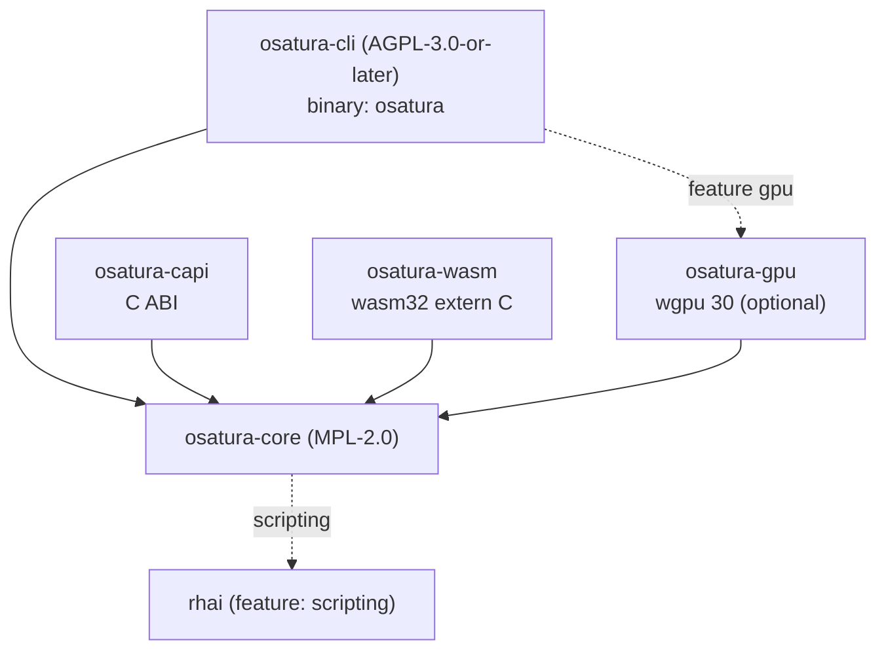

<!-- SPDX-License-Identifier: CC-BY-4.0 -->
<!-- Copyright (c) 2026 Alexandru-Ionuț Chiuță (Alexio) -->

# Az OSATURA architektúrája

Ez a dokumentum bemutatja, hogyan szerveződik a workspace, hogyan jutnak el az adatok a projektfájltól
a pixelekig, milyen garanciákat ad a motor és melyeket nem, valamint hogyan bővíthető. A fájlformátum
mezőszintű részletei a [PROJECT_FORMAT.md](PROJECT_FORMAT.md) fájlban vannak. A fogalmakat a
[GLOSSARY.md](GLOSSARY.md) határozza meg. A fenyegetési modell és a megerősítési lista a
[SECURITY.md](SECURITY.md) fájlban található. A nyilvános könyvtárfelületet az [API.md](API.md) írja le.

Tartalom

1. [Crate-ek és függőségi gráf](#1-crate-ek-és-függőségi-gráf)
2. [Adatfolyam](#2-adatfolyam)
3. [Az osatura-core modultérképe](#3-az-osatura-core-modultérképe)
4. [A nem destruktív bake minta](#4-a-nem-destruktív-bake-minta)
5. [Szerkesztő, op-ok és visszavonás](#5-szerkesztő-op-ok-és-visszavonás)
6. [Determinizmus: garanciák és korlátok](#6-determinizmus-garanciák-és-korlátok)
7. [Hibakezelési szabályzat](#7-hibakezelési-szabályzat)
8. [Biztonsági áttekintés](#8-biztonsági-áttekintés)
9. [A Studio-szerver architektúrája](#9-a-studio-szerver-architektúrája)
10. [Az együttműködés architektúrája](#10-az-együttműködés-architektúrája)
11. [Teljesítményjegyzetek](#11-teljesítményjegyzetek)
12. [Bővítési útmutató](#12-bővítési-útmutató)
13. [Feature flagek](#13-feature-flag-ek)
14. [Build célok](#14-build-célok)

## 1. Crate-ek és függőségi gráf

| Crate | Licenc | Fajta | Szerep |
| --- | --- | --- | --- |
| `osatura-core` | MPL-2.0 | könyvtár | Minden, ami nem kezelőfelület: adatmodell, motor, rendererek, eszközök, az együttműködési mag. Alapértelmezett feature: `scripting`. |
| `osatura-cli` | AGPL-3.0-or-later | `osatura` bináris | Parancssor, a Studio webszervere és az együttműködési HTTP-útvonalak. A core-tól `default-features = false` beállítással függ, és újra kiteszi a `scripting` featuret; opcionális feature: `gpu`. |
| `osatura-capi` | MPL-2.0 | `cdylib`, `staticlib`, `rlib` | C ABI (`osatura.h`, `ABI_VERSION` 1). A core-tól `default-features = false` beállítással függ. |
| `osatura-wasm` | MPL-2.0 | `cdylib`, `rlib` | Egyszerű `extern "C"` WebAssembly-modul, wasm-bindgen nélkül. A core-tól `default-features = false` beállítással függ. |
| `osatura-gpu` | MPL-2.0 | könyvtár | Opcionális wgpu renderer. A core-tól `default-features = false` beállítással függ. |



```text
            osatura-cli  (AGPL, bin "osatura")
              |        \.........(feature "gpu").........  osatura-gpu
              v                                              |
  osatura-capi --->  osatura-core  <---  osatura-wasm  <--+  (gpu also depends on core)
                          :
                          :.....(feature "scripting")..... rhai
```

Miért különböznek a licencek: a core MPL-2.0, hogy zárt forráskódú alkalmazások beágyazhassák a
könyvtáron, a C ABI-n vagy a WASM-modulon keresztül anélkül, hogy az AGPL-t kellene átvenniük; a parancssor és a Studio-
szerver AGPL. Minden forrásfájl az SPDX-sort hordozza, amely megegyezik a crate-je licencével; ezt egy teszt
(`osatura-cli/tests/spdx_audit.rs`) és a `scripts/licence-audit.sh` ellenőrzi. Lásd: `LICENSING.md`.

Stabilitás: csak az `osatura_core::api` és az `osatura_core::prelude` a stabil felület
(`API_VERSION` 1.4.0). Egy snapshot-teszt a nyilvános elemeket az `api_surface.txt` fájllal veti össze; a felület
megváltoztatása a fájl tudatos szerkesztését és verziódöntést kényszerít ki.

## 2. Adatfolyam

```text
 project.json
     |
     v   Project::from_json      parse, magnitude check (+-1e7), format gate
 Project (serde structs)
     |
     v   Engine::new / with_asset_dir
     |     validate everything (all problems returned), resolve names to indices,
     |     bake springs, resolve links and containers
 Engine
     |
     v   Engine::evaluate(frame)         pure function of the frame
 Frame  (bones, resolved geometry per node, camera, masks, effects, nonfinite flag)
     |
     +--> svg::      vector text (SVG)
     +--> raster::   tiny-skia, 8-bit RGBA
     +--> fraster::  own f32 scanline rasteriser (HDR / EXR path)
     +--> osatura-gpu  wgpu, stencil-then-cover
     +--> export / gltf / lottie_export / open_formats / ...
```

A láncot körülvevő belépési pontok:

- **CLI**: `load` / `load_sized` (fájlt olvas a `--max-input-bytes` korláttal), `Engine::with_asset_dir`,
  majd a parancs. Az írók a `write_json` függvényt hívják, amely íráskor az `Engine::new` révén újra validál, és
  a kimenethez képest relatívvá írja át az asset-útvonalakat.
- **`api::Animation`**: a C ABI és a WASM-modul által használt stabil homlokzat. A `check_frame`
  korlátozza a képkockaindexet; a `guard()` a hívást `catch_unwind` alatt futtatja, és a pánikot
  `ApiError::Internal` hibára képezi le. A `Player` futásidejű állapotgépeket és kötéseket ad egy
  `Animation` fölé.
- **Studio**: egy `Editor`-t (5. szakasz) tart egy kezelőszálon belül; minden kérés kiértékel egy képkockát,
  és renderel azt.

A rendererek csak egy `Frame`-et látnak. Soha nem futtatják újra a rig-logikát, így az IK, a skinelés és a deformerek
egyszer, az `engine` modulban vannak megvalósítva.

## 3. Az osatura-core modultérképe

Az `osatura-core/src` nagyjából 100 modult tartalmaz. Terület szerint vannak csoportosítva. Az egyes modulok „alapja” az a
nyilvános szabvány, tanulmány vagy tankönyvi technika, amelyet a `CLEANROOM.md` rögzít; a „saját tervezés” azt jelenti, hogy a clean-room napló
nem rögzít külső forrást. A `_tests` végződésű nevek tesztmodulok, ezeket kihagytuk.

### 3.1 Adatmodell és nyelv

A **project** határozza meg a fájl serde struktúráit (`Project`, `Bone`, `Layer`, `Channel`, `Camera`
és a többi), valamint a `Project::from_json` függvényt, amely a formátumkaput és a nagyságrend-ellenőrzést végzi.
Saját tervezés. A **path** vektoros útvonalakat, horgonyokat, morphokat és csontsúlyokat tartalmaz; a Bezier-
görbék laposítása tankönyvi de Casteljau. A **style** színeket, festékeket, színátmeneteket és vonalstílusokat tartalmaz; az sRGB
átvitel az IEC 61966-2-1 szabványt követi. Az **anim** kulcsokat, sávokat és easing-görbéket tartalmaz; a `Bounce` és a `Back`
elemi mechanikából származtatott saját levezetések (CLEANROOM `anim` sor); a `Smooth` nem egyenletes
Catmull-Rom spline. A **math** 2D affin algebra. A **rig** csontokat, FK-t, a kétcsontos analitikus
IK-t, FABRIK-ot, soft és stretch IK-t (saját paraméterezés) és kényszereket tartalmaz. Az **expr** egy kis
rekurzív leszálló kifejezésnyelv 4096 bájtos, 64 mélységű korláttal. A **noise** hash-alapú
értékzaj; az egész finalizáló Chris Wellons lowbias32 függvénye (közkincs) Knuth- és
MurmurHash3-konstansokkal. A **base64** egyszerű RFC 4648 kodek.

### 3.2 Motor és renderelés

Az **engine** validálja a projektet, kiértékel egy képkockát (a sorrend a PROJECT_FORMAT.md 16. szakaszában van),
és kijavítja a nem véges geometriát. A **raster** a tiny-skia segítségével renderel egy `Frame`-et (keverési módok, maszkok,
rétegeffektek, színátmenetek). A **fraster** saját scanline rasztereződő `f32` típuson (16 al-scanline,
pontos sávterület, nem-nulla és páros-páratlan körüljárás) a W3C Compositing and Blending Level 1
képleteivel, a HDR útvonal használja. Az **svg** SVG-t ír. A **hdr** színkezelt, nagy pontosságú kimenetet ad: sRGB/lineáris konverzió (IEC 61966-2-1), 16 bites
PNG és OpenEXR (nyilvános specifikáció, tömörítetlen egyrészes scanline-ok, IEEE 754 binary16). A **postfx** és az **fx** az utóeffekt-láncot tartalmazza (blur, levels,
`relight` Lambert-árnyalással normáltérképből, morfológiai műveletek; a Gauss-blur szeparálható);
az `fx` liquid, boolean és emitter geometriát is épít (marching squares, sokszög-vágás,
zárt alakú részecskék). A **layerfx** az SVG szűrőprimitívek (`feGaussianBlur`, `feOffset`, `feColorMatrix`, `feMerge`)
szemantikájával valósítja meg a rétegeffekteket. A **dof** saját rétegzett
szóródási kör közelítés Gauss-blurrel, a motor kompozitorán keresztül összeállítva, így a
keverési módok, maszkok és rétegeffektek megmaradnak. Az **export** animált GIF-et, az önálló HTML-lejátszót és Lottie JSON-t ír (az MP4 a CLI-ben
a felhasználó saját `ffmpeg`-jén megy át);
az **animimport**, a **seqimport** és az **open_formats** GIF89a, APNG, PNG-sorozat és
OpenRaster/OCA konténerek olvasását végzi (zip-korlátok kikényszerítve). A **gltf** glTF 2.0 / GLB-t ír a Khronos
specifikációja alapján (ear-clipping háromszögelés). A **lottie_export** és a **lottie_import** a
nyilvános Lottie JSON-elrendezésre képez (részhalmaz, figyelmeztetésekkel). Az **importers** SVG 1.1 útvonalnyelvtant, BVH-t és
egyszerű szöveges jelzéslapokat olvas.

### 3.3 Hang és beszéd

A **soundtrack** hangokat helyez az idővonalra, és ffmpeg-szűrőgráfot (atrim, afade,
adelay, amix) épít a felhasználó saját ffmpeg-jéhez; a vágási és fade-értékek másodpercek. Az **audio** hangvezérelt
lip-sync: amplitúdó- és nullátmenet-heurisztika (nem fonémafelismerés), amely képkockánként kiválaszt egyet öt
szájállásból. Az **audiomap** hangból burkológörbéket és onseteket készít (RMS egypólusú attack/release-szel; az onset-energia
egy mozgóátlaghoz képest). A **speech** hangaktivitás-észlelést, dinamikus programozással (Viterbi) végzett kényszerített illesztést
egy időtartam-priorral szemben, valamint betű–szájállás szabályokat végez, amelyek switch rétegeket vezérelnek.

### 3.4 Deformáció és geometriafeldolgozás

A **cage** a mean-value-coordinate cage deformer (M. S. Floater, CAGD 20(1), 2003). A **pinwarp**
a pin warp a Wendland 1995 kompakt tartójú radiális bázisfüggvénnyel, Gauss–Jordan-eliminációval megoldva. A **cloth** és a **physics** pozícióalapú dinamikát használ Verlet-
integrálással (tankönyvi) ruhafelületekhez, szalagokhoz és ütközőkhöz; az eredmények bake-eltek. A **warp** a deformer-
vezérlőpontok szerkesztési műveleteit tartalmazza: pivotok, arányos (soft) skálázás és teljes háló átméretezése. A **weights** csontsúlyokat számol Laplace/hő-
diffúzióval Gauss–Seidel iterációval. A **meshtrace** rasztereskből épít hálókat: marching
squares, Douglas–Peucker, Bridson-féle Poisson-disc mintavételezés, Bowyer–Watson Delaunay-háromszögelés és
Laplace-/Taubin-simítás. A **trace** bitképeket vektorizál (marching squares és
Ramer–Douglas–Peucker). Az **autotrace** hozzáadja a k-means-t (Lloyd 1982, k-means++), a median cut-ot, a Suzuki–Abe-féle
határkövetést, a Zhang–Suen-féle vékonyítást, az Otsu-küszöbölést és a Borgefors-féle chamfer-távolságot. A **links**
feloldja a mesh lock-okat és glue-kat (baricentrikus koordináták, Kahn-féle topologikus rendezés).

### 3.5 Rigging-segédek és animációs eszközök (bake-előállítók)

Az **autorig** és a **vocab** anatómiai szavakat párosít névvel egy alap rig felépítéséhez, kétcsontos IK-val 0-s mixen,
ismétlődő légzéssel és seedelt pislogással. A **rigedit** a nyugalmi pózt szerkeszti. Az **eyeclip** hagyományos maszkokat ad
a szemrétegekhez. A **parentswitch** affin algebrával (`relative = parent^-1 * child`) szülőt vált, és
kulcsokat bake-el. A **stretch** tankönyvi 2D aim plusz távolságskálázás. A **footlock** és a **magnet**
érintkezésészleléssel és smoothstep lecsengéssel korrigálja a pozíciókat. A **pathfollow** laposított
Bezier-görbéket mintavételez ívhossz szerint, és kulcsokat bake-el. A **drivers** egy vezérlőt pózokra képez le szakaszonként lineáris
interpolációval. A **procgen** és a **looper** üresjárati mozgást generál és ismétléseket javít (lineáris trendeltávolítás).
A **springfit** másodrendű rugóparamétereket illeszt. A **clipstack** a rétegzett klipköteg
replace, additive és multiply keveréssel, smoothstep fade-ekkel és glob maszkokkal. A **skins** elnevezett réteg-
csoportok. A **camshots** kamerafelvételeket kulcsol. A **comps** réteg-állapot pillanatképeket tárol. A **bonevis**
és a **chanmeta** szerkesztői metaadatokat tart. A **depth** a legfelső szintű rétegek `parallax` tényezőjét szórja el távolról közelre egy többsíkú kamerához.
A **motionlib** kulcstartományokat másol átnevezéssel és időskálázással. Az **anim_tools**, a **keyops**, a
**timeline** és a **timeline_graph** dope sheet-matematikát valósít meg (eltolás, skálázás pivot körül,
ripple), Hermite–Bezier konverziót és a Fritsch–Carlson-féle monoton korlátozót.

### 3.6 Interaktív futásidő

A **machine** a futásidejű állapotgép (saját tervezés: véges állapotú gép, 1D blend tree, easing
cross-fade). A **binding** külső adatokat tulajdonságokra képez (affin átképezés, egypólusú
simítás). A **statemachine** a korábbi eseménynaplós állapotgép bake-eléssel. A **containers**
flexbox-stílusú egydimenziós elosztást, pin és aspect téglalapokat, valamint az elasztikus
görgetést valósítja meg (csillapított rugó, félimplicit Euler). A **layout** igazítási és elosztási segédeket, valamint egy
bake-elt trim-path műveletet tartalmaz (laposított görbék befoglaló dobozai, ívhossz szerinti mintavételezés). A **liveinput** és a **midi** MIDI 1.0 üzeneteket és
Standard MIDI Fileokat értelmez, és élő bemenetet rögzít. A **perf** a rögzített mintákat minimális kulcsokká alakítja, a bemeneti jeleket (csúszkák, MIDI, hangszint)
paraméterekre képezi, és a mozgást végtaghossz szerint retargeteli. A **faceparam**
a szem képarányát (Soukupova és Cech 2016) és a One-Euro szűrőt (Casiez, Roussel és
Vogel, CHI 2012) számolja. A **facedet** és a **facegen** egy szintetikus arcokon tanított kis arcdetektor
(HOG jellemzők Dalal és Triggs 2005 nyomán, logisztikus regresszió, supervised descent). A **mocap** BVH-t
olvas. A **posesuggest**, a **posematch** és a **tinymlp** klasszikus helyi ML-segítség egy
(mu/mu_w, lambda) evolúciós stratégiával (Beyer és Schwefel 2002), mellékelt modellsúlyok nélkül.

### 3.7 Szerkesztő és együttműködés

Az **edit** az `Editor` op-okkal és visszavonással. A **pick** és a **gizmo** találatvizsgálatot (körüljárási szám,
szakasztól mért távolság) és transzformációs kezelőket (2×2-es mátrix QR-felbontása) végez. Az **overlays** és a
**scrub** hagymahéjat, mozgásnyomvonalat és egy revízió-kulcsolt LRU képkocka-gyorsítótárat állít elő proxy-
munkaszállal. A **collab**, a **collabhub** és a **collablog** a CRDT-replika, a szekvenszer és a
tartós napló (10. szakasz). A **script** és a **scriptops** egy sandboxolt Rhai API-t tesz elérhetővé (`scripting`
feature). Az **agent** egy JSON-RPC 2.0 / MCP-alakú eszközszerver egyetlen projekthez.
A **snapshots** számozott projektmásolatokat tart duplikátum-elnyomással és metszéssel (számláló, óra
nélkül, így mindenhol ugyanúgy viselkedik) összeomlás utáni helyreállításhoz. Az **explain** rendezett beszámolót ad mindenről, ami egy csont vagy réteg értékét meghatározza egy
képkockán; az **inspect** statisztikákat, szemantikus diffet és referenciakocka-regressziós hasheket tartalmaz (pontos FNV-1a
képkockánként, plusz egy 16×16-os bélyegkép).

### 3.8 Minőség, méret és verziókezelés

A **lint** animációs heurisztikákat ellenőriz (L001-től kezdődő kódok). A **safety** a villogás és a vörös villogás
küszöbeit ellenőrzi a WCAG 2.3.1 szerint, relatív luminanciával. A **ci** és a **percep** az animáció-CI-t valósítja meg:
CIE76 és CIEDE2000 (CIE TR 142-2001, a képletek Sharma, Wu és Dalal 2005 nyomtatott alakjában), blokk-SSIM
(Wang és mások 2004), DCT perceptuális hash, PSNR. A **fuzz** pózokat terhel (SplitMix64, latin
hiperkocka, Halton-sorozatok, 2×2-es deformációs gradiens, ddmin). A **sizefit** a kimenetet bájtkerethez illeszti (median cut, Floyd–Steinberg, RDP javítóhurokkal). A **lod** részletességi szinteket állít elő
deklarált hibahatárral (Douglas–Peucker 1973, Visvalingam–Whyatt 1993, Schneider legkisebb négyzetes
Bezier-illesztése, Garland–Heckbert kvadratikus hibametrika, diszkrét Fréchet-távolság Eiter és
Mannila nyomán). A **semdiff** és a **vcs** szemantikus diff és tartalomcímzett verziókezelés (Merkle-
DAG, SHA-256 a FIPS 180-4 szerint, diff3 Khanna, Kunal és Pierce 2007 nyomán). Az **unknownfields**
a figyelmen kívül hagyott JSON-kulcsokat észleli. Az **assets** és az **fsutil** az útvonal- és méretszabályokat kényszeríti ki a fájlokra.
Az **api** a stabil homlokzat; a **demo** a demóprojektet építi; a **robustness** és a **fuzz** olyan
teszteket és generátorokat tartalmaz, amelyek a bemenetkezelést pánikmentesen tartják.

## 4. A nem destruktív bake minta

Sok eszköz számol valamit az idő függvényében: fizika, magnet, footlock, stretch, útvonalkövetés, procedurális
generálás, klipköteg, kamerafelvételek, skinek, driverek, állapotgép- és élő bemenet-bake-elés, és
még sok más. Mindegyik ugyanazt teszi:

1. Beolvassa a projektet, és úgy értékeli ki, ahogy van.
2. Új értékeket számol képkockánként.
3. **Hagyományos csatornákat** fűz a `project.channels` végére (alapértelmezett egyesítési mód: `keep`).
4. Az eredeti animációt érintetlenül hagyja.

Mivel a kimenet egyszerű csatorna, nem kell hozzá különleges formátum, minden rendererben fut, és kézzel
szerkeszthető. Az összes baker által követett szabályok:

- Soha nem töröl kézzel készített kulcsokat. A hozzáfűzött `replace` csatornák kiértékeléskor felülbírálják a korábbi szögkulcsokat; a bake-elt csatorna
  eltávolítása visszaállítja az eredetit.
- Lock-tudatos: a `channel_meta` `lock` által fedett csatornákat és a `locked` rétegeket kihagyja.
- Idempotens, ahol a baker felismeri a saját kimenetét. A klipköteg a `clip_baked` mezőben pillanatképet készít arról, amit bake-elt,
  és újrabake-eléskor pontosan azt cseréli le.
- Determinisztikus marad: seedelt RNG-k és rögzített iterációszámok.

A futásidejű funkciók exportáláskor ugyanezt az elvet követik. A Player gépállapotai és kötései
konstans `replace` csatornákká alakulnak, amelyeket a projekt végére fűz a rendszer, így az exportált fájlnak nincs szüksége
a futtatókörnyezetre.

## 5. Szerkesztő, op-ok és visszavonás

Az `edit.rs` az `Editor`-t definiálja, amely egy `Project`-et és a teljes szerkesztési előzményt birtokolja.

- Az `Op` a `set`, `insert`, `remove` vagy `batch` egyike, amely a projekt JSON-ját RFC 6901
  pointerrel címzi. A `raw_apply` végrehajt egy op-ot, és visszaadja annak **inverzét**.
- Minden `apply` lefuttatja az op-ot, majd az új JSON-ból újraépít egy teljes `Engine`-t. Ha a validálás sikertelen, az
  op visszagörgetődik, és a hibalista visszaadódik, így a szerkesztő nem tarthat érvénytelen projektet.
- A visszavonási és újra-végrehajtási vermek inverz op-okat tartanak. A revíziószámláló minden változásnál nő; a gyorsítótárak
  (scrub képkockák, proxyk) ezt használják kulcsként.
- A magas szintű műveletek (`set_key`, mozgatás, törlés, container hozzáadása stb.) op-okból épülnek fel. Először az
  `assert_unlocked` függvényt hívják, így a `locked` rétegek és a zárolt csatornák ellenállnak a szerkesztői műveleteknek;
  a puszta `Op`-ok megkerülik ezt az ellenőrzést, mert ők az alacsony szintű réteg.
- A `replace_doc` egy teljes dokumentumot cserél be (az együttműködés használja), és törli az előzményeket.

Mivel minden JSON-pointer op-ként van kifejezve, ugyanaz az ábrázolás szolgálja a visszavonást, az
együttműködési CRDT-t (10. szakasz), a szkriptelési API-t és az ügynökszervert.

## 6. Determinizmus: garanciák és korlátok

Ami garantált:

- Az `Engine::evaluate(frame)` a projekt és a képkockaszám tiszta függvénye. A rugókat betöltéskor
  szimulálja a rendszer; a zaj hash-alapú; a részecskék az idő zárt alakú függvényei; az RNG-k
  seedeltek; a ruha és a fizika bake-elt.
- A képkockák tetszőleges sorrendű vagy kétszeri kiértékelése azonos eredményt ad.
- Ugyanannak a képkockának a kétszeri renderelése egy gépen, egy buildel bájtra azonos kimenetet ad. A CI
  tartalmaz ehhez determinizmus-ellenőrzést.

Ami nem garantált:

- Az operációs rendszerek, CPU-k vagy fordítóverziók közti egyezést nem ellenőriztük. A
  `libm`, a fused multiply-add és a SIMD kódutak eltérései elmozdíthatják az élsimított élpixeleket.
- A GPU-renderer a pontos hash-keretrendszeren kívül van; a CPU-rendererrel csak egy
  tűréshatáron belül egyezik (lásd ROADMAP, 9. szakasz).
- Az animáció-CI ezért pontos hashek helyett észlelési tűrést használ.

Szálak: a motor kiértékelése egyszálú. Szálak az arcdetektorban (scoped), a
scrub/LOD proxy-munkaszálban, a `sizefit` modulban és a Studio HTTP-szerverében vannak. Egyik sem változtatja meg a
kiértékelés eredményeit.

## 7. Hibakezelési szabályzat

- A bemenet soha nem okozhat pánikot. A robusztussági tesztek és a fuzz-generátorok ezt gyakorolják, a
  homlokzat, a C ABI és a WASM belépési pontjai pedig `catch_unwind` alatt futtatják a hívásokat.
  A `wasm32-unknown-unknown` célon az alapértelmezés `panic=abort`, így a `catch_unwind`-nak ott nincs hatása;
  az a modul ehelyett a validálásra támaszkodik.
- A validálás **az összes** problémát `Err(Vec<String>)` alakban adja vissza, hogy a felhasználó egy menetben javíthasson egy fájlt.
- Az üzenetek embereknek szólnak; ne értelmezd őket géppel. A stabilitást igénylő tesztek jellegzetes
  töredékekre illesztenek.
- Minden, ami a bemenettel együtt nő, korláttal rendelkezik: JSON-bájtok, csontok, hálócsúcspontok, effektek rétegenként,
  képoldalak és pixelek, képkockák szorozva horgonyokkal, container-tagok, HTTP-fejléc- és törzsméretek. A
  számok a PROJECT_FORMAT.md 12. és 18. szakaszában vannak.
- A nem véges értékeket a rendszer visszatartja, nem terjeszti: a csatornák átugorják őket, a `repair_nonfinite`
  elrejt egy hibás csomópontot, a `Frame.nonfinite` pedig jelzi a hívóknak. Az `evaluate_checked` és a
  `check_all_frames_finite` ezt hibává alakítja a kötegelt eszközök számára.
- A C ABI az utolsó hibát szálhelyi tárolóban tartja, és kódokat ad vissza; soha nem tekercselődik vissza a
  határon át.

## 8. Biztonsági áttekintés

A rövid változat: az OSATURA megbízhatatlan JSON- és asset-fájlokat olvas, a Studio pedig hálózati
socketen hallgatózik. A védelem rétegzett: szigorú betöltési korlátok (nagyságrend, méret, darabszám-plafonok), útvonal-
bezárás az assetekhez, határidőkkel és host/origin ellenőrzésekkel rendelkező, csak std-t használó HTTP-szerver, token-hitelesítés az együttműködéshez, valamint sandboxolt szkriptmotor
kifejezett korlátokkal. A fenyegetési modell és a megerősítő intézkedések a [SECURITY.md](SECURITY.md) fájlban vannak.

## 9. A Studio-szerver architektúrája

Az `osatura studio` egyetlen HTML-oldalt (`studio.html`) és egy JSON API-t szolgál ki egyetlen folyamatból.

```text
 browser  <--HTTP/1.1-->  http.rs  (accept loop; bounded connection threads, I/O only)
                             |  parsed request over a channel
                             v
                       handler thread  (single owner of the Editor and caches)
                             |   studio.rs  ~52 /api routes
                             |   uiconfig.rs  command registry, key map
                             |   collab_srv.rs  /api/collab/* routes
                             v
                      osatura-core: Editor, Engine, raster, svg, scrub, collab
```

- Az **http.rs** csak std-t használó HTTP/1.1-szerver (a korábbi `tiny_http` függőséget biztonsági
  felülvizsgálat után eltávolítottuk). A kapcsolatszálak száma korlátozott, és csak socketeket olvasnak és írnak; a
  kéréseket az egyetlen kezelőszálnak adják át, amely az `Editor`-t birtokolja. Így semmilyen zár nem védi a projekt
  állapotát, és két kérés sem módosíthatja egyszerre.
- Korlátok és válaszok: olvasási és írási határidők (408), méretkorlátok (413), kapcsolatplafon (503),
  `Connection: close` minden válaszon. A válaszok Content-Security-Policy-t,
  `X-Content-Type-Options: nosniff`, `X-Frame-Options` és `Referrer-Policy` fejlécet hordoznak.
- **Hálózati kitettség**: az alapértelmezett bind a `127.0.0.1`. Bármely más bindhoz token kell. A Host
  engedélylista védi a DNS rebinding ellen, a POST-kérésekhez pedig same-origin ellenőrzés kell.
- A **studio.rs** nagyjából 52 `/api` útvonalat valósít meg (szerkesztés, visszavonás és újra, képkockák renderelése, proxyk,
  kijelölés és gizmók, overlayek, importok és exportok, LOD háttérbeli építések). Az **uiconfig.rs** a parancsregisztert tartalmazza: azonosítók, címek, alapértelmezett billentyűkiosztás,
  előre beállított panelelrendezések.
- Az oldalt a memóriából szolgálja ki a rendszer. Egy `/source` útvonal a megfelelő forráskódot kínálja, az
  AGPL-lel összhangban.
- **Proxyk**: léptetés közben az oldal csökkentett részletességű képet kér (`LodProxy`, háttérben futó
  munkaszál építi), és elengedéskor teljes minőséget kér.

## 10. Az együttműködés architektúrája

A többfelhasználós szerkesztés három rétegben épül fel, mindegyik determinisztikus és hálózat nélkül tesztelhető.

**collab.rs, a replika.** CRDT a projekt JSON-ja fölött. Egy objektumkulcs last-writer-wins
regiszter. A tömb RGA (replicated growable array, Roh és mások 2011) sírkövekkel, és a törlés
felülírja az egyidejű szerkesztéseket. A rendezés Lamport-órákat (Lamport 1978) és vektorórákat (Fidge,
Mattern) használ. A változások `Envelope { replica, seq, lamport, deps, ops }` alakban utaznak. A kézbesítés oksági
(egy envelope megvárja, amíg a függőségei alkalmazva lesznek) és idempotens (az újrakézbesítésnek nincs
hatása). Minden felhasználónak saját visszavonási verme van, amely csak a saját op-jait fordítja meg. A `compaction` eldobja azokat a
sírköveket, amelyeket minden replika látott. A tervezés Shapiro és mások 2011 (műveletalapú
CRDT-k) munkáját követi.

**collabhub.rs, a szekvenszer.** Egy hiteles `Hub` birtokolja a fő replikát. A felhasználók vagy
*Thin* (a hub által tartott proxy-replika, böngészőknek) vagy *Replica* (saját replika) típusúak. A hub
egy hívó által megadott closure-rel validálja az egyesített JSON-t, így az az egyesítés, amely
érvénytelen projektet eredményezne, elutasításra kerül. Követi a jelenlétet (kurzorok, kijelölések) és egy eseményfolyamot is
(server-sent events). Korlátok: 32 felhasználó (`MAX_USERS`), és a 10 percig tétlen felhasználók lekapcsolódnak.

**collablog.rs, tartósság.** Soralapú JSON-napló. Minden rekordot az előzőhöz láncol egy
hash (FNV-1a 64 bites az 1-es verzióban, SHA-256 a 2-esben), így a sérülés észlelhető; az írások
`fdatasync` hívást használnak, ha a `--collab-log` be van állítva.

**collab_srv.rs (CLI), a HTTP-oldal.** A `/api/collab/` alatti útvonalak: `join`, `leave`, `state`, `log`,
`ops`, `undo`, `redo`, `presence`, `compact`, `events`. Hitelesítés: legalább 16 karakteres token,
amelyet az `X-Collab-Token` fejlécben vagy az `arm_token` sütiben küldenek (a `/api/login` állítja be),
állandó időben hasonlítja össze a rendszer, és sebességkorlát válaszol 429-cel. Minden résztvevő saját titkot is kap
(`X-Collab-Secret`), hogy egy felhasználó ne járhasson el egy másik nevében. Az átvitel egyszerű HTTP TLS nélkül:
megbízható hálózaton túli használathoz tegyél elé TLS-t lezáró proxyt.

Az `osatura collab-sim` sok szimulált klienst futtat egy hub ellen folyamaton belül, így tesztelik a konvergenciát.

## 11. Teljesítményjegyzetek

Az alábbi számok a `ROADMAP.md` 9. szakaszában rögzített mérések. Reprodukálva vannak, nem
újra mérve. Kezeld őket nagyságrendként a megadott gépre és buildre.

| Mérés | Eredmény |
| --- | --- |
| 640x480 demó, release build, egy szál, 48 képkocka átlaga: raster 0. szint | 14,4 ms képkockánként |
| ugyanez, proxy 1. szint / 2. szint / 4. szint | 3,5 ms / 0,7 ms / 0,09 ms |
| SVG-író; egyszerűsített SVG | 0,17 ms; 0,10-0,15 ms |
| 671 rétegű szintetikus projekt, raster 0. szint a 2. szinttel szemben | 1832 ms a 106 ms-mal szemben |
| e projekt böngészős dekódolása: teljes SVG, proxy 2, proxy 4 | 45 ms, 28 ms, 25 ms |
| gyorsítótár-találat a scrub-gyorsítótárban | kb. 0,002 ms |
| GPU-renderer Mesa llvmpipe-en (szoftveres, nem valódi GPU), 1-es skála | 253-295 ms képkockánként (GL 253, Vulkan 295) a tiny-skia 13,8 ms-ával szemben |
| ugyanez, 2-es skála | 1260 ms az 56 ms-mal szemben |
| Studio proxy-teszt (debug build): bitkép, vektor | 51,6-34,2 ms; 2,12-0,30 ms |
| LOD háttérbeli építés, debug build | 19,5 s |
| végponttól végpontig tartó tesztcsomag | kb. 19 s debug, kb. 40 s release |
| arcdetektor tanítása, 2 mag | 91 s; a dobozok 99,3 százaléka megtalálva |
| LOD demó, deklarált és mért hiba (px) | 0.104/0.386/0.928/1.537/1.657 vs 0.099/0.334/0.819/1.337/1.337 |

Az értelmezésük: a vektoros útvonal olcsó, így a proxy a böngészőben kis projekteknél keveset segít, bitképes
rendereléshez és több száz rétegű projektekhez viszont sokat. A GPU-számok semmit sem mondanak a hardveres
teljesítményről; hardveres adapter nem állt rendelkezésre. A LOD-szintek soha nem
lépik túl a deklarált hibájukat, és a mért hiba a deklarált korlát alatt marad.

Gyakorlati megjegyzések: a kiértékelés költsége a csatornákkal, csontokkal és deformerméretekkel nő; a renderelés költsége
a felbontással, az effektekkel (mindegyik egy képernyőn kívüli réteget használ) és a maszkokkal nő. Léptetés közben használd a `--proxy N` kapcsolót vagy a LOD-szinteket,
a végső kimenethez pedig a teljes renderert.

## 12. Bővítési útmutató

Általános szabályok bármilyen változtatáshoz:

- Minden új forrásfájl a saját crate-jének SPDX-sorával és a szerzői jogi sorral kezdődik. Ennek hiányában egy teszt elbukik.
- Az új bemenetnek korlátokkal (caps) kell rendelkeznie, az új validációs üzenetek pedig sorolják fel az összes problémát, ne álljanak meg az elsőnél.
- Mindent, ami külső módszert vagy szabványt használ, rögzíteni kell a `CLEANROOM.md` fájlban
  (lásd annak szabályait és az opcionális spec-note sablont).
- Frissítsd a `PROJECT_FORMAT.md` fájlt, ha a fájlformátum változik, és az `API.md` fájlt, ha a homlokzat (facade) változik.

### 12.1 Réteg-tulajdonság hozzáadása

Példa: egy új, rétegenkénti szám.

1. Add hozzá a mezőt a `Layer` típushoz az `osatura-core/src/project.rs` fájlban
   `#[serde(default = "...", skip_serializing_if = "...")]` attribútummal, hogy a régi fájlok változatlanul betöltődjenek, és az alapértékek ne íródjanak vissza. Egy opcionális mező hozzáadása nem változtatja a `FORMAT_VERSION` értékét.
2. Adj hozzá validációt az `Engine::new` függvényben (véges érték, tartomány), olyan üzenettel, amely megnevezi a réteget.
3. Ha animálható, adj hozzá egy `Prop` variánst, a `target_kind` leképezését, az írási korlátozást (clamp), a kezdőértéket az `initial_state` függvényben és az `apply_channels` esetét. Ha al-célt (sub-target) használ, bővítsd a `layer::sub` feloldót.
4. Használd az `evaluate` függvényben és azokban a renderelőkben, amelyekre hatással van (`svg`, `raster`, `fraster`, GPU), hogy egyezzenek.
5. Ellenőrizd az exportálókat (`lottie_export`, `gltf`, ...): vagy leképezik, vagy jelzik, hogy elhagyják.
6. Tesztek:
   - egy serde körút (round trip), amely bizonyítja, hogy az alapérték kimarad;
   - egy validációs teszt minden szabályra, a hibaüzenettel együtt;
   - egy kiértékelési teszt, benne egy csatornával, amely animálja;
   - az ismeretlen mezők ellenőrzése (`unknownfields`) nem jelölheti meg az új mezőt;
   - robusztusság: NaN, végtelen és 1e7 határértékek (add hozzá a meglévő robusztussági tesztekhez);
   - az `api_surface.txt` pillanatkép, ha egy nyilvános típus megváltozott.
7. Dokumentáld a PROJECT_FORMAT.md fájlban (név, típus, alapérték, tartomány, szemantika, példa).

### 12.2 CLI-parancs hozzáadása

1. Írd meg a logikát az `osatura-core` crate-ben függvényként, típusos bemenettel és `Result<_, String>` vagy hibalista visszatéréssel; a CLI-nek csak a kapcsolókat kell feldolgoznia és kiírnia. Így a logika használható marad a C ABI-ból, a WASM-ból és a Studióból.
2. Az `osatura-cli/src/usage.rs` fájlban adj hozzá egy `USAGE` bejegyzést. A `usage_for`, a `documented_options` és a `check_flags` ezt olvassa, és egy teszt összeveti a USAGE-ot az értelmezővel, így az a kapcsoló, amelyet az értelmező elfogad, de a USAGE nem említ, megbuktatja a tesztet.
3. Az értéket váró opciókat regisztráld a `VALUE_OPTS` táblában (vagy a parancsonkénti `takes_value` táblában).
4. Adj hozzá egy match ágat a `run` függvényben (a `match pos.as_slice()` alapján oszt szét).
5. A projekteket a `load` vagy a `load_sized` függvényen keresztül olvasd, hogy a méretkorlátok és az asset-bezárás érvényesüljön.
6. A projekteket a `write_json` függvényen keresztül írd (újravalidál és átírja az asset-útvonalakat). Ha a parancs a bemenettől eltérő fajta fájlt ír, hívd meg a `guard_out` függvényt, hogy egy elgépelt kimeneti útvonal ne írhassa felül a bemeneti projektet.
7. Tesztek az `osatura-cli/tests/` könyvtárban: `e2e.rs` a sikeres esethez, `robust.rs` a rosszindulatú bemenethez, `fixes.rs` vagy `wave4.rs` a regressziókhoz; a `scripts/e2e.sh` a teljes folyamatot lefuttatja.
8. Dokumentáld a parancs-referenciában.

### 12.3 Exportáló hozzáadása

1. Az írót az `osatura-core` crate-be tedd (például az `export.rs`, a `gltf.rs` vagy a `lottie_export.rs` mellé). `Engine`-t vagy `Project`-et kap, a képkockákat az `evaluate_checked` függvényen keresztül értékeli ki, és nem olvashat privát állapotot.
2. Döntsd el és dokumentáld, mit nem tud ábrázolni. Az elhagyott funkciókról figyelmeztetést adj, ne találgass.
3. Alkalmazz korlátokat: képkockák szorozva a horgonyokkal (40 milliós keret), képoldalak (16384) és pixelek, kimeneti méret.
4. Soha ne írd felül a bemenetet: a CLI-ben használd a `guard_out` függvényt.
5. Tesztek: a kimenetet egy független olvasó vagy a modul saját importálója beolvassa (körút); determinizmus (azonos bemenet, azonos bájtok); egy rosszindulatú projekttel végzett teszt, amely hibát vár, nem pánikot; valamint egy golden- vagy hash-teszt a demóprojekten. A modul megjegyzésében jelezd, hogy független lejátszó ellenőrizte-e a kimenetet (a Lottie-exportáló például megjegyzi, hogy ez az ellenőrzés még hátravan).
6. Add hozzá a bekötést (CLI-parancs, opcionális facade-függvény, Studio-útvonal) és az eredet (provenance) sorát a CLEANROOM.md fájlban.

## 13. Feature flag-ek

| Crate | Feature | Alapértelmezett | Hatás |
| --- | --- | --- | --- |
| `osatura-core` | `scripting` | be | Felépíti a Rhai szkript-API-t (`script`, `scriptops`). Behúzza a `rhai` crate-et és annak `smartstring` függőségét (MPL-2.0). |
| `osatura-cli` | `scripting` | be | Engedélyezi az `osatura-core/scripting` feature-t és a `script` parancsot. A `--no-default-features` elhagyja. |
| `osatura-cli` | `gpu` | ki | Behúzza az `osatura-gpu` crate-et és hozzáadja a `render-gpu` parancsot. Kikapcsolva marad, hogy a hétköznapi buildek kicsik maradjanak. |

Az `osatura-capi`, az `osatura-wasm` és az `osatura-gpu` a core-t `default-features = false` beállítással használja, így nem hordozzák a szkriptmotort.

## 14. Build célok

| Cél | Parancs | Megjegyzések |
| --- | --- | --- |
| CLI és Studio | `cargo build -p osatura-cli` (a gyorsaságért add hozzá a `--release` kapcsolót) | Az `osatura` binárist adja. |
| CLI GPU-val | `cargo build -p osatura-cli --features gpu` | wgpu 30, csak Vulkannal és GL-lel. Csak Mesa llvmpipe-on ellenőrizve. |
| Könyvtár | `cargo build -p osatura-core` | Rust API. |
| C könyvtár | `cargo build -p osatura-capi` | `cdylib`, `staticlib` és az `osatura-capi/osatura.h` header; `ABI_VERSION` 1. |
| WebAssembly | `osatura-wasm/build-wasm.sh` (szükséges hozzá: `rustup target add wasm32-unknown-unknown`) | Egyszerű extern "C" felület, `index.html` és `js/` segédfájlokkal. A fejlesztői környezetben nem lehetett telepíteni a célt; a modult (release profillal) a `.github/workflows/release.yml` építi, a debug buildet pedig a `ci.yml` teszteli Node alatt. Magát a szkriptet nem a CI futtatja. |
| Ablakos alkalmazás (Windows, macOS) | `cargo build --release -p osatura-gui` | Az `osatura-studio` bináris: `tao` ablak + `wry` webnézet a stúdió körül; Linuxon csonk. |
| Tesztek | `cargo test --workspace` | Végpontok közötti shell-folyamat a `scripts/e2e.sh` fájlban; licenc-audit a `scripts/licence-audit.sh` fájlban. |

A workspace alapértelmezett tagjai nem tartalmazzák az `osatura-gpu` crate-et.
