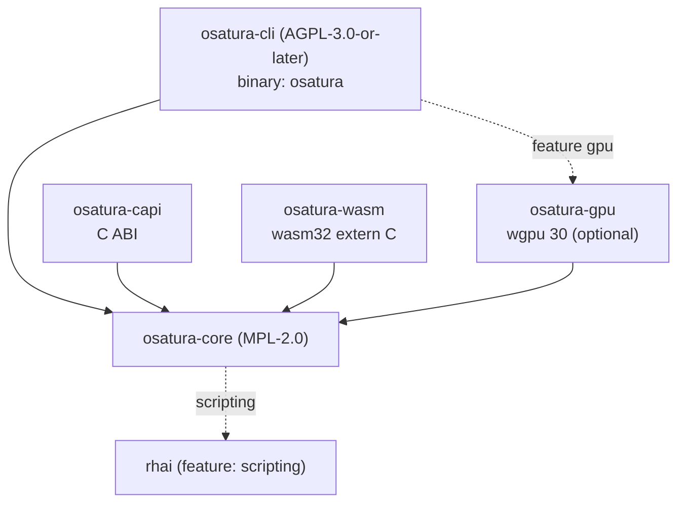

<!-- SPDX-License-Identifier: CC-BY-4.0 -->
<!-- Copyright (c) 2026 Alexandru-Ionuț Chiuță (Alexio) -->

# Architettura di OSATURA

Questo documento spiega come è organizzato il workspace, come i dati fluiscono da un file di progetto ai
pixel, quali garanzie offre il motore e quali no, e come estenderlo. Il dettaglio a livello di campo del formato di file è in [PROJECT_FORMAT.md](PROJECT_FORMAT.md). I termini sono definiti in
[GLOSSARY.md](GLOSSARY.md). Il modello delle minacce e l'elenco delle misure di hardening sono in
[SECURITY.md](SECURITY.md). La superficie pubblica della libreria è descritta in [API.md](API.md).

Indice

1. [Crate e grafo delle dipendenze](#1-crate-e-grafo-delle-dipendenze)
2. [Flusso dei dati](#2-flusso-dei-dati)
3. [Mappa dei moduli di osatura-core](#3-mappa-dei-moduli-di-osatura-core)
4. [Il pattern di bake non distruttivo](#4-il-pattern-di-bake-non-distruttivo)
5. [Editor, op e undo](#5-editor-op-e-undo)
6. [Determinismo: garanzie e limiti](#6-determinismo-garanzie-e-limiti)
7. [Politica di gestione degli errori](#7-politica-di-gestione-degli-errori)
8. [Panoramica della sicurezza](#8-panoramica-della-sicurezza)
9. [Architettura del server Studio](#9-architettura-del-server-studio)
10. [Architettura della collaborazione](#10-architettura-della-collaborazione)
11. [Note sulle prestazioni](#11-note-sulle-prestazioni)
12. [Guida all'estensione](#12-guida-allestensione)
13. [Feature flag](#13-feature-flag)
14. [Target di build](#14-target-di-build)

## 1. Crate e grafo delle dipendenze

| Crate | Licenza | Tipo | Ruolo |
| --- | --- | --- | --- |
| `osatura-core` | MPL-2.0 | libreria | Tutto ciò che non è un front end: modello dei dati, motore, renderer, strumenti, nucleo della collaborazione. Feature predefinita `scripting`. |
| `osatura-cli` | AGPL-3.0-or-later | binario `osatura` | Riga di comando, server web dello Studio e rotte HTTP della collaborazione. Dipende da core con `default-features = false` e riespone `scripting`; feature facoltativa `gpu`. |
| `osatura-capi` | MPL-2.0 | `cdylib`, `staticlib`, `rlib` | ABI C (`osatura.h`, `ABI_VERSION` 1). Dipende da core con `default-features = false`. |
| `osatura-wasm` | MPL-2.0 | `cdylib`, `rlib` | Modulo WebAssembly `extern "C"` semplice, senza wasm-bindgen. Dipende da core con `default-features = false`. |
| `osatura-gpu` | MPL-2.0 | libreria | Renderer wgpu facoltativo. Dipende da core con `default-features = false`. |



```text
            osatura-cli  (AGPL, bin "osatura")
              |        \.........(feature "gpu").........  osatura-gpu
              v                                              |
  osatura-capi --->  osatura-core  <---  osatura-wasm  <--+  (gpu also depends on core)
                          :
                          :.....(feature "scripting")..... rhai
```

Perché le licenze differiscono: core è MPL-2.0 così che le applicazioni a sorgente chiuso possano incorporarlo tramite la
libreria, l'ABI C o il modulo WASM senza adottare l'AGPL; la riga di comando e il server Studio
sono AGPL. Ogni file sorgente porta una riga SPDX uguale alla licenza del suo crate; un test
(`osatura-cli/tests/spdx_audit.rs`) e `scripts/licence-audit.sh` lo verificano. Vedi `LICENSING.md`.

Stabilità: solo `osatura_core::api` e `osatura_core::prelude` costituiscono la superficie stabile
(`API_VERSION` 1.4.0). Un test di snapshot confronta gli elementi pubblici con `api_surface.txt`; cambiare la
superficie impone una modifica consapevole di quel file e una decisione sulla versione.

## 2. Flusso dei dati

```text
 project.json
     |
     v   Project::from_json      parse, magnitude check (+-1e7), format gate
 Project (serde structs)
     |
     v   Engine::new / with_asset_dir
     |     validate everything (all problems returned), resolve names to indices,
     |     bake springs, resolve links and containers
 Engine
     |
     v   Engine::evaluate(frame)         pure function of the frame
 Frame  (bones, resolved geometry per node, camera, masks, effects, nonfinite flag)
     |
     +--> svg::      vector text (SVG)
     +--> raster::   tiny-skia, 8-bit RGBA
     +--> fraster::  own f32 scanline rasteriser (HDR / EXR path)
     +--> osatura-gpu  wgpu, stencil-then-cover
     +--> export / gltf / lottie_export / open_formats / ...
```

Punti di ingresso che racchiudono questa catena:

- **CLI**: `load` / `load_sized` (legge un file con `--max-input-bytes`), `Engine::with_asset_dir`,
  poi il comando. I writer chiamano `write_json`, che rivalida tramite `Engine::new` prima di
  scrivere e riscrive i percorsi degli asset in modo relativo all'output.
- **`api::Animation`**: la facciata stabile usata dall'ABI C e dal modulo WASM. `check_frame`
  limita l'indice del fotogramma; `guard()` esegue la chiamata sotto `catch_unwind` e trasforma un panic in
  `ApiError::Internal`. `Player` aggiunge macchine a stati e binding a run time sopra un'`Animation`.
- **Studio**: tiene un `Editor` (sezione 5) dentro un thread handler; ogni richiesta valuta un fotogramma
  e lo renderizza.

I renderer vedono solo un `Frame`. Non rieseguono mai la logica del rig, quindi IK, skinning e deformatori sono
implementati una sola volta, in `engine`.

## 3. Mappa dei moduli di osatura-core

`osatura-core/src` ha circa 100 moduli. Sono raggruppati per area. Per ogni modulo la "base" è
lo standard pubblico, l'articolo o la tecnica da manuale registrati in `CLEANROOM.md`; "progetto proprio" significa che il registro clean-room
non riporta alcuna fonte esterna. I nomi che terminano con `_tests` sono moduli di test e sono omessi.

### 3.1 Modello dei dati e linguaggio

**project** definisce le struct serde del file (`Project`, `Bone`, `Layer`, `Channel`, `Camera`
e il resto) e `Project::from_json`, che esegue il controllo del formato e il controllo di grandezza.
Progetto proprio. **path** contiene percorsi vettoriali, ancore, morph e pesi degli ossi; l'appiattimento delle curve di Bezier
è il de Casteljau da manuale. **style** ha colori, paint, gradienti e stili di tratto; la funzione di trasferimento sRGB segue IEC 61966-2-1. **anim** ha chiavi, tracce e curve di easing; `Bounce` e `Back` sono
derivazioni proprie dalla meccanica elementare (riga `anim` di CLEANROOM); `Smooth` è una spline
Catmull-Rom non uniforme. **math** è algebra affine 2D. **rig** ha ossi, FK, l'IK analitica
a due ossi, FABRIK, IK soft e stretch (parametrizzazione propria) e vincoli. **expr** è un piccolo
linguaggio di espressioni a discesa ricorsiva con un limite di 4096 byte e profondità 64. **noise** è rumore
di valore basato su hash; il finalizzatore intero è lowbias32 di Chris Wellons (pubblico dominio) con costanti di Knuth e
MurmurHash3. **base64** è un semplice codec RFC 4648.

### 3.2 Motore e rendering

**engine** valida il progetto, valuta un fotogramma (l'ordine è in PROJECT_FORMAT.md sezione 16)
e ripara la geometria non finita. **raster** renderizza un `Frame` con tiny-skia (modalità di fusione, maschere,
effetti dei livelli, gradienti). **fraster** è un rasterizzatore scanline proprio in `f32` (16 sub-scanline,
area esatta degli span, avvolgimento non-zero ed even-odd) con le formule W3C Compositing and Blending Level 1,
usato dal percorso HDR. **svg** scrive SVG. **hdr** produce output ad alta precisione con gestione del colore: conversione sRGB/lineare (IEC 61966-2-1), PNG a 16 bit
e OpenEXR (specifica pubblica, scanline a parte singola non compresse, IEEE 754 binary16). **postfx** e **fx** contengono la catena di post-effetti (blur, levels,
`relight` con shading di Lambert da una normal map, operazioni morfologiche; il blur gaussiano è separabile);
`fx` costruisce anche la geometria di liquid, boolean ed emitter (marching squares, ritaglio di poligoni,
particelle in forma chiusa). **layerfx** implementa gli effetti dei livelli con la semantica delle primitive
dei filtri SVG (`feGaussianBlur`, `feOffset`, `feColorMatrix`, `feMerge`). **dof** è un'approssimazione propria a livelli
del cerchio di confusione con blur gaussiano, composta tramite il compositor del motore così che
modalità di fusione, maschere ed effetti dei livelli sopravvivano. **export** scrive GIF animate, il player HTML autonomo e JSON Lottie (l'MP4 passa
per l'`ffmpeg` dell'utente nella CLI);
**animimport**, **seqimport** e **open_formats** leggono GIF89a, APNG, sequenze PNG e
container OpenRaster/OCA (con i limiti zip applicati). **gltf** scrive glTF 2.0 / GLB dalla specifica
Khronos (triangolazione per ear clipping). **lottie_export** e **lottie_import** mappano sul layout
JSON pubblico di Lottie (sottoinsieme, con avvisi). **importers** legge la grammatica dei percorsi SVG 1.1, BVH e
cue sheet in testo semplice.

### 3.3 Audio e parlato

**soundtrack** colloca i suoni sulla timeline e costruisce un grafo di filtri ffmpeg (atrim, afade,
adelay, amix) per l'ffmpeg dell'utente; i valori di trim e fade sono in secondi. **audio** è il lip-sync
guidato dall'audio: un'euristica basata su ampiezza e attraversamenti dello zero (non riconoscimento dei fonemi) che sceglie una tra cinque
forme della bocca per fotogramma. **audiomap** trasforma l'audio in inviluppi e onset (RMS con attacco/rilascio a un polo; energia
dell'onset rispetto a una media mobile). **speech** esegue il rilevamento dell'attività vocale, l'allineamento forzato tramite programmazione
dinamica (Viterbi) rispetto a una distribuzione a priori delle durate, e regole lettera-bocca che pilotano i livelli switch.

### 3.4 Deformazione ed elaborazione della geometria

**cage** è il deformatore a gabbia con coordinate a valor medio (M. S. Floater, CAGD 20(1), 2003). **pinwarp**
è il pin warp che usa la funzione a base radiale a supporto compatto di Wendland 1995, risolta per
eliminazione di Gauss-Jordan. **cloth** e **physics** usano la dinamica basata sulle posizioni con integrazione
di Verlet (da manuale) per superfici di stoffa, strisce e collider; i risultati sono baked. **warp** contiene le operazioni di modifica sui punti
di controllo dei deformatori: pivot, scalatura proporzionale (soft) e ridimensionamento dell'intera mesh. **weights** calcola i pesi degli ossi per diffusione di Laplace/calore
con iterazione di Gauss-Seidel. **meshtrace** costruisce mesh da forme raster: marching
squares, Douglas-Peucker, campionamento Poisson-disc di Bridson, triangolazione di Delaunay Bowyer-Watson e
smoothing laplaciano/di Taubin. **trace** vettorializza le bitmap (marching squares e
Ramer-Douglas-Peucker). **autotrace** aggiunge k-means (Lloyd 1982, k-means++), median cut, inseguimento
dei bordi di Suzuki-Abe, assottigliamento di Zhang-Suen, sogliatura di Otsu e distanza chamfer di Borgefors. **links**
risolve mesh lock e glue (coordinate baricentriche, ordinamento topologico di Kahn).

### 3.5 Aiuti per il rigging e strumenti di animazione (produttori di bake)

**autorig** e **vocab** associano per nome le parole dell'anatomia per costruire un rig di base con un'IK a due ossi con mix 0,
un respiro in loop e un battito di ciglia con seed. **rigedit** modifica la posa di riposo. **eyeclip** aggiunge maschere ordinarie
ai livelli degli occhi. **parentswitch** cambia genitore con l'algebra affine (`relative = parent^-1 * child`) e
esegue il baking delle chiavi. **stretch** è un aim 2D da manuale più scalatura per distanza. **footlock** e **magnet**
correggono le posizioni tramite rilevamento dei contatti e decadimento smoothstep. **pathfollow** campiona Bezier appiattite
per lunghezza d'arco e fa il baking delle chiavi. **drivers** mappa un controller su pose per interpolazione
lineare a tratti. **procgen** e **looper** generano movimento idle e correggono i loop (detrending lineare).
**springfit** adatta i parametri di molle del secondo ordine. **clipstack** è la pila di clip a livelli con
fusione replace, additive e multiply, dissolvenze smoothstep e maschere glob. Le **skins** sono gruppi di livelli
con nome. **camshots** mette in keyframe le inquadrature della camera. **comps** memorizza istantanee dello stato dei livelli. **bonevis**
e **chanmeta** contengono metadati dell'editor. **depth** distribuisce il fattore `parallax` dei livelli di primo livello da lontano a vicino per una camera multipiano.
**motionlib** copia intervalli di chiavi con rinomina e scalatura del tempo. **anim_tools**, **keyops**,
**timeline** e **timeline_graph** implementano la matematica del dope sheet (traslazione, scalatura attorno a un pivot,
ripple), la conversione da Hermite a Bezier e il limitatore monotono di Fritsch-Carlson.

### 3.6 Runtime interattivo

**machine** è la macchina a stati runtime (progetto proprio: automa a stati finiti, blend tree 1D, cross-fade con
easing). **binding** mappa dati esterni su proprietà (rimappatura affine, smoothing a un polo).
**statemachine** è la precedente macchina a stati con registro degli eventi e baking. **containers**
implementa la distribuzione monodimensionale in stile flexbox, i rettangoli pin e aspect e lo scroll
elastico (molla smorzata, Eulero semi-implicito). **layout** ha helper di allineamento e distribuzione e un'operazione
trim-path baked (bounding box di curve appiattite, campionamento per lunghezza d'arco). **liveinput** e **midi** analizzano messaggi MIDI 1.0 e
Standard MIDI File e registrano l'input dal vivo. **perf** trasforma i campioni registrati in chiavi minime, mappa segnali di input (slider, MIDI, livello audio)
su parametri e fa il retargeting del movimento in base alla portata degli arti. **faceparam**
calcola il rapporto d'aspetto dell'occhio (Soukupova e Cech 2016) e il filtro One-Euro (Casiez, Roussel e
Vogel, CHI 2012). **facedet** e **facegen** sono un piccolo rilevatore di volti addestrato su volti sintetici
(feature HOG secondo Dalal e Triggs 2005, regressione logistica, supervised descent). **mocap** legge
BVH. **posesuggest**, **posematch** e **tinymlp** sono un assistente ML locale classico con una
strategia evolutiva (mu/mu_w, lambda) (Beyer e Schwefel 2002) e senza pesi di modelli inclusi.

### 3.7 Editor e collaborazione

**edit** è l'`Editor` con op e undo. **pick** e **gizmo** eseguono il hit testing (numero di avvolgimento,
distanza dal segmento) e le maniglie di trasformazione (decomposizione QR di una matrice 2 per 2). **overlays** e
**scrub** producono onion skin, tracce di movimento e una cache LRU di fotogrammi indicizzata per revisione con un worker
proxy. **collab**, **collabhub** e **collablog** sono la replica CRDT, il sequenziatore e il
registro persistente (sezione 10). **script** e **scriptops** espongono un'API Rhai in sandbox (feature
`scripting`). **agent** è un server di strumenti JSON-RPC 2.0 / in stile MCP per un singolo progetto.
**snapshots** mantiene copie numerate del progetto con soppressione dei duplicati e potatura (un contatore, nessun
orologio, così si comporta allo stesso modo ovunque) per il recupero dopo un crash. **explain** fornisce un resoconto ordinato di tutto ciò che determina il valore di un osso o di un livello a un
fotogramma; **inspect** ha statistiche, diff semantico e hash di regressione dei fotogrammi di riferimento (FNV-1a esatto
per fotogramma più una miniatura 16 per 16).

### 3.8 Qualità, dimensioni e controllo di versione

**lint** controlla le euristiche di animazione (codici L001 in poi). **safety** controlla le soglie di flash e di flash rosso
secondo WCAG 2.3.1 usando la luminanza relativa. **ci** e **percep** implementano la CI delle animazioni:
CIE76 e CIEDE2000 (CIE TR 142-2001, formule come stampate in Sharma, Wu e Dalal 2005), SSIM a blocchi
(Wang et al. 2004), un hash percettivo DCT, PSNR. **fuzz** mette sotto stress le pose (SplitMix64, ipercubo
latino, sequenze di Halton, gradiente di deformazione 2 per 2, ddmin). **sizefit** adatta l'output a un budget di
byte (median cut, Floyd-Steinberg, RDP con un ciclo di riparazione). **lod** produce livelli di dettaglio con
un limite d'errore dichiarato (Douglas-Peucker 1973, Visvalingam-Whyatt 1993, adattamento Bezier ai minimi quadrati di Schneider,
metriche d'errore quadratico di Garland-Heckbert, distanza di Frechet discreta secondo Eiter e
Mannila). **semdiff** e **vcs** sono un diff semantico e un controllo di versione indirizzato per contenuto (DAG di Merkle,
SHA-256 secondo FIPS 180-4, diff3 secondo Khanna, Kunal e Pierce 2007). **unknownfields**
rileva le chiavi JSON ignorate. **assets** e **fsutil** impongono regole su percorsi e dimensioni per i file.
**api** è la facciata stabile; **demo** costruisce il progetto demo; **robustness** e **fuzz** contengono
test e generatori che mantengono la gestione dell'input priva di panic.

## 4. Il pattern di bake non distruttivo

Molti strumenti calcolano qualcosa nel tempo: physics, magnet, footlock, stretch, path following, generazione
procedurale, clip stack, inquadrature della camera, skin, driver, baking di macchine a stati e input dal vivo, e
altro. Fanno tutti la stessa cosa:

1. Leggono il progetto e lo valutano così com'è.
2. Calcolano nuovi valori per fotogramma.
3. Aggiungono **canali ordinari** a `project.channels` (modalità di unione predefinita `keep`).
4. Lasciano intatta l'animazione originale.

Poiché l'output è costituito da semplici canali, non serve alcun formato speciale, funziona in ogni renderer e può essere
modificato a mano. Le regole che ogni baker segue:

- Non cancellare mai le chiavi create a mano. I canali `replace` aggiunti sovrascrivono le chiavi d'angolo precedenti al
  momento della valutazione; rimuovere il canale baked ripristina l'originale.
- Rispettare i blocchi: i canali coperti da `lock` di `channel_meta`, e i livelli con `locked`, vengono saltati.
- Essere idempotenti dove un baker può riconoscere il proprio output. Il clip stack salva un'istantanea di ciò che ha baked
  in `clip_baked` e sostituisce esattamente quello a un nuovo baking.
- Restare deterministici: RNG con seed e numero fisso di iterazioni.

Le funzionalità runtime seguono la stessa idea all'esportazione. Gli stati delle macchine e i binding di un Player vengono
trasformati in canali `replace` costanti aggiunti al progetto, così un file esportato non ha bisogno
del runtime.

## 5. Editor, op e undo

`edit.rs` definisce `Editor`, che possiede un `Project` e tutta la cronologia delle modifiche.

- Un `Op` è uno tra `set`, `insert`, `remove` o `batch`, e indirizza il JSON del progetto tramite un puntatore
  RFC 6901. `raw_apply` applica un'op e ne restituisce l'**inversa**.
- Ogni `apply` esegue l'op, poi ricostruisce un `Engine` completo dal nuovo JSON. Se la validazione fallisce, l'
  op viene annullata e viene restituito l'elenco degli errori, così l'editor non può contenere un progetto non valido.
- Le pile di undo e redo contengono op inverse. Un contatore di revisione si incrementa a ogni modifica; le cache
  (fotogrammi di scrub, proxy) usano questo contatore come chiave.
- Le operazioni di alto livello (`set_key`, spostamento, eliminazione, aggiunta di container e così via) sono costruite con le op. Chiamano
  prima `assert_unlocked`, così i livelli `locked` e i canali bloccati resistono alle operazioni dell'editor;
  le semplici `Op` aggirano questo controllo, perché sono il livello basso.
- `replace_doc` sostituisce un intero documento (usato dalla collaborazione) e azzera la cronologia.

Poiché tutto è espresso come op con puntatori JSON, la stessa rappresentazione serve l'undo, il CRDT
della collaborazione (sezione 10), l'API di scripting e il server agent.

## 6. Determinismo: garanzie e limiti

Che cosa è garantito:

- `Engine::evaluate(frame)` è una funzione pura del progetto e del numero di fotogramma. Le molle sono
  simulate al caricamento; il rumore è basato su hash; le particelle sono funzioni in forma chiusa del tempo; gli RNG sono
  con seed; cloth e physics sono baked.
- Valutare i fotogrammi in qualsiasi ordine, o due volte, dà risultati identici.
- Renderizzare lo stesso fotogramma due volte sulla stessa macchina con la stessa build dà un output identico byte per byte. La CI
  include un controllo di determinismo a tale scopo.

Che cosa non è garantito:

- L'uguaglianza tra sistemi operativi, CPU o versioni del compilatore non è stata verificata. Differenze in
  `libm`, nella fused multiply-add e nei percorsi di codice SIMD possono spostare i pixel di bordo con anti-aliasing.
- Il renderer GPU è fuori dall'harness degli hash esatti; coincide con il renderer CPU solo entro una
  tolleranza (vedi ROADMAP, sezione 9).
- La CI delle animazioni usa una tolleranza percettiva anziché hash esatti per questo motivo.

Thread: la valutazione del motore è a thread singolo. I thread esistono nel rilevatore di volti (con scope), nel
worker proxy di scrub/LOD, in `sizefit` e nel server HTTP dello Studio. Nessuno di essi modifica i risultati della
valutazione.

## 7. Politica di gestione degli errori

- L'input non deve mai causare un panic. I test di robustezza e i generatori fuzz lo verificano, e la
  facciata, l'ABI C e i punti di ingresso WASM racchiudono le chiamate in `catch_unwind`.
  Su `wasm32-unknown-unknown` l'impostazione predefinita è `panic=abort`, quindi `catch_unwind` lì non ha effetto;
  quel modulo si affida invece alla validazione.
- La validazione restituisce **tutti** i problemi come `Err(Vec<String>)` così un utente può correggere un file in un solo passaggio.
- I messaggi sono per le persone; non analizzarli. I test che richiedono stabilità confrontano frammenti
  distintivi.
- Tutto ciò che cresce con l'input ha un limite: byte JSON, ossi, vertici delle mesh, effetti per livello,
  lati e pixel delle immagini, fotogrammi per ancore, membri dei container, dimensioni di intestazioni e corpo HTTP. I
  numeri sono in PROJECT_FORMAT.md sezione 12 e sezione 18.
- I valori non finiti sono contenuti anziché propagati: i canali li saltano, `repair_nonfinite`
  nasconde un nodo difettoso, e `Frame.nonfinite` lo segnala ai chiamanti. `evaluate_checked` e
  `check_all_frames_finite` lo trasformano in un errore per gli strumenti batch.
- L'ABI C memorizza l'ultimo errore nel thread-local storage e restituisce codici; non esegue mai l'unwinding attraverso
  il confine.

## 8. Panoramica della sicurezza

In breve: OSATURA legge JSON e file di asset non attendibili, e lo Studio ascolta su un socket
di rete. Le difese sono a più livelli: rigidi limiti di caricamento (grandezza, dimensione, tetti sui conteggi), confinamento
dei percorsi per gli asset, un server HTTP basato solo su std con
scadenze e controlli di host/origin, autenticazione a token per la collaborazione, e un motore di scripting
in sandbox con limiti espliciti. Il modello delle minacce e le misure di hardening sono in [SECURITY.md](SECURITY.md).

## 9. Architettura del server Studio

`osatura studio` serve una singola pagina HTML (`studio.html`) e un'API JSON da un unico processo.

```text
 browser  <--HTTP/1.1-->  http.rs  (accept loop; bounded connection threads, I/O only)
                             |  parsed request over a channel
                             v
                       handler thread  (single owner of the Editor and caches)
                             |   studio.rs  ~52 /api routes
                             |   uiconfig.rs  command registry, key map
                             |   collab_srv.rs  /api/collab/* routes
                             v
                      osatura-core: Editor, Engine, raster, svg, scrub, collab
```

- **http.rs** è un server HTTP/1.1 basato solo su std (la precedente dipendenza `tiny_http` è stata rimossa dopo una
  revisione di sicurezza). I thread di connessione sono limitati nel numero e leggono e scrivono solo sui socket; passano
  le richieste all'unico thread handler, che possiede l'`Editor`. Quindi nessun lock protegge lo stato del
  progetto e due richieste non lo modificano mai contemporaneamente.
- Limiti e risposte: scadenze di lettura e scrittura (408), limiti di dimensione (413), tetto alle connessioni (503),
  `Connection: close` su ogni risposta. Le risposte portano una Content-Security-Policy,
  `X-Content-Type-Options: nosniff`, `X-Frame-Options` e `Referrer-Policy`.
- **Esposizione di rete**: il bind predefinito è `127.0.0.1`. Qualsiasi altro bind richiede un token. Una allow-list di
  Host difende dal DNS rebinding, e le richieste POST richiedono un controllo di same-origin.
- **studio.rs** implementa circa 52 rotte `/api` (modifica, undo e redo, rendering dei fotogrammi, proxy,
  picking e gizmo, overlay, importazioni ed esportazioni, build LOD in background). **uiconfig.rs** contiene il registro dei comandi: id, titoli, mappa dei tasti predefinita,
  disposizioni predefinite dei pannelli.
- La pagina viene servita dalla memoria. Una rotta `/source` offre il sorgente corrispondente, in linea con
  l'AGPL.
- **Proxy**: durante lo scrubbing la pagina richiede un'immagine a dettaglio ridotto (`LodProxy`, costruita da un
  worker in background) e richiede la qualità piena al rilascio.

## 10. Architettura della collaborazione

La modifica multiutente è costruita su tre livelli, tutti deterministici e testabili senza rete.

**collab.rs, la replica.** Un CRDT sul JSON del progetto. Una chiave di oggetto è un registro
last-writer-wins. Un array è un RGA (replicated growable array, Roh et al. 2011) con tombstone, e la rimozione
prevale sulle modifiche concorrenti. L'ordinamento usa orologi di Lamport (Lamport 1978) e orologi vettoriali (Fidge,
Mattern). Le modifiche viaggiano come `Envelope { replica, seq, lamport, deps, ops }`. La consegna è causale
(un envelope attende che le sue dipendenze siano state applicate) e idempotente (una nuova consegna non ha
effetto). Ogni utente ha una pila di undo che inverte solo le proprie op. `compaction` scarta le
tombstone che ogni replica ha visto. Il progetto segue Shapiro et al. 2011 (CRDT basati sulle
operazioni).

**collabhub.rs, il sequenziatore.** Un unico `Hub` autorevole possiede la replica principale. Gli utenti sono *Thin* (una replica proxy tenuta dall'hub, per i browser) oppure *Replica* (la loro replica). L'hub
valida il JSON unito con una closure fornita dal chiamante, così un'unione che produrrebbe un
progetto non valido viene rifiutata. Tiene anche traccia della presenza (cursori, selezioni) e di un flusso di eventi
(server-sent events). Limiti: 32 utenti (`MAX_USERS`), e gli utenti inattivi per 10 minuti vengono scartati.

**collablog.rs, la persistenza.** Un registro JSON orientato alle righe. Ogni record è concatenato al precedente da un
hash (FNV-1a a 64 bit nella versione 1, SHA-256 nella versione 2) così i danni vengono rilevati; le scritture usano
`fdatasync` quando è impostato `--collab-log`.

**collab_srv.rs (CLI), il lato HTTP.** Rotte sotto `/api/collab/`: `join`, `leave`, `state`, `log`,
`ops`, `undo`, `redo`, `presence`, `compact`, `events`. Autenticazione: un token di almeno 16
caratteri, inviato nell'intestazione `X-Collab-Token` o nel cookie `arm_token` (impostato da `/api/login`),
confrontato in tempo costante, con un limite di frequenza che risponde 429. Ogni partecipante riceve anche un segreto
(`X-Collab-Secret`) così un utente non può agire come un altro. Il trasporto è HTTP semplice senza TLS:
metti davanti un proxy che termina il TLS per qualsiasi uso oltre una rete fidata.

`osatura collab-sim` esegue molti client simulati contro un hub in-process, ed è così che viene testata la
convergenza.

## 11. Note sulle prestazioni

I numeri qui sotto sono le misurazioni registrate in `ROADMAP.md` sezione 9. Sono riprodotti, non
rimisurati qui. Trattali come ordini di grandezza per la macchina e la build indicate.

| Misurazione | Risultato |
| --- | --- |
| demo 640x480, build release, un thread, media di 48 fotogrammi: raster livello 0 | 14.4 ms per fotogramma |
| lo stesso, proxy livello 1 / livello 2 / livello 4 | 3.5 ms / 0.7 ms / 0.09 ms |
| writer SVG; SVG semplificato | 0.17 ms; da 0.10 a 0.15 ms |
| progetto sintetico da 671 livelli, raster livello 0 contro livello 2 | 1832 ms contro 106 ms |
| decodifica nel browser di quel progetto: SVG completo, proxy 2, proxy 4 | 45 ms, 28 ms, 25 ms |
| cache hit nella cache di scrub | circa 0.002 ms |
| renderer GPU su Mesa llvmpipe (software, non una vera GPU), scala 1 | da 253 a 295 ms per fotogramma (GL 253, Vulkan 295) contro 13.8 ms di tiny-skia |
| lo stesso, scala 2 | 1260 ms contro 56 ms |
| Test del proxy dello Studio (build debug): bitmap, vettoriale | da 51.6 a 34.2 ms; da 2.12 a 0.30 ms |
| build LOD in background, build debug | 19.5 s |
| suite end-to-end | circa 19 s in debug, circa 40 s in release |
| addestramento del rilevatore di volti, 2 core | 91 s; 99.3 percento dei riquadri trovati |
| demo LOD, errore dichiarato contro misurato (px) | 0.104/0.386/0.928/1.537/1.657 contro 0.099/0.334/0.819/1.337/1.337 |

Come leggerli: il percorso vettoriale è economico, quindi un proxy dà poco beneficio nel browser per progetti piccoli
ma molto per il rendering di bitmap e per i progetti con centinaia di livelli. I valori della GPU
non dicono nulla sulle prestazioni dell'hardware; non era disponibile alcun adattatore hardware. I livelli LOD non
superano mai il proprio errore dichiarato, e l'errore misurato sta sotto il limite dichiarato.

Note pratiche: il costo della valutazione cresce con canali, ossi e dimensioni dei deformatori; il costo del rendering cresce
con la risoluzione, gli effetti (ognuno usa un livello offscreen) e le maschere. Usa `--proxy N` o i livelli LOD
durante lo scrubbing, e il renderer completo per l'output finale.

## 12. Guida all'estensione

Regole generali per qualsiasi modifica:

- Ogni nuovo file sorgente inizia con la riga SPDX del proprio crate e con la riga del copyright. In caso
  contrario un test fallisce.
- Ogni nuovo input deve avere dei limiti massimi, e i nuovi messaggi di validazione devono elencare tutti i
  problemi invece di fermarsi al primo.
- Tutto ciò che è nuovo e usa un metodo o uno standard esterno deve essere registrato in `CLEANROOM.md`
  (vedi le sue regole e il modello facoltativo di nota di specifica).
- Aggiorna `PROJECT_FORMAT.md` quando il file cambia e `API.md` quando cambia la facciata.

### 12.1 Aggiungere una proprietà di livello

Esempio: un nuovo numero per livello.

1. Aggiungi il campo a `Layer` in `osatura-core/src/project.rs` con
   `#[serde(default = "...", skip_serializing_if = "...")]`, in modo che i vecchi file si carichino senza
   modifiche e i valori predefiniti non vengano riscritti. L'aggiunta di un campo opzionale non cambia
   `FORMAT_VERSION`.
2. Aggiungi la validazione in `Engine::new` (finito, intervallo) con un messaggio che nomina il livello.
3. Se è animabile, aggiungi una variante di `Prop`, la sua mappatura `target_kind`, il clamp in scrittura, il
   valore iniziale in `initial_state` e il caso in `apply_channels`. Se usa un sotto-target, estendi il
   resolver `layer::sub`.
4. Usalo in `evaluate` e nei renderer interessati (`svg`, `raster`, `fraster`, GPU) in modo che
   concordino.
5. Verifica che gli esportatori (`lottie_export`, `gltf`, ...) lo mappino oppure segnalino che lo scartano.
6. Test:
   - un round trip serde che dimostri che il valore predefinito viene omesso;
   - un test di validazione per ogni regola, con il messaggio di errore;
   - un test di valutazione, che includa un canale che lo anima;
   - il controllo dei campi sconosciuti (`unknownfields`) non deve segnalare il nuovo campo;
   - robustezza: limiti NaN, infinito e 1e7 (aggiungilo ai test di robustezza esistenti);
   - lo snapshot `api_surface.txt`, se è cambiato un tipo pubblico.
7. Documentalo in PROJECT_FORMAT.md (nome, tipo, valore predefinito, intervallo, semantica, esempio).

### 12.2 Aggiungere un comando CLI

1. Scrivi la logica in `osatura-core` come funzione con input tipizzato e `Result<_, String>` o un
   elenco di errori; la CLI deve limitarsi a interpretare i flag e a stampare. Così la logica resta
   utilizzabile dall'ABI C, da WASM e dallo Studio.
2. In `osatura-cli/src/usage.rs`, aggiungi una voce in `USAGE`. `usage_for`, `documented_options` e
   `check_flags` la leggono, e un test confronta USAGE con il parser, quindi un flag che il parser
   accetta ma che USAGE non menziona fa fallire il test.
3. Registra le opzioni che richiedono un valore in `VALUE_OPTS` (o nella tabella `takes_value` del singolo
   comando).
4. Aggiungi un ramo di match in `run` (che smista con `match pos.as_slice()`).
5. Leggi i progetti tramite `load` o `load_sized`, così si applicano i limiti di dimensione e il
   confinamento degli asset.
6. Scrivi i progetti tramite `write_json` (rivalida e riscrive i percorsi degli asset). Se il comando scrive
   un tipo di file diverso da quello in ingresso, chiama `guard_out` affinché un percorso di output
   digitato per errore non possa sovrascrivere il progetto di input.
7. Test in `osatura-cli/tests/`: `e2e.rs` per il caso normale, `robust.rs` per l'input ostile,
   `fixes.rs` o `wave4.rs` per le regressioni; `scripts/e2e.sh` esegue l'intero flusso.
8. Documentalo nel riferimento dei comandi.

### 12.3 Aggiungere un esportatore

1. Colloca il writer in `osatura-core` (per esempio accanto a `export.rs`, `gltf.rs` o
   `lottie_export.rs`). Riceve un `Engine` o un `Project`, valuta i fotogrammi tramite
   `evaluate_checked` e non deve leggere lo stato privato.
2. Decidi e documenta ciò che non può rappresentare. Emetti avvisi, non supposizioni, per le funzionalità
   scartate.
3. Applica i limiti: fotogrammi per ancore (budget di 40 milioni), lati dell'immagine (16384) e pixel,
   dimensione dell'output.
4. Non sovrascrivere mai l'input: usa `guard_out` nella CLI.
5. Test: l'output viene letto da un lettore indipendente o dall'importatore del modulo stesso (un round
   trip); determinismo (stesso input, stessi byte); un test con progetto ostile che si aspetta un errore,
   non un panic; e un test golden o di hash sul progetto demo. Indica nel commento del modulo se un
   player indipendente ha verificato l'output (l'esportatore Lottie, per esempio, segnala che questa
   verifica è ancora in sospeso).
6. Aggiungi il collegamento (comando CLI, funzione facoltativa della facciata, route dello Studio) e la
   riga di provenienza in CLEANROOM.md.

## 13. Feature flag

| Crate | Feature | Predefinito | Effetto |
| --- | --- | --- | --- |
| `osatura-core` | `scripting` | attiva | Compila l'API di scripting Rhai (`script`, `scriptops`). Include `rhai` e la sua dipendenza `smartstring` (MPL-2.0). |
| `osatura-cli` | `scripting` | attiva | Abilita `osatura-core/scripting` e il comando `script`. `--no-default-features` la esclude. |
| `osatura-cli` | `gpu` | disattiva | Include `osatura-gpu` e aggiunge il comando `render-gpu`. Resta disattiva perché le build ordinarie rimangano piccole. |

`osatura-capi`, `osatura-wasm` e `osatura-gpu` usano il core con `default-features = false`, quindi
non portano con sé il motore di scripting.

## 14. Target di build

| Target | Comando | Note |
| --- | --- | --- |
| CLI e Studio | `cargo build -p osatura-cli` (aggiungi `--release` per la velocità) | Binario `osatura`. |
| CLI con GPU | `cargo build -p osatura-cli --features gpu` | wgpu 30 solo con Vulkan e GL. Verificato soltanto su Mesa llvmpipe. |
| Libreria | `cargo build -p osatura-core` | API Rust. |
| Libreria C | `cargo build -p osatura-capi` | `cdylib`, `staticlib` e l'header `osatura-capi/osatura.h`; `ABI_VERSION` 1. |
| WebAssembly | `osatura-wasm/build-wasm.sh` (richiede `rustup target add wasm32-unknown-unknown`) | Interfaccia extern "C" semplice, con `index.html` e gli helper in `js/`. L'ambiente di sviluppo non ha potuto installare il target; il modulo viene compilato (profilo release) da `.github/workflows/release.yml` e una build di debug viene testata sotto Node da `ci.yml`. Lo script in sé non è ciò che esegue la CI. |
| App a finestra (Windows, macOS) | `cargo build --release -p osatura-gui` | Binario `osatura-studio`: finestra `tao` + web view `wry` attorno allo studio; uno stub su Linux. |
| Test | `cargo test --workspace` | Flusso shell end-to-end in `scripts/e2e.sh`; audit delle licenze in `scripts/licence-audit.sh`. |

I membri predefiniti del workspace non includono `osatura-gpu`.
