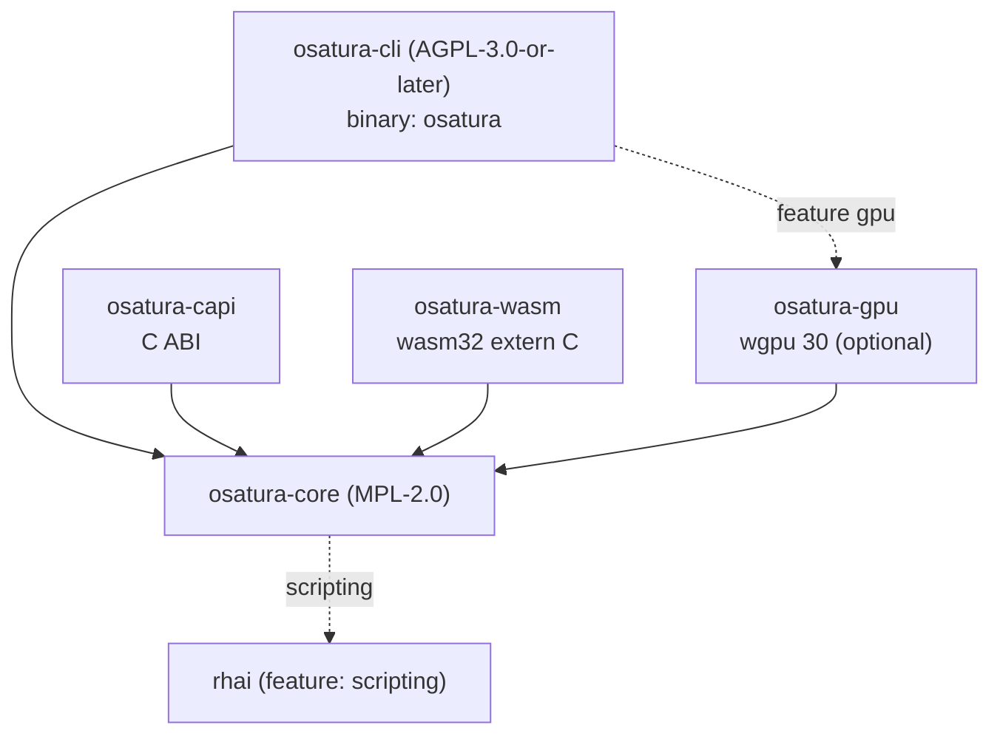

<!-- SPDX-License-Identifier: CC-BY-4.0 -->
<!-- Copyright (c) 2026 Alexandru-Ionuț Chiuță (Alexio) -->

# Arquitetura do OSATURA

Este documento explica como o workspace é organizado, como os dados fluem de um arquivo de projeto até
os pixels, quais garantias o motor oferece e quais não oferece, e como estendê-lo. O detalhamento por campo
do formato de arquivo está em [PROJECT_FORMAT.md](PROJECT_FORMAT.md). Os termos são definidos em
[GLOSSARY.md](GLOSSARY.md). O modelo de ameaças e a lista de medidas de hardening estão em
[SECURITY.md](SECURITY.md). A superfície pública da biblioteca é descrita em [API.md](API.md).

Conteúdo

1. [Crates e grafo de dependências](#1-crates-e-grafo-de-dependências)
2. [Fluxo de dados](#2-fluxo-de-dados)
3. [Mapa de módulos do osatura-core](#3-mapa-de-módulos-do-osatura-core)
4. [O padrão de bake não destrutivo](#4-o-padrão-de-bake-não-destrutivo)
5. [Editor, ops e desfazer](#5-editor-ops-e-desfazer)
6. [Determinismo: garantias e limites](#6-determinismo-garantias-e-limites)
7. [Política de tratamento de erros](#7-política-de-tratamento-de-erros)
8. [Visão geral de segurança](#8-visão-geral-de-segurança)
9. [Arquitetura do servidor do Studio](#9-arquitetura-do-servidor-do-studio)
10. [Arquitetura de colaboração](#10-arquitetura-de-colaboração)
11. [Notas de desempenho](#11-notas-de-desempenho)
12. [Guia de extensão](#12-guia-de-extensão)
13. [Feature flags](#13-feature-flags)
14. [Alvos de build](#14-alvos-de-compilação)

## 1. Crates e grafo de dependências

| Crate | Licença | Tipo | Papel |
| --- | --- | --- | --- |
| `osatura-core` | MPL-2.0 | biblioteca | Tudo que não é front end: modelo de dados, motor, renderizadores, ferramentas, núcleo de colaboração. Feature padrão `scripting`. |
| `osatura-cli` | AGPL-3.0-or-later | binário `osatura` | Linha de comando, o servidor web do Studio e as rotas HTTP de colaboração. Depende do core com `default-features = false` e reexpõe `scripting`; feature opcional `gpu`. |
| `osatura-capi` | MPL-2.0 | `cdylib`, `staticlib`, `rlib` | ABI C (`osatura.h`, `ABI_VERSION` 1). Depende do core com `default-features = false`. |
| `osatura-wasm` | MPL-2.0 | `cdylib`, `rlib` | Módulo WebAssembly `extern "C"` simples, sem wasm-bindgen. Depende do core com `default-features = false`. |
| `osatura-gpu` | MPL-2.0 | biblioteca | Renderizador wgpu opcional. Depende do core com `default-features = false`. |



```text
            osatura-cli  (AGPL, bin "osatura")
              |        \.........(feature "gpu").........  osatura-gpu
              v                                              |
  osatura-capi --->  osatura-core  <---  osatura-wasm  <--+  (gpu also depends on core)
                          :
                          :.....(feature "scripting")..... rhai
```

Por que as licenças diferem: o core é MPL-2.0 para que aplicações de código fechado possam incorporá-lo por meio da
biblioteca, da ABI C ou do módulo WASM sem adotar a AGPL; a linha de comando e o servidor do Studio
são AGPL. Todo arquivo-fonte traz uma linha SPDX igual à licença da sua crate; um teste
(`osatura-cli/tests/spdx_audit.rs`) e `scripts/licence-audit.sh` verificam isso. Veja `LICENSING.md`.

Estabilidade: somente `osatura_core::api` e `osatura_core::prelude` constituem a superfície estável
(`API_VERSION` 1.4.0). Um teste de snapshot compara os itens públicos com `api_surface.txt`; mudar a
superfície obriga a uma edição consciente desse arquivo e a uma decisão de versão.

## 2. Fluxo de dados

```text
 project.json
     |
     v   Project::from_json      parse, magnitude check (+-1e7), format gate
 Project (serde structs)
     |
     v   Engine::new / with_asset_dir
     |     validate everything (all problems returned), resolve names to indices,
     |     bake springs, resolve links and containers
 Engine
     |
     v   Engine::evaluate(frame)         pure function of the frame
 Frame  (bones, resolved geometry per node, camera, masks, effects, nonfinite flag)
     |
     +--> svg::      vector text (SVG)
     +--> raster::   tiny-skia, 8-bit RGBA
     +--> fraster::  own f32 scanline rasteriser (HDR / EXR path)
     +--> osatura-gpu  wgpu, stencil-then-cover
     +--> export / gltf / lottie_export / open_formats / ...
```

Pontos de entrada que envolvem essa cadeia:

- **CLI**: `load` / `load_sized` (lê um arquivo com `--max-input-bytes`), `Engine::with_asset_dir`,
  depois o comando. Os gravadores chamam `write_json`, que revalida por meio de `Engine::new` antes de
  gravar e reescreve os caminhos de assets relativos à saída.
- **`api::Animation`**: a fachada estável usada pela ABI C e pelo módulo WASM. `check_frame`
  limita o índice do quadro; `guard()` executa a chamada sob `catch_unwind` e converte um panic em
  `ApiError::Internal`. `Player` acrescenta máquinas de estados e bindings em tempo de execução sobre uma
  `Animation`.
- **Studio**: mantém um `Editor` (seção 5) dentro de uma thread de tratamento; cada requisição avalia um quadro
  e o renderiza.

Os renderizadores só enxergam um `Frame`. Eles nunca reexecutam a lógica do rig, de modo que IK, skinning e deformadores são
implementados uma única vez, em `engine`.

## 3. Mapa de módulos do osatura-core

`osatura-core/src` tem cerca de 100 módulos. Eles são agrupados por área. Para cada módulo, a "base" é
o padrão público, o artigo ou a técnica de livro didático registrados em `CLEANROOM.md`; "projeto próprio" significa que o
registro clean-room não cita nenhuma fonte externa. Nomes terminados em `_tests` são módulos de teste e foram omitidos.

### 3.1 Modelo de dados e linguagem

**project** define as structs serde do arquivo (`Project`, `Bone`, `Layer`, `Channel`, `Camera`
e as demais) e `Project::from_json`, que executa o format gate e a verificação de magnitude.
Projeto próprio. **path** contém caminhos vetoriais, âncoras, morphs e pesos de osso; o achatamento de curvas
Bezier é o de Casteljau, de livro didático. **style** tem cores, tintas, gradientes e estilos de traço; a transferência
sRGB segue a IEC 61966-2-1. **anim** tem keys, trilhas e curvas de easing; `Bounce` e `Back` são
derivações próprias a partir da mecânica elementar (linha `anim` do CLEANROOM); `Smooth` é uma spline
Catmull-Rom não uniforme. **math** é álgebra afim 2-D. **rig** tem ossos, FK, o IK analítico
de dois ossos, FABRIK, IK soft e stretch (parametrização própria) e restrições. **expr** é uma pequena linguagem de expressões
de descida recursiva com limite de 4096 bytes e profundidade 64. **noise** é ruído de valor baseado em hash; o finalizador de inteiros
é o lowbias32 de Chris Wellons (domínio público) com constantes de Knuth e
MurmurHash3. **base64** é um codec RFC 4648 simples.

### 3.2 Motor e renderização

**engine** valida o projeto, avalia um quadro (a ordem está em PROJECT_FORMAT.md seção 16)
e repara geometria não finita. **raster** renderiza um `Frame` com tiny-skia (modos de mesclagem, máscaras,
efeitos de camada, gradientes). **fraster** é um rasterizador scanline próprio em `f32` (16 sub-scanlines,
área exata do span, enrolamento não nulo e par-ímpar) com as fórmulas do W3C Compositing and Blending Level 1,
usado pelo caminho HDR. **svg** grava SVG. **hdr** faz a saída de alta precisão com gerenciamento de cor: conversão sRGB/linear (IEC 61966-2-1), PNG de 16 bits
e OpenEXR (especificação pública, scanlines de parte única sem compressão, IEEE 754 binary16). **postfx** e **fx** contêm a cadeia de pós-efeitos (blur, levels,
`relight` com sombreamento de Lambert a partir de um normal map, operações morfológicas; o blur gaussiano é separável);
`fx` também constrói a geometria de liquid, boolean e emitter (marching squares, recorte de polígonos,
partículas em forma fechada). **layerfx** implementa os efeitos de camada com a semântica das primitivas de filtro do SVG
(`feGaussianBlur`, `feOffset`, `feColorMatrix`, `feMerge`). **dof** é uma aproximação própria em camadas de
círculo de confusão com blur gaussiano, composta pelo compositor do motor, de modo que modos de mesclagem, máscaras e efeitos de camada sobrevivem. **export** grava GIF animado, o player HTML autocontido e JSON Lottie (o MP4 passa pelo
`ffmpeg` do usuário na CLI);
**animimport**, **seqimport** e **open_formats** leem GIF89a, APNG, sequências PNG e
contêineres OpenRaster/OCA (limites de zip impostos). **gltf** grava glTF 2.0 / GLB a partir da especificação
do Khronos (triangulação por ear clipping). **lottie_export** e **lottie_import** mapeiam para o layout
JSON público do Lottie (subconjunto, com avisos). **importers** lê a gramática de caminhos do SVG 1.1, BVH e
folhas de cues em texto simples.

### 3.3 Áudio e fala

**soundtrack** posiciona sons na linha do tempo e constrói um grafo de filtros do ffmpeg (atrim, afade,
adelay, amix) para o ffmpeg do próprio usuário; os valores de trim e fade são em segundos. **audio** é o lip-sync
guiado por áudio: uma heurística de amplitude e cruzamento por zero (não é reconhecimento de fonemas) que escolhe uma entre cinco
formas de boca por quadro. **audiomap** transforma áudio em envelopes e onsets (RMS com attack/release de um polo; energia de onset
contra uma média móvel). **speech** faz detecção de atividade de voz, alinhamento forçado por programação
dinâmica (Viterbi) contra um prior de duração, e regras de letra para boca que conduzem camadas switch.

### 3.4 Deformação e processamento de geometria

**cage** é o deformador de cage por coordenadas de valor médio (M. S. Floater, CAGD 20(1), 2003). **pinwarp**
é o pin warp que usa a função de base radial de suporte compacto de Wendland 1995, resolvida por
eliminação de Gauss-Jordan. **cloth** e **physics** usam dinâmica baseada em posição com integração de Verlet
(livro didático) para superfícies de tecido, tiras e colisores; os resultados passam por baking. **warp** contém operações de edição sobre os pontos de controle
de deformadores: pivôs, escala proporcional (soft) e redimensionamento da malha inteira. **weights** calcula pesos de osso por difusão de
Laplace/calor com iteração de Gauss-Seidel. **meshtrace** constrói malhas a partir de formas raster: marching
squares, Douglas-Peucker, amostragem Poisson-disc de Bridson, triangulação de Delaunay de Bowyer-Watson e
suavização laplaciana/de Taubin. **trace** vetoriza bitmaps (marching squares e
Ramer-Douglas-Peucker). **autotrace** acrescenta k-means (Lloyd 1982, k-means++), median cut, seguimento de borda de Suzuki-Abe,
afinamento de Zhang-Suen, limiarização de Otsu e distância chamfer de Borgefors. **links**
resolve mesh locks e glues (coordenadas baricêntricas, ordenação topológica de Kahn).

### 3.5 Auxiliares de rigging e ferramentas de animação (produtores de bake)

**autorig** e **vocab** associam por nome palavras de anatomia para construir um rig básico com IK de dois ossos em mix 0,
uma respiração em loop e um piscar de olhos com seed. **rigedit** edita a pose de repouso. **eyeclip** adiciona máscaras comuns
às camadas dos olhos. **parentswitch** troca o pai com álgebra afim (`relative = parent^-1 * child`) e
faz baking das keys. **stretch** é aim 2-D de livro didático mais escala por distância. **footlock** e **magnet**
corrigem posições por detecção de contato e queda com smoothstep. **pathfollow** amostra Bezier achatadas
por comprimento de arco e faz baking das keys. **drivers** mapeia um controlador para poses por interpolação
linear por partes. **procgen** e **looper** geram movimento idle e corrigem loops (remoção linear de tendência).
**springfit** ajusta parâmetros de spring de segunda ordem. **clipstack** é a pilha de clipes em camadas com mesclagem
replace, additive e multiply, fades com smoothstep e máscaras glob. **skins** são grupos de camadas
nomeados. **camshots** anima por keys os shots de câmera. **comps** guarda instantâneos do estado das camadas. **bonevis**
e **chanmeta** contêm metadados do editor. **depth** distribui o fator `parallax` das camadas de nível superior de longe para perto, para uma câmera multiplano.
**motionlib** copia intervalos de keys com renomeação e escala de tempo. **anim_tools**, **keyops**,
**timeline** e **timeline_graph** implementam a matemática da dope sheet (translação, escala em torno de um pivô,
ripple), a conversão de Hermite para Bezier e o limitador monótono de Fritsch-Carlson.

### 3.6 Runtime interativo

**machine** é a máquina de estados em tempo de execução (projeto próprio: máquina de estados finitos, blend tree 1-D, cross-fade
com easing). **binding** mapeia dados externos para propriedades (remapeamento afim, suavização de um polo).
**statemachine** é a máquina de estados anterior, baseada em log de eventos, com baking. **containers**
implementa a distribuição unidimensional no estilo flexbox, retângulos pin e aspect e o
scroll elástico (spring amortecida, Euler semi-implícito). **layout** tem auxiliares de alinhar e distribuir e uma
operação de trim-path com baking (caixas delimitadoras de curvas achatadas, amostragem por comprimento de arco). **liveinput** e **midi** analisam mensagens MIDI 1.0 e
Standard MIDI Files e gravam entrada ao vivo. **perf** transforma amostras gravadas em keys mínimas, mapeia sinais de entrada (sliders, MIDI, nível de áudio)
para parâmetros e faz retargeting de movimento pelo alcance dos membros. **faceparam**
calcula a razão de aspecto do olho (Soukupova e Cech 2016) e o filtro One-Euro (Casiez, Roussel e
Vogel, CHI 2012). **facedet** e **facegen** são um pequeno detector de rostos treinado com rostos sintéticos
(características HOG segundo Dalal e Triggs 2005, regressão logística, descida supervisionada). **mocap** lê
BVH. **posesuggest**, **posematch** e **tinymlp** são assistentes clássicos locais de ML com uma
estratégia evolutiva (mu/mu_w, lambda) (Beyer e Schwefel 2002) e sem pesos de modelo incluídos.

### 3.7 Editor e colaboração

**edit** é o `Editor` com ops e desfazer. **pick** e **gizmo** fazem teste de acerto (número de enrolamento,
distância até o segmento) e handles de transformação (decomposição QR de uma matriz 2 por 2). **overlays** e
**scrub** produzem onion skins, trilhas de movimento e um cache LRU de quadros indexado por revisão com um worker de
proxy. **collab**, **collabhub** e **collablog** são a réplica CRDT, o sequenciador e o
log persistente (seção 10). **script** e **scriptops** expõem uma API Rhai em sandbox (feature
`scripting`). **agent** é um servidor de ferramentas no formato JSON-RPC 2.0 / MCP para um único projeto.
**snapshots** mantém cópias numeradas do projeto com supressão de duplicatas e poda (um contador, sem
relógio, de modo que se comporta da mesma forma em qualquer lugar) para recuperação após falhas. **explain** dá um relato ordenado de tudo que determina o valor de um osso ou camada em um
quadro; **inspect** tem estatísticas, diff semântico e hashes de regressão de golden frames (FNV-1a exato
por quadro mais uma miniatura de 16 por 16).

### 3.8 Qualidade, tamanho e controle de versão

**lint** verifica heurísticas de animação (códigos L001 em diante). **safety** verifica limiares de flash e de flash vermelho
segundo a WCAG 2.3.1 usando luminância relativa. **ci** e **percep** implementam o CI de animação:
CIE76 e CIEDE2000 (CIE TR 142-2001, fórmulas como impressas em Sharma, Wu e Dalal 2005), SSIM por blocos
(Wang et al. 2004), um hash perceptual DCT, PSNR. **fuzz** submete poses a estresse (SplitMix64, hipercubo latino, sequências de Halton, gradiente de deformação 2 por 2, ddmin). **sizefit** ajusta a saída a um orçamento
de bytes (median cut, Floyd-Steinberg, RDP com laço de reparo). **lod** produz níveis de detalhe com
um limite de erro declarado (Douglas-Peucker 1973, Visvalingam-Whyatt 1993, ajuste Bezier por mínimos quadrados de Schneider, métricas de erro quádrico de Garland-Heckbert, distância discreta de Frechet segundo Eiter e
Mannila). **semdiff** e **vcs** são um diff semântico e um controle de versão endereçado por conteúdo (DAG de Merkle,
SHA-256 conforme FIPS 180-4, diff3 segundo Khanna, Kunal e Pierce 2007). **unknownfields**
detecta chaves JSON ignoradas. **assets** e **fsutil** impõem regras de caminho e tamanho para arquivos.
**api** é a fachada estável; **demo** constrói o projeto de demonstração; **robustness** e **fuzz** contêm
testes e geradores que mantêm o tratamento de entradas livre de panic.

## 4. O padrão de bake não destrutivo

Muitas ferramentas calculam algo ao longo do tempo: física, magnet, footlock, stretch, path following, geração
procedural, clip stack, shots de câmera, skins, drivers, baking de máquinas de estados e de entrada ao vivo, e
mais. Todas fazem a mesma coisa:

1. Ler o projeto e avaliá-lo como ele está.
2. Calcular novos valores por quadro.
3. Acrescentar **canais comuns** a `project.channels` (modo de mesclagem padrão `keep`).
4. Deixar a animação original intocada.

Como a saída são canais simples, ela não precisa de formato especial, funciona em todos os renderizadores e pode ser
editada à mão. As regras que todo baker segue:

- Nunca apagar keys feitas à mão. Canais `replace` acrescentados sobrepõem keys de ângulo anteriores no momento da
  avaliação; remover o canal gerado por baking restaura o original.
- Respeitar bloqueios: canais cobertos por `lock` de `channel_meta` e camadas com `locked` são ignorados.
- Ser idempotente quando um baker consegue reconhecer a própria saída. O clip stack guarda um instantâneo do que gerou
  em `clip_baked` e substitui exatamente isso em um novo baking.
- Permanecer determinístico: RNGs com seed e contagens fixas de iteração.

Os recursos de tempo de execução seguem a mesma ideia na exportação. Os estados de máquina e os bindings de um Player são
transformados em canais `replace` constantes acrescentados ao projeto, de modo que um arquivo exportado não precisa
do runtime.

## 5. Editor, ops e desfazer

`edit.rs` define `Editor`, que é dono de um `Project` e de todo o histórico de edição.

- Um `Op` é um entre `set`, `insert`, `remove` ou `batch`, endereçando o JSON do projeto por ponteiro
  RFC 6901. `raw_apply` aplica um op e devolve o seu **inverso**.
- Cada `apply` executa o op e depois reconstrói um `Engine` completo a partir do novo JSON. Se a validação falha, o
  op é revertido e a lista de erros é devolvida, de modo que o editor não pode manter um projeto inválido.
- As pilhas de desfazer e refazer guardam ops inversos. Um contador de revisão é incrementado a cada mudança; os caches
  (quadros de scrub, proxies) usam-no como chave.
- As operações de alto nível (`set_key`, mover, excluir, adicionar container e assim por diante) são construídas a partir de ops. Elas
  chamam `assert_unlocked` primeiro, de modo que camadas `locked` e canais bloqueados resistem às operações do editor;
  os `Op`s simples ignoram essa verificação, porque são a camada de baixo nível.
- `replace_doc` troca o documento inteiro (usado pela colaboração) e limpa o histórico.

Como tudo é expresso como ops de ponteiro JSON, a mesma representação serve ao desfazer, ao CRDT de
colaboração (seção 10), à API de scripting e ao servidor agent.

## 6. Determinismo: garantias e limites

O que é garantido:

- `Engine::evaluate(frame)` é uma função pura do projeto e do número do quadro. As springs são
  simuladas no carregamento; o ruído é baseado em hash; as partículas são funções de forma fechada do tempo; os RNGs têm
  seed; tecido e física passam por baking.
- Avaliar quadros em qualquer ordem, ou duas vezes, dá resultados idênticos.
- Renderizar o mesmo quadro duas vezes na mesma máquina com a mesma build dá uma saída idêntica byte a byte. O CI
  inclui uma verificação de determinismo para isso.

O que não é garantido:

- A igualdade entre sistemas operacionais, CPUs ou versões de compilador não foi verificada. Diferenças em
  `libm`, em multiplicação-adição fundida e em caminhos de código SIMD podem mover pixels de borda com anti-aliasing.
- O renderizador de GPU está fora do conjunto de hashes exatos; ele corresponde ao renderizador de CPU apenas dentro de uma
  tolerância (veja ROADMAP, seção 9).
- O CI de animação usa uma tolerância perceptual em vez de hashes exatos por esse motivo.

Threads: a avaliação do motor é de thread única. Existem threads no detector de rostos (com escopo), no
worker de proxy de scrub/LOD, em `sizefit` e no servidor HTTP do Studio. Nenhuma delas altera os resultados da
avaliação.

## 7. Política de tratamento de erros

- A entrada nunca deve causar um panic. Os testes de robustez e os geradores de fuzz exercitam isso, e a
  fachada, a ABI C e os pontos de entrada WASM envolvem as chamadas em `catch_unwind`.
  Em `wasm32-unknown-unknown` o padrão é `panic=abort`, portanto `catch_unwind` não tem efeito ali;
  esse módulo se apoia na validação.
- A validação devolve **todos** os problemas como `Err(Vec<String>)` para que o usuário possa corrigir um arquivo em uma só passada.
- As mensagens são para pessoas; não as analise por parse. Os testes que precisam de estabilidade casam fragmentos
  distintivos.
- Tudo que cresce com a entrada tem um limite: bytes de JSON, ossos, vértices de malha, efeitos por camada,
  lados e pixels de imagem, quadros vezes âncoras, membros de container, tamanhos de cabeçalho e corpo HTTP. Os
  números estão em PROJECT_FORMAT.md seção 12 e seção 18.
- Valores não finitos são contidos em vez de propagados: os canais os ignoram, `repair_nonfinite`
  oculta um nó defeituoso e `Frame.nonfinite` avisa quem chama. `evaluate_checked` e
  `check_all_frames_finite` transformam isso em um erro para ferramentas em lote.
- A ABI C guarda o último erro em armazenamento local da thread e devolve códigos; ela nunca propaga um unwind através
  da fronteira.

## 8. Visão geral de segurança

A versão curta: o OSATURA lê JSON e arquivos de assets não confiáveis, e o Studio escuta em um
socket de rede. As defesas são em camadas: limites rigorosos de carregamento (magnitude, tamanho, limites de contagem), confinamento
de caminhos para assets, um servidor HTTP somente com a std com
prazos e verificações de host/origin, autenticação por token para a colaboração e um motor de scripting
em sandbox com limites explícitos. O modelo de ameaças e as medidas de hardening estão em [SECURITY.md](SECURITY.md).

## 9. Arquitetura do servidor do Studio

`osatura studio` serve uma única página HTML (`studio.html`) e uma API JSON a partir de um único processo.

```text
 browser  <--HTTP/1.1-->  http.rs  (accept loop; bounded connection threads, I/O only)
                             |  parsed request over a channel
                             v
                       handler thread  (single owner of the Editor and caches)
                             |   studio.rs  ~52 /api routes
                             |   uiconfig.rs  command registry, key map
                             |   collab_srv.rs  /api/collab/* routes
                             v
                      osatura-core: Editor, Engine, raster, svg, scrub, collab
```

- **http.rs** é um servidor HTTP/1.1 somente com a std (a dependência anterior `tiny_http` foi removida após uma
  revisão de segurança). As threads de conexão são limitadas em número e apenas leem e escrevem em sockets; elas
  entregam as requisições à única thread de tratamento, que é dona do `Editor`. Assim, nenhum lock protege o estado do
  projeto e duas requisições nunca o modificam ao mesmo tempo.
- Limites e respostas: prazos de leitura e escrita (408), limites de tamanho (413), limite de conexões (503),
  `Connection: close` em toda resposta. As respostas carregam Content-Security-Policy,
  `X-Content-Type-Options: nosniff`, `X-Frame-Options` e `Referrer-Policy`.
- **Exposição de rede**: o bind padrão é `127.0.0.1`. Qualquer outro bind exige um token. Uma lista de Host
  permitidos defende contra DNS rebinding, e as requisições POST exigem uma verificação de mesma origem.
- **studio.rs** implementa cerca de 52 rotas `/api` (edição, desfazer e refazer, renderização de quadros, proxies,
  picking e gizmos, overlays, importações e exportações, builds de LOD em segundo plano). **uiconfig.rs** contém o registro de comandos: ids, títulos, mapa de teclas padrão,
  arranjos predefinidos de painéis.
- A página é servida da memória. Uma rota `/source` oferece o código-fonte correspondente, em conformidade com
  a AGPL.
- **Proxies**: durante o scrubbing, a página pede uma imagem de detalhe reduzido (`LodProxy`, construído por um
  worker em segundo plano) e solicita qualidade total ao soltar.

## 10. Arquitetura de colaboração

A edição multiusuário é construída em três camadas, todas determinísticas e testáveis sem rede.

**collab.rs, a réplica.** Um CRDT sobre o JSON do projeto. Uma chave de objeto é um registrador last-writer-wins.
Um array é um RGA (replicated growable array, Roh et al. 2011) com tombstones, e a remoção
prevalece sobre edições concorrentes. A ordenação usa relógios de Lamport (Lamport 1978) e relógios vetoriais (Fidge,
Mattern). As mudanças viajam como um `Envelope { replica, seq, lamport, deps, ops }`. A entrega é causal
(um envelope espera até que suas dependências tenham sido aplicadas) e idempotente (reentregar não tem
efeito). Cada usuário tem uma pilha de desfazer que inverte apenas os seus próprios ops. `compaction` descarta
tombstones que todas as réplicas já viram. O projeto segue Shapiro et al. 2011 (CRDTs baseados em
operações).

**collabhub.rs, o sequenciador.** Um `Hub` autoritativo é dono da réplica principal. Os usuários são *Thin* (uma réplica proxy
mantida pelo hub, para navegadores) ou *Replica* (sua própria réplica). O hub
valida o JSON mesclado com uma closure fornecida por quem chama, de modo que uma mesclagem que produziria um
projeto inválido é rejeitada. Ele também acompanha a presença (cursores, seleções) e um fluxo de eventos
(server-sent events). Limites: 32 usuários (`MAX_USERS`), e usuários ociosos por 10 minutos são removidos.

**collablog.rs, persistência.** Um log JSON orientado a linhas. Cada registro é encadeado ao anterior por um
hash (FNV-1a de 64 bits na versão 1, SHA-256 na versão 2), de modo que danos são detectados; as gravações usam
`fdatasync` quando `--collab-log` é definido.

**collab_srv.rs (CLI), o lado HTTP.** Rotas em `/api/collab/`: `join`, `leave`, `state`, `log`,
`ops`, `undo`, `redo`, `presence`, `compact`, `events`. Autenticação: um token de pelo menos 16
caracteres, enviado no cabeçalho `X-Collab-Token` ou no cookie `arm_token` (definido por `/api/login`),
comparado em tempo constante, com um limite de taxa que responde 429. Cada participante também recebe um segredo
(`X-Collab-Secret`) para que um usuário não possa agir como outro. O transporte é HTTP simples, sem TLS:
coloque um proxy que termine TLS na frente para qualquer uso além de uma rede confiável.

`osatura collab-sim` executa muitos clientes simulados contra um hub no mesmo processo, que é como a convergência
é testada.

## 11. Notas de desempenho

Os números abaixo são as medições registradas em `ROADMAP.md` seção 9. Eles são reproduzidos, não
remedidos aqui. Trate-os como ordens de grandeza para a máquina e a build indicadas.

| Medição | Resultado |
| --- | --- |
| demo 640x480, build release, uma thread, média de 48 quadros: raster nível 0 | 14.4 ms por quadro |
| o mesmo, proxy nível 1 / nível 2 / nível 4 | 3.5 ms / 0.7 ms / 0.09 ms |
| gravador SVG; SVG simplificado | 0.17 ms; 0.10 a 0.15 ms |
| projeto sintético de 671 camadas, raster nível 0 vs nível 2 | 1832 ms vs 106 ms |
| decodificação no navegador desse projeto: SVG completo, proxy 2, proxy 4 | 45 ms, 28 ms, 25 ms |
| acerto de cache no cache de scrub | cerca de 0.002 ms |
| renderizador de GPU no Mesa llvmpipe (software, não uma GPU real), escala 1 | 253 a 295 ms por quadro (GL 253, Vulkan 295) contra 13.8 ms do tiny-skia |
| o mesmo, escala 2 | 1260 ms contra 56 ms |
| teste de proxy do Studio (build debug): bitmap, vetor | 51.6 a 34.2 ms; 2.12 a 0.30 ms |
| build de LOD em segundo plano, build debug | 19.5 s |
| suíte de ponta a ponta | cerca de 19 s em debug, cerca de 40 s em release |
| treinamento do detector de rostos, 2 núcleos | 91 s; 99.3 por cento das caixas encontradas |
| demo de LOD, erro declarado vs medido (px) | 0.104/0.386/0.928/1.537/1.657 vs 0.099/0.334/0.819/1.337/1.337 |

Lendo isso: o caminho vetorial é barato, portanto um proxy traz pouco benefício no navegador para projetos pequenos,
mas um benefício grande para a renderização de bitmaps e para projetos com centenas de camadas. Os números
de GPU nada dizem sobre o desempenho de hardware; nenhum adaptador de hardware estava disponível. Os níveis de LOD nunca
excedem o erro declarado, e o erro medido fica abaixo do limite declarado.

Notas práticas: o custo da avaliação cresce com canais, ossos e tamanhos de deformadores; o custo da renderização cresce
com a resolução, os efeitos (cada um usa uma camada fora da tela) e as máscaras. Use `--proxy N` ou níveis de LOD
durante o scrubbing, e o renderizador completo para a saída final.

## 12. Guia de extensão

Regras gerais para qualquer alteração:

- Todo novo arquivo-fonte começa com a linha SPDX do seu crate e a linha de copyright. Um teste falha
  caso contrário.
- Toda nova entrada deve ter limites (caps), e as novas mensagens de validação devem listar os problemas em vez de parar no
  primeiro.
- Tudo o que for novo e usar um método ou padrão externo deve ser registrado em `CLEANROOM.md`
  (veja suas regras e o modelo opcional de spec-note).
- Atualize `PROJECT_FORMAT.md` quando o arquivo mudar e `API.md` quando a fachada mudar.

### 12.1 Adicionar uma propriedade de camada

Exemplo: um novo número por camada.

1. Adicione o campo a `Layer` em `osatura-core/src/project.rs` com
   `#[serde(default = "...", skip_serializing_if = "...")]`, para que arquivos antigos carreguem sem alterações e os valores padrão
   não sejam gravados de volta. Adicionar um campo opcional não altera `FORMAT_VERSION`.
2. Adicione a validação em `Engine::new` (finito, intervalo) com uma mensagem que nomeie a camada.
3. Se for animável, adicione uma variante de `Prop`, seu mapeamento `target_kind`, o clamp de escrita, o
   valor inicial em `initial_state` e o caso em `apply_channels`. Se usar um subalvo, estenda o
   resolvedor `layer::sub`.
4. Use-o em `evaluate` e nos renderizadores que dependem dele (`svg`, `raster`, `fraster`, GPU) para que
   concordem entre si.
5. Verifique se os exportadores (`lottie_export`, `gltf`, ...) o mapeiam ou informam que o descartam.
6. Testes:
   - um round trip de serde que prove que o valor padrão é omitido;
   - um teste de validação para cada regra, com a mensagem de falha;
   - um teste de avaliação, incluindo um canal que o anime;
   - a verificação de campos desconhecidos (`unknownfields`) não deve sinalizar o novo campo;
   - robustez: limites de NaN, infinito e 1e7 (adicione-o aos testes de robustez existentes);
   - o snapshot `api_surface.txt`, se um tipo público mudou.
7. Documente-o em PROJECT_FORMAT.md (nome, tipo, valor padrão, intervalo, semântica, exemplo).

### 12.2 Adicionar um comando da CLI

1. Escreva a lógica em `osatura-core` como uma função com entrada tipada e `Result<_, String>` ou uma
   lista de erros; a CLI deve apenas interpretar as flags e imprimir. Isso mantém a lógica utilizável a partir da C ABI,
   do WASM e do Studio.
2. Em `osatura-cli/src/usage.rs`, adicione uma entrada em `USAGE`. `usage_for`, `documented_options` e
   `check_flags` a leem, e um teste compara USAGE com o parser, de modo que uma flag que o parser
   aceita mas USAGE não menciona faz o teste falhar.
3. Registre as opções que recebem um valor em `VALUE_OPTS` (ou na tabela `takes_value` de cada comando).
4. Adicione um braço de match em `run` (ele despacha com `match pos.as_slice()`).
5. Leia os projetos por meio de `load` ou `load_sized` para que os limites de tamanho e o confinamento de assets sejam aplicados.
6. Grave os projetos por meio de `write_json` (revalida e reescreve os caminhos dos assets). Se o comando grava
   um tipo de arquivo diferente da entrada, chame `guard_out` para que um caminho de saída digitado errado não possa
   sobrescrever o projeto de entrada.
7. Testes em `osatura-cli/tests/`: `e2e.rs` para o caminho feliz, `robust.rs` para entrada hostil,
   `fixes.rs` ou `wave4.rs` para regressões; `scripts/e2e.sh` executa o fluxo completo.
8. Documente-o na referência de comandos.

### 12.3 Adicionar um exportador

1. Coloque o escritor em `osatura-core` (por exemplo ao lado de `export.rs`, `gltf.rs` ou
   `lottie_export.rs`). Ele recebe um `Engine` ou `Project`, avalia os quadros por meio de
   `evaluate_checked` e não deve ler estado privado.
2. Decida e documente o que ele não consegue representar. Emita avisos, não suposições, para recursos descartados.
3. Aplique limites: quadros vezes âncoras (orçamento de 40 milhões), lados de imagem (16384) e pixels, tamanho da saída.
4. Nunca sobrescreva a entrada: use `guard_out` na CLI.
5. Testes: a saída é interpretada por um leitor independente ou pelo importador do próprio módulo (um round trip);
   determinismo (mesma entrada, mesmos bytes); um teste de projeto hostil que espera um erro, não um panic;
   e um teste golden ou de hash no projeto de demonstração. Indique no comentário do módulo se um
   player independente verificou a saída (o exportador Lottie, por exemplo, observa que essa verificação
   está pendente).
6. Adicione a ligação (comando da CLI, função opcional da fachada, rota do Studio) e a linha de proveniência em
   CLEANROOM.md.

## 13. Feature flags

| Crate | Feature | Padrão | Efeito |
| --- | --- | --- | --- |
| `osatura-core` | `scripting` | ativada | Compila a API de scripting Rhai (`script`, `scriptops`). Traz `rhai` e sua dependência `smartstring` (MPL-2.0). |
| `osatura-cli` | `scripting` | ativada | Habilita `osatura-core/scripting` e o comando `script`. `--no-default-features` a remove. |
| `osatura-cli` | `gpu` | desativada | Traz `osatura-gpu` e adiciona o comando `render-gpu`. Mantida desativada para que as compilações comuns continuem pequenas. |

`osatura-capi`, `osatura-wasm` e `osatura-gpu` usam o core com `default-features = false`, portanto
não carregam o motor de scripting.

## 14. Alvos de compilação

| Alvo | Comando | Observações |
| --- | --- | --- |
| CLI e Studio | `cargo build -p osatura-cli` (adicione `--release` para ganhar velocidade) | Binário `osatura`. |
| CLI com GPU | `cargo build -p osatura-cli --features gpu` | wgpu 30 apenas com Vulkan e GL. Verificado somente em Mesa llvmpipe. |
| Biblioteca | `cargo build -p osatura-core` | API Rust. |
| Biblioteca C | `cargo build -p osatura-capi` | `cdylib`, `staticlib` e o header `osatura-capi/osatura.h`; `ABI_VERSION` 1. |
| WebAssembly | `osatura-wasm/build-wasm.sh` (requer `rustup target add wasm32-unknown-unknown`) | Interface extern "C" simples, com `index.html` e helpers em `js/`. O ambiente de desenvolvimento não conseguiu instalar o alvo; o módulo é compilado (perfil release) por `.github/workflows/release.yml` e um build de depuração é testado sob o Node por `ci.yml`. O próprio script não é o que o CI executa. |
| Aplicativo de janela (Windows, macOS) | `cargo build --release -p osatura-gui` | Binário `osatura-studio`: janela `tao` + web view `wry` em torno do estúdio; um stub no Linux. |
| Testes | `cargo test --workspace` | Fluxo de shell de ponta a ponta em `scripts/e2e.sh`; auditoria de licenças em `scripts/licence-audit.sh`. |

Os membros padrão do workspace não incluem `osatura-gpu`.
