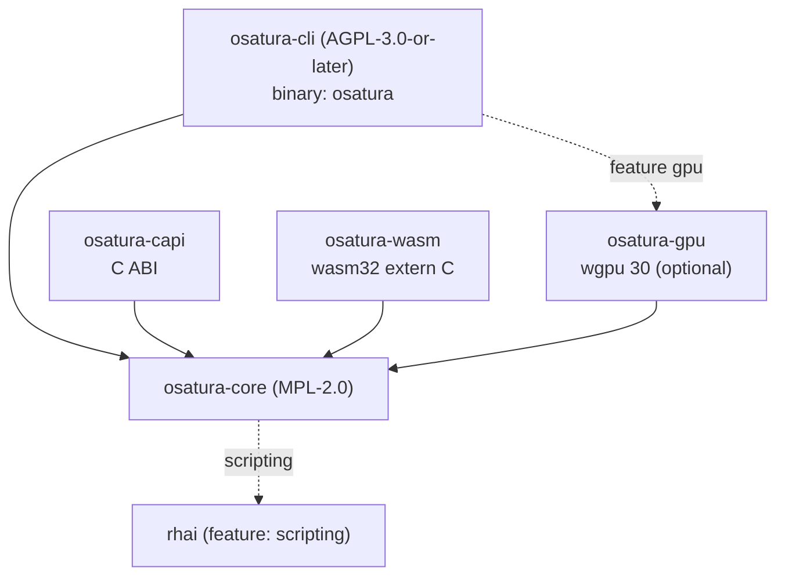

<!-- SPDX-License-Identifier: CC-BY-4.0 -->
<!-- Copyright (c) 2026 Alexandru-Ionuț Chiuță (Alexio) -->

# Arhitectura OSATURA

Acest document explică cum este organizat workspace-ul, cum circulă datele de la un fișier de proiect până la
pixeli, ce garanții oferă motorul și ce garanții nu oferă, și cum poate fi extins. Detaliile la nivel de câmp ale
formatului de fișier se află în [PROJECT_FORMAT.md](PROJECT_FORMAT.md). Termenii sunt definiți în
[GLOSSARY.md](GLOSSARY.md). Modelul de amenințări și lista de măsuri de întărire se află în
[SECURITY.md](SECURITY.md). Suprafața publică a bibliotecii este descrisă în [API.md](API.md).

Cuprins

1. [Crate-uri și graful de dependențe](#1-crate-uri-și-graful-de-dependențe)
2. [Fluxul de date](#2-fluxul-de-date)
3. [Harta modulelor din osatura-core](#3-harta-modulelor-din-osatura-core)
4. [Tiparul bake nedistructiv](#4-tiparul-bake-nedistructiv)
5. [Editor, ops și undo](#5-editor-ops-și-undo)
6. [Determinism: garanții și limite](#6-determinism-garanții-și-limite)
7. [Politica de tratare a erorilor](#7-politica-de-tratare-a-erorilor)
8. [Prezentare generală a securității](#8-prezentare-generală-a-securității)
9. [Arhitectura serverului Studio](#9-arhitectura-serverului-studio)
10. [Arhitectura colaborării](#10-arhitectura-colaborării)
11. [Note de performanță](#11-note-de-performanță)
12. [Ghid de extindere](#12-ghid-de-extindere)
13. [Feature flags](#13-feature-flags)
14. [Ținte de build](#14-ținte-de-build)

## 1. Crate-uri și graful de dependențe

| Crate | Licență | Tip | Rol |
| --- | --- | --- | --- |
| `osatura-core` | MPL-2.0 | bibliotecă | Tot ce nu este front end: modelul de date, motorul, randerele, uneltele, nucleul de colaborare. Feature implicit `scripting`. |
| `osatura-cli` | AGPL-3.0-or-later | binar `osatura` | Linia de comandă, serverul web Studio și rutele HTTP de colaborare. Depinde de core cu `default-features = false` și re-expune `scripting`; feature opțional `gpu`. |
| `osatura-capi` | MPL-2.0 | `cdylib`, `staticlib`, `rlib` | ABI C (`osatura.h`, `ABI_VERSION` 1). Depinde de core cu `default-features = false`. |
| `osatura-wasm` | MPL-2.0 | `cdylib`, `rlib` | Modul WebAssembly `extern "C"` simplu, fără wasm-bindgen. Depinde de core cu `default-features = false`. |
| `osatura-gpu` | MPL-2.0 | bibliotecă | Rander wgpu opțional. Depinde de core cu `default-features = false`. |



```text
            osatura-cli  (AGPL, bin "osatura")
              |        \.........(feature "gpu").........  osatura-gpu
              v                                              |
  osatura-capi --->  osatura-core  <---  osatura-wasm  <--+  (gpu also depends on core)
                          :
                          :.....(feature "scripting")..... rhai
```

De ce diferă licențele: core este MPL-2.0 pentru ca aplicațiile closed-source să îl poată încorpora prin
bibliotecă, prin ABI-ul C sau prin modulul WASM fără a adopta AGPL; linia de comandă și serverul Studio
sunt AGPL. Fiecare fișier sursă poartă o linie SPDX egală cu licența crate-ului său; un test
(`osatura-cli/tests/spdx_audit.rs`) și `scripts/licence-audit.sh` verifică acest lucru. Vezi `LICENSING.md`.

Stabilitate: doar `osatura_core::api` și `osatura_core::prelude` reprezintă suprafața stabilă
(`API_VERSION` 1.4.0). Un test de snapshot compară elementele publice cu `api_surface.txt`; schimbarea
suprafeței impune o editare conștientă a acelui fișier și o decizie de versiune.

## 2. Fluxul de date

```text
 project.json
     |
     v   Project::from_json      parse, magnitude check (+-1e7), format gate
 Project (serde structs)
     |
     v   Engine::new / with_asset_dir
     |     validate everything (all problems returned), resolve names to indices,
     |     bake springs, resolve links and containers
 Engine
     |
     v   Engine::evaluate(frame)         pure function of the frame
 Frame  (bones, resolved geometry per node, camera, masks, effects, nonfinite flag)
     |
     +--> svg::      vector text (SVG)
     +--> raster::   tiny-skia, 8-bit RGBA
     +--> fraster::  own f32 scanline rasteriser (HDR / EXR path)
     +--> osatura-gpu  wgpu, stencil-then-cover
     +--> export / gltf / lottie_export / open_formats / ...
```

Punctele de intrare care învelesc acest lanț:

- **CLI**: `load` / `load_sized` (citește un fișier cu `--max-input-bytes`), `Engine::with_asset_dir`,
  apoi comanda. Writer-ii apelează `write_json`, care re-validează prin `Engine::new` înainte de
  scriere și rescrie căile asset-urilor relativ la ieșire.
- **`api::Animation`**: fațada stabilă folosită de ABI-ul C și de modulul WASM. `check_frame`
  limitează indexul cadrului; `guard()` rulează apelul sub `catch_unwind` și transformă un panic în
  `ApiError::Internal`. `Player` adaugă mașini de stări și binding-uri la runtime peste o
  `Animation`.
- **Studio**: ține un `Editor` (secțiunea 5) într-un thread de handler; fiecare cerere evaluează un cadru
  și îl randează.

Randerele văd doar un `Frame`. Ele nu mai rulează niciodată logica rig-ului, deci IK, skinning-ul și deformatoarele sunt
implementate o singură dată, în `engine`.

## 3. Harta modulelor din osatura-core

`osatura-core/src` are aproximativ 100 de module. Ele sunt grupate pe domenii. Pentru fiecare modul „baza” este
standardul public, lucrarea sau tehnica din manuale consemnată în `CLEANROOM.md`; „design propriu” înseamnă că
jurnalul clean-room nu consemnează nicio sursă externă. Numele care se termină în `_tests` sunt module de test și sunt omise.

### 3.1 Modelul de date și limbajul

**project** definește structurile serde ale fișierului (`Project`, `Bone`, `Layer`, `Channel`, `Camera`
și restul) și `Project::from_json`, care execută poarta de format și verificarea de magnitudine.
Design propriu. **path** conține căile vectoriale, ancorele, morph-urile și greutățile de os; aplatizarea curbelor
Bezier este de Casteljau, din manuale. **style** are culori, paint-uri, gradiente și stiluri de contur; transferul sRGB
urmează IEC 61966-2-1. **anim** are chei, piste și curbe de easing; `Bounce` și `Back` sunt
derivări proprii din mecanica elementară (rândul `anim` din CLEANROOM); `Smooth` este o spline Catmull-Rom
neuniformă. **math** este algebră afină 2-D. **rig** are oase, FK, IK analitic cu două oase,
FABRIK, IK soft și stretch (parametrizare proprie) și constrângeri. **expr** este un mic limbaj de expresii
cu descendență recursivă, cu o limită de 4096 de octeți și adâncime 64. **noise** este zgomot de valoare bazat pe hash; finalizatorul
de întregi este lowbias32 al lui Chris Wellons (domeniu public) cu constante Knuth și
MurmurHash3. **base64** este un codec RFC 4648 simplu.

### 3.2 Motorul și randarea

**engine** validează proiectul, evaluează un cadru (ordinea este în PROJECT_FORMAT.md secțiunea 16)
și repară geometria nefinită. **raster** randează un `Frame` cu tiny-skia (moduri de blend, măști,
efecte de strat, gradiente). **fraster** este un rasterizator scanline propriu în `f32` (16 sub-scanline-uri,
arie exactă a span-ului, înfășurare non-zero și even-odd) cu formulele W3C Compositing and Blending Level 1,
folosit de calea HDR. **svg** scrie SVG. **hdr** realizează ieșire de înaltă precizie cu management al culorii: conversie sRGB/liniar (IEC 61966-2-1), PNG pe 16 biți
și OpenEXR (specificație publică, scanline-uri necomprimate într-o singură parte, IEEE 754 binary16). **postfx** și **fx** conțin lanțul de post-efecte (blur, levels,
`relight` cu shading Lambert dintr-un normal map, operații morfologice; blur-ul Gaussian este separabil);
`fx` construiește de asemenea geometria liquid, boolean și emitter (marching squares, decupare de poligoane,
particule în formă închisă). **layerfx** implementează efectele de strat cu semantica primitivelor de filtru
SVG (`feGaussianBlur`, `feOffset`, `feColorMatrix`, `feMerge`). **dof** este o aproximare proprie, stratificată, a
cercului de confuzie, cu blur Gaussian, compusă prin compozitorul motorului, astfel încât modurile de blend, măștile și efectele de strat să supraviețuiască. **export** scrie GIF animat, playerul HTML autonom și JSON Lottie (MP4 trece prin
`ffmpeg`-ul utilizatorului, în CLI);
**animimport**, **seqimport** și **open_formats** citesc GIF89a, APNG, secvențe PNG și
containere OpenRaster/OCA (limitele zip sunt impuse). **gltf** scrie glTF 2.0 / GLB după specificația
Khronos (triangulare prin ear clipping). **lottie_export** și **lottie_import** se mapează pe structura
publică JSON Lottie (subset, cu avertismente). **importers** citește gramatica de căi SVG 1.1, BVH și
fișe de indicii în text simplu.

### 3.3 Audio și vorbire

**soundtrack** plasează sunete pe timeline și construiește un graf de filtre ffmpeg (atrim, afade,
adelay, amix) pentru ffmpeg-ul propriu al utilizatorului; valorile de trim și fade sunt în secunde. **audio** este lip-sync
condus de audio: o euristică de amplitudine și treceri prin zero (nu recunoaștere de foneme) care alege una din cinci
forme ale gurii pe cadru. **audiomap** transformă audio în anvelope și onset-uri (RMS cu atac/release cu un pol; energia onset-ului
față de o medie mobilă). **speech** face detecția activității vocale, aliniere forțată prin programare
dinamică (Viterbi) față de o distribuție a priori a duratelor, și reguli literă-către-gură care conduc straturile switch.

### 3.4 Deformare și procesare geometrică

**cage** este deformatorul de tip cage cu coordonate cu valoare medie (M. S. Floater, CAGD 20(1), 2003). **pinwarp**
este pin warp-ul care folosește funcția de bază radială cu suport compact Wendland 1995, rezolvată prin
eliminare Gauss-Jordan. **cloth** și **physics** folosesc dinamica bazată pe poziții cu integrare Verlet
(din manuale) pentru suprafețe de pânză, benzi și coliziuni; rezultatele sunt baked. **warp** conține operații de editare pe punctele
de control ale deformatoarelor: pivoți, scalare proporțională (soft) și redimensionare a întregului mesh. **weights** calculează greutățile de os prin difuzie
Laplace/căldură cu iterații Gauss-Seidel. **meshtrace** construiește mesh-uri din forme raster: marching
squares, Douglas-Peucker, eșantionare Poisson-disc Bridson, triangulare Delaunay Bowyer-Watson și
netezire Laplace/Taubin. **trace** vectorizează bitmap-uri (marching squares și
Ramer-Douglas-Peucker). **autotrace** adaugă k-means (Lloyd 1982, k-means++), median cut, urmărire de contur
Suzuki-Abe, subțiere Zhang-Suen, prag Otsu și distanță chamfer Borgefors. **links**
rezolvă mesh lock-urile și glue-urile (coordonate baricentrice, sortare topologică Kahn).

### 3.5 Ajutoare de rigging și unelte de animație (producători de bake)

**autorig** și **vocab** potrivesc după nume cuvinte de anatomie pentru a construi un rig de bază cu un IK cu două oase la mix 0,
o respirație în buclă și un clipit cu seed. **rigedit** editează poza de repaus. **eyeclip** adaugă măști obișnuite
straturilor de ochi. **parentswitch** schimbă părintele cu algebră afină (`relative = parent^-1 * child`) și
coace (bake) chei. **stretch** este aim 2-D din manuale plus scalare după distanță. **footlock** și **magnet**
corectează pozițiile prin detecția contactului și atenuare smoothstep. **pathfollow** eșantionează Bezier aplatizat
după lungimea arcului și coace chei. **drivers** mapează un controller la poze prin interpolare
liniară pe porțiuni. **procgen** și **looper** generează mișcare idle și repară buclele (eliminare liniară a trendului).
**springfit** potrivește parametrii de spring de ordinul doi. **clipstack** este stiva de clipuri pe straturi, cu
blending replace, additive și multiply, fade-uri smoothstep și măști glob. **skins** sunt grupuri denumite de straturi.
**camshots** pune chei pe shot-urile de cameră. **comps** stochează instantanee ale stării straturilor. **bonevis**
și **chanmeta** conțin metadate de editor. **depth** distribuie factorul `parallax` al straturilor de nivel superior de la departe la aproape pentru o cameră multiplan.
**motionlib** copiază intervale de chei cu redenumire și scalare în timp. **anim_tools**, **keyops**,
**timeline** și **timeline_graph** implementează matematica dope-sheet-ului (translare, scalare în jurul unui pivot,
ripple), conversia Hermite în Bezier și limitatorul monoton Fritsch-Carlson.

### 3.6 Runtime interactiv

**machine** este mașina de stări de la runtime (design propriu: mașină cu stări finite, blend tree 1-D, cross-fade cu easing). **binding** mapează date externe pe proprietăți (remapare afină, netezire cu un pol).
**statemachine** este mașina de stări anterioară, bazată pe jurnal de evenimente, cu baking. **containers**
implementează distribuția unidimensională în stil flexbox, dreptunghiuri pin și aspect și scroll-ul
elastic (arc amortizat, Euler semi-implicit). **layout** are ajutoare de aliniere și distribuție și o operație
baked de trim-path (casete de încadrare ale curbelor aplatizate, eșantionare după lungimea arcului). **liveinput** și **midi** parsează mesaje MIDI 1.0 și
Standard MIDI Files și înregistrează intrarea live. **perf** transformă eșantioanele înregistrate în chei minimale, mapează semnalele de intrare (slidere, MIDI, nivel audio)
pe parametri și redirecționează (retarget) mișcarea după raza de acțiune a membrelor. **faceparam**
calculează raportul de aspect al ochiului (Soukupova și Cech 2016) și filtrul One-Euro (Casiez, Roussel și
Vogel, CHI 2012). **facedet** și **facegen** sunt un mic detector de fețe antrenat pe fețe sintetice
(trăsături HOG după Dalal și Triggs 2005, regresie logistică, supervised descent). **mocap** citește
BVH. **posesuggest**, **posematch** și **tinymlp** sunt asistență ML locală clasică, cu o
strategie evolutivă (mu/mu_w, lambda) (Beyer și Schwefel 2002) și fără ponderi de model incluse.

### 3.7 Editor și colaborare

**edit** este `Editor`-ul cu ops și undo. **pick** și **gizmo** fac hit testing (număr de înfășurare,
distanță până la segment) și mânere de transformare (descompunere QR a unei matrice 2 pe 2). **overlays** și
**scrub** produc onion skin-uri, urme de mișcare și un cache LRU de cadre indexat pe revizie, cu un worker
proxy. **collab**, **collabhub** și **collablog** sunt replica CRDT, secvențiatorul și jurnalul
persistent (secțiunea 10). **script** și **scriptops** expun un API Rhai în sandbox (feature
`scripting`). **agent** este un server de unelte în stil JSON-RPC 2.0 / MCP pentru un singur proiect.
**snapshots** păstrează copii numerotate ale proiectului, cu suprimarea duplicatelor și curățare (un contor, fără
ceas, deci se comportă la fel peste tot) pentru recuperare după cădere. **explain** oferă o relatare ordonată a tot ce determină valoarea unui os sau strat la un
cadru; **inspect** are statistici, diff semantic și hash-uri de regresie pe cadre golden (FNV-1a exact
pe cadru plus o miniatură 16 pe 16).

### 3.8 Calitate, dimensiune și controlul versiunilor

**lint** verifică euristici de animație (coduri L001 și în sus). **safety** verifică pragurile de flash și flash roșu
după WCAG 2.3.1, folosind luminanța relativă. **ci** și **percep** implementează CI pentru animație:
CIE76 și CIEDE2000 (CIE TR 142-2001, formule așa cum sunt tipărite în Sharma, Wu și Dalal 2005), SSIM pe blocuri
(Wang et al. 2004), un hash perceptual DCT, PSNR. **fuzz** testează poze la limită (SplitMix64, hipercub latin,
secvențe Halton, gradient de deformare 2 pe 2, ddmin). **sizefit** încadrează ieșirea într-un buget de octeți (median cut, Floyd-Steinberg, RDP cu buclă de reparare). **lod** produce niveluri de detaliu cu
o margine de eroare declarată (Douglas-Peucker 1973, Visvalingam-Whyatt 1993, potrivirea Bezier prin cele mai mici pătrate a lui Schneider, metrici de eroare quadrică Garland-Heckbert, distanța Fréchet discretă după Eiter și
Mannila). **semdiff** și **vcs** sunt diff semantic și un control al versiunilor adresat prin conținut (Merkle
DAG, SHA-256 conform FIPS 180-4, diff3 după Khanna, Kunal și Pierce 2007). **unknownfields**
detectează cheile JSON ignorate. **assets** și **fsutil** impun reguli de cale și dimensiune pentru fișiere.
**api** este fațada stabilă; **demo** construiește proiectul demo; **robustness** și **fuzz** conțin
teste și generatoare care mențin tratarea intrării fără panic.

## 4. Tiparul bake nedistructiv

Multe unelte calculează ceva în timp: physics, magnet, footlock, stretch, path following, generare procedurală,
clip stack, shot-uri de cameră, skin-uri, drivers, baking de mașini de stări și de intrare live, și
altele. Toate fac același lucru:

1. Citesc proiectul și îl evaluează așa cum este.
2. Calculează valori noi pe cadru.
3. Adaugă **canale obișnuite** la `project.channels` (modul de îmbinare implicit `keep`).
4. Lasă animația originală neatinsă.

Deoarece ieșirea sunt canale obișnuite, nu are nevoie de niciun format special, rulează în orice rander și poate fi
editată manual. Regulile pe care le urmează fiecare baker:

- Nu șterg niciodată cheile făcute manual. Canalele `replace` adăugate suprascriu cheile de unghi anterioare la
  evaluare; eliminarea canalului baked restaurează originalul.
- Țin cont de blocări: canalele acoperite de `lock` din `channel_meta` și straturile cu `locked` sunt sărite.
- Sunt idempotente acolo unde un baker își poate recunoaște propria ieșire. Clip stack-ul face un instantaneu al ceea ce a coapt
  în `clip_baked` și înlocuiește exact acel conținut la un re-bake.
- Rămân deterministe: RNG-uri cu seed și număr fix de iterații.

Funcționalitățile de runtime urmează aceeași idee la export. Stările mașinilor și binding-urile unui Player sunt
transformate în canale `replace` constante adăugate la proiect, astfel încât un fișier exportat nu are nevoie
de runtime.

## 5. Editor, ops și undo

`edit.rs` definește `Editor`, care deține un `Project` și tot istoricul de editare.

- Un `Op` este unul dintre `set`, `insert`, `remove` sau `batch`, adresând JSON-ul proiectului printr-un pointer
  RFC 6901. `raw_apply` aplică un op și returnează **inversul** lui.
- Fiecare `apply` rulează op-ul, apoi reconstruiește un `Engine` complet din noul JSON. Dacă validarea eșuează, op-ul
  este anulat și se returnează lista de erori, astfel încât editorul nu poate ține un proiect invalid.
- Stivele de undo și redo conțin op-uri inverse. Un contor de revizie crește la fiecare schimbare; cache-urile
  (cadre de scrub, proxy-uri) se indexează pe el.
- Operațiile de nivel înalt (`set_key`, mutare, ștergere, adăugare de container și așa mai departe) sunt construite din op-uri. Ele
  apelează mai întâi `assert_unlocked`, astfel încât straturile `locked` și canalele blocate rezistă operațiilor de editor;
  `Op`-urile simple ocolesc această verificare, deoarece sunt stratul de nivel scăzut.
- `replace_doc` înlocuiește un document întreg (folosit de colaborare) și șterge istoricul.

Deoarece totul este exprimat ca op-uri cu pointer JSON, aceeași reprezentare servește undo-ul,
CRDT-ul de colaborare (secțiunea 10), API-ul de scripting și serverul agent.

## 6. Determinism: garanții și limite

Ce este garantat:

- `Engine::evaluate(frame)` este o funcție pură de proiect și de numărul cadrului. Spring-urile sunt
  simulate la încărcare; noise-ul este bazat pe hash; particulele sunt funcții în formă închisă de timp; RNG-urile sunt
  cu seed; cloth și physics sunt baked.
- Evaluarea cadrelor în orice ordine, sau de două ori, dă rezultate identice.
- Randarea aceluiași cadru de două ori pe o mașină cu un build dă o ieșire identică octet cu octet. CI
  include o verificare de determinism pentru aceasta.

Ce nu este garantat:

- Egalitatea între sisteme de operare, procesoare sau versiuni de compilator nu a fost verificată. Diferențele din
  `libm`, înmulțirea-adunarea fuzionată și căile de cod SIMD pot muta pixeli de margine anti-aliased.
- Randerul GPU se află în afara harness-ului cu hash-uri exacte; corespunde randerului CPU doar în limita unei
  toleranțe (vezi ROADMAP, secțiunea 9).
- CI-ul de animație folosește o toleranță perceptuală, nu hash-uri exacte, din acest motiv.

Thread-uri: evaluarea motorului este single-threaded. Thread-uri există în detectorul de fețe (cu scope), în
workerul proxy de scrub/LOD, în `sizefit` și în serverul HTTP Studio. Niciunul dintre ele nu schimbă rezultatele
evaluării.

## 7. Politica de tratare a erorilor

- Intrarea nu trebuie să provoace niciodată un panic. Testele de robustețe și generatoarele fuzz exersează acest lucru, iar
  fațada, ABI-ul C și punctele de intrare WASM învelesc apelurile în `catch_unwind`.
  Pe `wasm32-unknown-unknown` valoarea implicită este `panic=abort`, deci `catch_unwind` nu are efect acolo;
  acel modul se bazează în schimb pe validare.
- Validarea returnează **toate** problemele ca `Err(Vec<String>)`, astfel încât un utilizator să poată repara un fișier dintr-o singură trecere.
- Mesajele sunt pentru oameni; nu le parsa. Testele care au nevoie de stabilitate caută fragmente distinctive.
- Tot ce crește odată cu intrarea are un plafon: octeți JSON, oase, vertecși de mesh, efecte pe strat,
  laturi și pixeli de imagine, cadre înmulțite cu ancore, membri de container, dimensiuni de antet și corp HTTP. Numerele
  sunt în PROJECT_FORMAT.md secțiunea 12 și secțiunea 18.
- Valorile nefinite sunt conținute, nu propagate: canalele le sar, `repair_nonfinite`
  ascunde un nod defect, iar `Frame.nonfinite` informează apelanții. `evaluate_checked` și
  `check_all_frames_finite` transformă aceasta într-o eroare pentru uneltele batch.
- ABI-ul C stochează ultima eroare în stocare thread-local și returnează coduri; nu derulează niciodată stiva peste
  graniță.

## 8. Prezentare generală a securității

Pe scurt: OSATURA citește JSON și fișiere de asset nesigure, iar Studio ascultă pe un
socket de rețea. Apărarea este stratificată: limite stricte la încărcare (magnitudine, dimensiune, plafoane de număr), confinarea căilor
pentru asset-uri, un server HTTP doar cu std, cu
termene limită și verificări de host/origine, autentificare cu token pentru colaborare și un motor de scripting
în sandbox, cu limite explicite. Modelul de amenințări și măsurile de întărire se află în [SECURITY.md](SECURITY.md).

## 9. Arhitectura serverului Studio

`osatura studio` servește o singură pagină HTML (`studio.html`) și un API JSON dintr-un singur proces.

```text
 browser  <--HTTP/1.1-->  http.rs  (accept loop; bounded connection threads, I/O only)
                             |  parsed request over a channel
                             v
                       handler thread  (single owner of the Editor and caches)
                             |   studio.rs  ~52 /api routes
                             |   uiconfig.rs  command registry, key map
                             |   collab_srv.rs  /api/collab/* routes
                             v
                      osatura-core: Editor, Engine, raster, svg, scrub, collab
```

- **http.rs** este un server HTTP/1.1 doar cu std (dependența anterioară `tiny_http` a fost eliminată în urma unei
  revizuiri de securitate). Thread-urile de conexiune sunt limitate ca număr și doar citesc și scriu socket-uri; ele
  predau cererile singurului thread de handler, care deține `Editor`-ul. Astfel, nicio blocare (lock) nu protejează starea
  proiectului și nu există două cereri care să o modifice simultan.
- Limite și răspunsuri: termene limită de citire și scriere (408), limite de dimensiune (413), plafon de conexiuni (503),
  `Connection: close` la fiecare răspuns. Răspunsurile poartă Content-Security-Policy,
  `X-Content-Type-Options: nosniff`, `X-Frame-Options` și `Referrer-Policy`.
- **Expunere în rețea**: legarea implicită este `127.0.0.1`. Orice altă legare cere un token. O listă
  de gazde permise (Host) apără de DNS rebinding, iar cererile POST au nevoie de o verificare de aceeași origine.
- **studio.rs** implementează aproximativ 52 de rute `/api` (editare, undo și redo, randarea cadrelor, proxy-uri,
  picking și gizmo-uri, overlay-uri, importuri și exporturi, build-uri LOD în fundal). **uiconfig.rs** conține registrul de comenzi: id-uri, titluri, harta implicită de taste,
  aranjamente prestabilite de panouri.
- Pagina este servită din memorie. O rută `/source` oferă sursa corespunzătoare, conform
  AGPL.
- **Proxy-uri**: în timpul scrub-ului, pagina cere o imagine cu detaliu redus (`LodProxy`, construită de un
  worker în fundal) și cere calitate completă la eliberare.

## 10. Arhitectura colaborării

Editarea multi-utilizator este construită pe trei straturi, toate deterministe și testabile fără rețea.

**collab.rs, replica.** Un CRDT peste JSON-ul proiectului. O cheie de obiect este un registru last-writer-wins.
Un array este un RGA (replicated growable array, Roh et al. 2011) cu tombstone-uri, iar ștergerea
câștigă în fața editărilor concurente. Ordonarea folosește ceasuri Lamport (Lamport 1978) și ceasuri vectoriale (Fidge,
Mattern). Modificările circulă ca un `Envelope { replica, seq, lamport, deps, ops }`. Livrarea este cauzală
(un envelope așteaptă până când dependențele lui au fost aplicate) și idempotentă (re-livrarea nu are
efect). Fiecare utilizator are o stivă de undo care inversează doar op-urile proprii. `compaction` elimină
tombstone-urile pe care le-au văzut toate replicile. Designul urmează Shapiro et al. 2011 (CRDT-uri
bazate pe operații).

**collabhub.rs, secvențiatorul.** Un singur `Hub` autoritar deține replica principală. Utilizatorii sunt fie
*Thin* (o replică proxy ținută de hub, pentru browsere), fie *Replica* (propria replică). Hub-ul
validează JSON-ul îmbinat cu o closure furnizată de apelant, astfel încât o îmbinare care ar produce un
proiect invalid este respinsă. Urmărește de asemenea prezența (cursoare, selecții) și un flux de evenimente
(server-sent events). Limite: 32 de utilizatori (`MAX_USERS`), iar utilizatorii inactivi 10 minute sunt eliminați.

**collablog.rs, persistența.** Un jurnal JSON orientat pe linii. Fiecare înregistrare este legată de cea anterioară printr-un
hash (FNV-1a pe 64 de biți în versiunea 1, SHA-256 în versiunea 2), astfel încât deteriorarea este detectată; scrierile folosesc
`fdatasync` când este setat `--collab-log`.

**collab_srv.rs (CLI), partea HTTP.** Rute sub `/api/collab/`: `join`, `leave`, `state`, `log`,
`ops`, `undo`, `redo`, `presence`, `compact`, `events`. Autentificare: un token de cel puțin 16
caractere, trimis în antetul `X-Collab-Token` sau în cookie-ul `arm_token` (setat de `/api/login`),
comparat în timp constant, cu o limită de rată care răspunde 429. Fiecare participant primește de asemenea un secret
(`X-Collab-Secret`), astfel încât un utilizator să nu poată acționa în numele altuia. Transportul este HTTP simplu, fără TLS:
pune un proxy care termină TLS în fața lui pentru orice dincolo de o rețea de încredere.

`osatura collab-sim` rulează mulți clienți simulați împotriva unui hub în același proces, așa se testează
convergența.

## 11. Note de performanță

Numerele de mai jos sunt măsurătorile consemnate în `ROADMAP.md` secțiunea 9. Sunt reproduse, nu
re-măsurate aici. Tratează-le ca ordine de mărime pentru mașina și build-ul indicate.

| Măsurătoare | Rezultat |
| --- | --- |
| demo 640x480, build release, un thread, media a 48 de cadre: raster nivel 0 | 14.4 ms pe cadru |
| la fel, proxy nivel 1 / nivel 2 / nivel 4 | 3.5 ms / 0.7 ms / 0.09 ms |
| writer SVG; SVG simplificat | 0.17 ms; 0.10 până la 0.15 ms |
| proiect sintetic cu 671 de straturi, raster nivel 0 față de nivel 2 | 1832 ms față de 106 ms |
| decodare în browser a acelui proiect: SVG complet, proxy 2, proxy 4 | 45 ms, 28 ms, 25 ms |
| cache hit în cache-ul de scrub | aproximativ 0.002 ms |
| rander GPU pe Mesa llvmpipe (software, nu un GPU real), scală 1 | 253 până la 295 ms pe cadru (GL 253, Vulkan 295) față de 13.8 ms pentru tiny-skia |
| la fel, scală 2 | 1260 ms față de 56 ms |
| test proxy Studio (build debug): bitmap, vector | 51.6 până la 34.2 ms; 2.12 până la 0.30 ms |
| build LOD în fundal, build debug | 19.5 s |
| suita end-to-end | aproximativ 19 s debug, aproximativ 40 s release |
| antrenarea detectorului de fețe, 2 nuclee | 91 s; 99.3 la sută dintre casete găsite |
| demo LOD, eroare declarată față de cea măsurată (px) | 0.104/0.386/0.928/1.537/1.657 față de 0.099/0.334/0.819/1.337/1.337 |

Cum se citesc: calea vectorială este ieftină, deci un proxy aduce puțin beneficiu în browser pentru proiecte mici,
dar unul mare pentru randarea bitmap și pentru proiectele cu sute de straturi. Cifrele GPU nu spun nimic despre performanța
hardware; nu a fost disponibil niciun adaptor hardware. Nivelurile LOD nu depășesc niciodată eroarea lor declarată, iar eroarea măsurată se
află sub limita declarată.

Note practice: costul evaluării crește cu canalele, oasele și dimensiunile deformatoarelor; costul randării crește
cu rezoluția, efectele (fiecare folosește un strat offscreen) și măștile. Folosește `--proxy N` sau niveluri LOD
în timpul scrub-ului și randerul complet pentru ieșirea finală.

## 12. Ghid de extindere

Reguli generale pentru orice modificare:

- Fiecare fișier sursă nou începe cu linia SPDX a crate-ului său și cu linia de copyright. Altfel, un
  test eșuează.
- Intrările noi trebuie să aibă limite, iar mesajele noi de validare trebuie să enumere toate
  problemele, nu să se oprească la prima.
- Tot ce este nou și folosește o metodă sau un standard din exterior trebuie consemnat în `CLEANROOM.md`
  (vezi regulile sale și șablonul opțional de notă de specificație).
- Actualizează `PROJECT_FORMAT.md` când se schimbă fișierul și `API.md` când se schimbă fațada.

### 12.1 Adăugarea unei proprietăți de strat

Exemplu: un număr nou, specific fiecărui strat.

1. Adaugă câmpul în `Layer`, în `osatura-core/src/project.rs`, cu
   `#[serde(default = "...", skip_serializing_if = "...")]`, astfel încât fișierele vechi să se încarce
   neschimbate, iar valorile implicite să nu fie scrise înapoi. Adăugarea unui câmp opțional nu schimbă
   `FORMAT_VERSION`.
2. Adaugă validarea în `Engine::new` (finit, interval) cu un mesaj care numește stratul.
3. Dacă proprietatea poate fi animată, adaugă o variantă `Prop`, maparea ei `target_kind`, limitarea
   la scriere (clamp), valoarea inițială din `initial_state` și cazul din `apply_channels`. Dacă
   folosește o sub-țintă, extinde resolverul `layer::sub`.
4. Folosește-o în `evaluate` și în randerele care o iau în calcul (`svg`, `raster`, `fraster`, GPU),
   astfel încât să fie de acord între ele.
5. Verifică exportatoarele (`lottie_export`, `gltf`, ...): fie o mapează, fie raportează că o
   omit.
6. Teste:
   - o parcurgere dus-întors serde care dovedește că valoarea implicită este omisă;
   - un test de validare pentru fiecare regulă, cu mesajul de eșec;
   - un test de evaluare, inclusiv un canal care o animă;
   - verificarea câmpurilor necunoscute (`unknownfields`) nu trebuie să semnaleze câmpul nou;
   - robustețe: limitele NaN, infinit și 1e7 (adaug-o la testele de robustețe existente);
   - snapshotul `api_surface.txt`, dacă s-a schimbat un tip public.
7. Documentează-o în PROJECT_FORMAT.md (nume, tip, valoare implicită, interval, semantică, exemplu).

### 12.2 Adăugarea unei comenzi CLI

1. Scrie logica în `osatura-core` ca funcție cu intrare tipizată și `Result<_, String>` sau o listă
   de erori; CLI-ul trebuie doar să parseze flag-urile și să afișeze. Astfel logica rămâne utilizabilă
   din ABI-ul C, din WASM și din Studio.
2. În `osatura-cli/src/usage.rs`, adaugă o intrare `USAGE`. `usage_for`, `documented_options` și
   `check_flags` o citesc, iar un test compară USAGE cu parserul, deci un flag pe care parserul îl
   acceptă, dar USAGE nu îl menționează, face testul să eșueze.
3. Înregistrează opțiunile care primesc o valoare în `VALUE_OPTS` (sau în tabelul `takes_value` al
   fiecărei comenzi).
4. Adaugă o ramură de potrivire în `run` (aceasta dirijează după `match pos.as_slice()`).
5. Citește proiectele prin `load` sau `load_sized`, ca să se aplice limitele de dimensiune și
   confinarea resurselor.
6. Scrie proiectele prin `write_json` (revalidează și rescrie căile resurselor). Dacă comanda scrie
   un alt fel de fișier decât intrarea, apelează `guard_out`, astfel încât o cale de ieșire greșit
   scrisă să nu poată suprascrie proiectul de intrare.
7. Teste în `osatura-cli/tests/`: `e2e.rs` pentru cazul fericit, `robust.rs` pentru intrări ostile,
   `fixes.rs` sau `wave4.rs` pentru regresii; `scripts/e2e.sh` rulează întregul flux.
8. Documentează-o în referința de comenzi.

### 12.3 Adăugarea unui exportator

1. Pune scriitorul în `osatura-core` (de exemplu lângă `export.rs`, `gltf.rs` sau
   `lottie_export.rs`). Acesta primește un `Engine` sau un `Project`, evaluează cadrele prin
   `evaluate_checked` și nu are voie să citească starea privată.
2. Decide și documentează ce nu poate reprezenta. Emite avertismente, nu presupuneri, pentru
   funcționalitățile omise.
3. Aplică limitele: cadre înmulțite cu ancore (buget de 40 de milioane), laturile imaginilor (16384)
   și pixelii, dimensiunea ieșirii.
4. Nu suprascrie niciodată intrarea: folosește `guard_out` în CLI.
5. Teste: ieșirea este parsată de un cititor independent sau de importatorul propriu al modulului (o
   parcurgere dus-întors); determinism (aceeași intrare, aceiași octeți); un test cu proiect ostil
   care așteaptă o eroare, nu un panic; și un test golden sau pe hash pe proiectul demo. Precizează în
   comentariul modulului dacă un player independent a verificat ieșirea (exportatorul Lottie, de
   exemplu, notează că această verificare este încă în așteptare).
6. Adaugă legăturile (comandă CLI, funcție opțională în fațadă, rută în Studio) și rândul de
   proveniență din CLEANROOM.md.

## 13. Feature flags

| Crate | Feature | Implicit | Efect |
| --- | --- | --- | --- |
| `osatura-core` | `scripting` | activ | Compilează API-ul de scripting Rhai (`script`, `scriptops`). Aduce `rhai` și dependența sa `smartstring` (MPL-2.0). |
| `osatura-cli` | `scripting` | activ | Activează `osatura-core/scripting` și comanda `script`. `--no-default-features` o elimină. |
| `osatura-cli` | `gpu` | inactiv | Aduce `osatura-gpu` și adaugă comanda `render-gpu`. Ținut inactiv pentru ca build-urile obișnuite să rămână mici. |

`osatura-capi`, `osatura-wasm` și `osatura-gpu` folosesc core cu `default-features = false`, deci
nu includ motorul de scripting.

## 14. Ținte de build

| Țintă | Comandă | Note |
| --- | --- | --- |
| CLI și Studio | `cargo build -p osatura-cli` (adaugă `--release` pentru viteză) | Binarul `osatura`. |
| CLI cu GPU | `cargo build -p osatura-cli --features gpu` | wgpu 30 doar cu Vulkan și GL. Verificat doar pe Mesa llvmpipe. |
| Bibliotecă | `cargo build -p osatura-core` | API Rust. |
| Bibliotecă C | `cargo build -p osatura-capi` | `cdylib`, `staticlib` și header-ul `osatura-capi/osatura.h`; `ABI_VERSION` 1. |
| WebAssembly | `osatura-wasm/build-wasm.sh` (necesită `rustup target add wasm32-unknown-unknown`) | Interfață extern "C" simplă, cu `index.html` și utilitarele din `js/`. Mediul de creație nu a putut instala ținta; modulul este construit (profil release) de `.github/workflows/release.yml`, iar o compilare debug este testată sub Node de `ci.yml`. Scriptul în sine nu este ceea ce rulează CI. |
| Aplicație cu fereastră (Windows, macOS) | `cargo build --release -p osatura-gui` | Binarul `osatura-studio`: fereastră `tao` + web view `wry` în jurul studioului; stub pe Linux. |
| Teste | `cargo test --workspace` | Flux shell end-to-end în `scripts/e2e.sh`; audit de licențe în `scripts/licence-audit.sh`. |

Membrii impliciți ai workspace-ului nu includ `osatura-gpu`.
